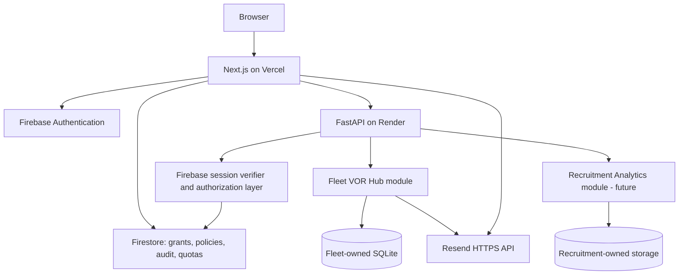

# Portfolio Lab — Authentication, Authorization, and Project Access

**Technical Requirements Specification (TRS) and Implementation Blueprint**

| Field | Value |
|---|---|
| Document ID | `PL-IDENTITY-ACCESS-TRS-001` |
| Version | `1.0` |
| Date | 2026-11-12 |
| Status | **Requirements agreed; architecture proposed for implementation; not yet implemented** |
| Product | Portfolio Lab, integrated into the existing portfolio website |
| Intended audience | Owner, maintainers, software engineers, QA, security reviewers, AI coding agents |
| Primary stack | Next.js (Vercel), FastAPI (Render), Firebase Authentication, Cloud Firestore, Resend |
| Existing demo storage | SQLite, retained unchanged for Fleet VOR Hub |
| Language | English |

> **Interpretation of this document**  
> **Agreed requirement** denotes an explicit product decision made during requirements discovery. **Proposed implementation** denotes the recommended technical solution, subject to repository-level validation. **Constraint** denotes an external or technical limitation that cannot safely be assumed away. No source code, Firebase project, or production configuration is claimed to have been changed by this document.

---

## 1. Executive Summary

Portfolio Lab shall give the Owner a private, administratively controlled way to demonstrate a growing collection of portfolio applications to selected visitors. A visitor may be granted different access levels for different projects, without receiving access to unrelated projects. The public portfolio, résumé, contact features, and public RAG/chat behavior shall continue to work without authentication unless individually designated otherwise.

The agreed authentication methods are **Google, Microsoft, GitHub, and email/password**, implemented using **Firebase Authentication**. The Owner shall be able to create accounts with an administrator-selected initial password, or send/copy a link allowing the user to set their own password. Initial passwords need not be one-time; their application-enforced validity shall be configurable up to 90 days. Email verification shall **not** be a separate mandatory step. Users may securely link external accounts even when the email addresses differ.

Authorization shall be **per project**, with `No Access`, `View`, `Test`, and `Admin`, and a separate global `Owner` privilege. Authorized `Test` and `Admin` users shall be able to invoke real project functionality, including sending real emails within configurable quantity limits. `View` shall remain read-only. Grant changes and external-action policies shall be administered via the website, and access-notification emails shall be explicitly optional.

The target is a **modular monolith with project-owned business logic and data**, shared identity/access services, and no unnecessary paid infrastructure. **Fleet VOR Hub keeps SQLite**. Its demonstration mutations may disappear after Render restarts; durability of those mutations is not a requirement. In contrast, users, grants, invitations, security policies, and reliable outbound-email quota accounting **must not** depend on ephemeral demo SQLite storage.

### 1.1 Non-negotiable outcomes

1. No guest or ungranted Firebase user can access a protected project's UI **or API**.
2. No user's Fleet actions can mutate Recruitment Analytics data, and vice versa.
3. An Owner can grant a project-specific role, change it, revoke it, and optionally notify the user.
4. A newly registered project is inaccessible to existing users until an explicit grant exists.
5. `View` never changes state or triggers real external actions; `Test` and `Admin` can do so within the project policy and quotas.
6. A user invited months earlier can still authenticate and access an unexpired grant even if Render was sleeping or demo SQLite was reset.
7. The Fleet application's established routes, internal business behavior, and public-site functionality survive migration.
8. No unauthenticated direct request to Render bypasses the access policy.

## 2. Background and Existing Repository Baseline

The current repository uses a single portfolio monorepo and deployment footprint:

- **Next.js frontend** on Vercel.
- **FastAPI backend** on Render.
- An embedded Fleet VOR Hub frontend/backend implementation under `portfolio/fleet_hub/`.
- Fleet VOR Hub's **own SQLite database**, schema, seed, bootstrap and migration lifecycle.
- An existing **password-only Fleet demo session** that must be migrated safely, not bypassed.
- An existing **Resend** integration for Fleet live-email delivery.
- A shared frontend rewrite from `/api/:path*` to the Render backend defined in `frontend/next.config.mjs`.

Repository source paths reviewed on the default branch:

| Path | Existing purpose / constraint |
|---|---|
| `docs/architecture/portfolio.md` | Portfolio boundaries and shared-deployment design |
| `portfolio/catalog/registry.json` | Registered project IDs; currently contains `fleet_hub` |
| `portfolio/fleet_hub/project.json` | Project metadata and established routes |
| `portfolio/fleet_hub/backend/src/fleet_hub/api/vor.py` | Existing Fleet API and password-based endpoints |
| `portfolio/fleet_hub/backend/src/fleet_hub/api/dependencies.py` | Legacy Fleet cookie/authentication and Origin protection |
| `portfolio/fleet_hub/backend/src/fleet_hub/services/message_delivery.py` | Fleet email recipient policy, provider calls, quotas, idempotency |
| `portfolio/fleet_hub/backend/src/fleet_hub/services/vor_store.py` | SQLite and seed-backed demo persistence |
| `backend/app/main.py` | Shared FastAPI app and mounted routers |
| `frontend/next.config.mjs` | `/api/*` rewrite into backend origin |
| `backend/scripts/check_import_boundaries.py` | Existing architecture checks; partly Fleet-specific |
| `scripts/check-website-portfolio-boundaries.mjs` | Existing frontend boundaries; partly Fleet-specific |

**Compatibility rule:** These findings describe the checked codebase; the implementation team shall inspect the latest `main` again before creating the first PR. Historical or planned changes in documentation do not prove that corresponding code is currently deployed.

## 3. Decisions Register

| ID | Area | Agreed decision |
|---|---|---|
| D-01 | Authentication provider | Firebase Authentication |
| D-02 | Login methods | Google, Microsoft, GitHub, email/password |
| D-03 | Access model | Pre-authorized users only; Owner controls admission |
| D-04 | Project permissions | Independent `No Access`, `View`, `Test`, `Admin` per project |
| D-05 | Global authority | `Owner` exclusively manages identities, grants and security policies |
| D-06 | Demo data | Testers of **one project** share that project's demo environment |
| D-07 | Project separation | Projects have separate logic, APIs and owned datasets; no cross-project effects |
| D-08 | Fleet storage | Remain on SQLite; no PostgreSQL migration in this initiative |
| D-09 | Demo persistence | Test changes may reset on sleep/restart/redeploy |
| D-10 | Control-plane persistence | Firestore recommended for durable users/grants/config/audit/quota ledger |
| D-11 | Initial password | Owner-selected initial password supported; not single-use; validity up to 90 days |
| D-12 | Password setup | Alternative invitation link for user-selected password supported |
| D-13 | Email verification | No separate mandatory email-verification step |
| D-14 | Multiple identities | One person may link accounts with different emails, after secure proof of account control |
| D-15 | Email notifications | Optional; never send automatically when Owner merely saves an invitation |
| D-16 | External actions | `Test`/`Admin` may execute real project actions, including emails, within quotas |
| D-17 | Read-only role | `View` cannot write data or perform external actions |
| D-18 | Email policy | Quantity is the intended user-facing restriction; no project-specific recipient-domain allowlist by default in target UX |
| D-19 | Hosting | Continue Vercel and Render; use free tiers where practical |
| D-20 | RAG | No separate per-user RAG knowledge-data authorization scope is required |
| D-21 | Future projects | New projects are registered separately and begin with zero non-Owner grants |
| D-22 | Cold start | Authentication and Lab catalogue should not require waking Render |

**Proposed technical refinements, not extra product commitments:** default five-day website sessions; Firestore as the only initial control-plane database; 15 recipients/day as the Fleet starting quota (subject to Owner configuration); one Firebase project per deployment environment where feasible; a dedicated Next.js session-issuance endpoint; a server-side Firebase validation dependency on every protected FastAPI route.

## 4. Scope and Explicit Non-Goals

### 4.1 In scope

- Firebase project and OAuth configuration for the four login methods.
- Provisioning, access grants, credential lifecycle, password setup and reset, account linking.
- Portfolio Lab login/logout, eligible-project catalogue and account/security screens.
- Owner-only administrative access management, invitation creation and optional notification.
- Per-project `View`/`Test`/`Admin` authorization and project-level External Actions controls.
- Firebase session verification on Next.js and FastAPI, including direct Render URL protections.
- Durable Firestore authorization state, audit trail, policies, and email quota reservations.
- Fleet VOR Hub authentication migration without business-data migration.
- Resend invitation notifications; existing Fleet live-email behavior adapted to target policies.
- Automated authorization, regression, integration and production smoke testing.
- Documentation, configuration, secret handling and runbooks.

### 4.2 Out of scope

- Moving Fleet data from SQLite to PostgreSQL, Neon or Firestore.
- Individual private test databases or per-user demo sandboxes.
- Separate Firebase projects, Render services or domains for each embedded portfolio application.
- Tenant-specific RAG knowledge partitions.
- General-purpose IAM, enterprise SSO/SCIM, organizations, group hierarchy or billing.
- Guaranteed always-on compute on free Render.
- Automatic merging of two existing Firebase UIDs based only on matching email.
- Automatic granting of access to newly created portfolio projects.

## 5. Terminology and Trust Boundaries

- **Owner:** global platform administrator; independent of project roles and identified using a pinned Firebase UID, not just an email string.
- **Project:** registered, independently owned demonstration application with stable `project_id`.
- **Grant:** per-user, per-project authorization record.
- **View:** read-only project access.
- **Test:** view plus intended demo mutations and real external actions within quotas.
- **Admin:** project-level management of demo data and domain-specific project settings, plus Test abilities. Does **not** manage users, grants, central security policies or global provider credentials.
- **Control Plane:** Firebase identity, durable grants, project access metadata, security policies, administrative audit and global quota state.
- **Data Plane:** each project's own API, data store, business rules, fixtures and demo reset.
- **Initial password:** provisioned password subject to a finite application policy; distinct from the password-reset-link lifetime.
- **Invitation:** Owner-created account/access configuration; not necessarily an email being sent.

The separation is **logical**, not a claim of full process/CPU/RAM isolation: the embedded projects currently share Next.js and FastAPI deployment resources.

## 6. Target Architecture



### 6.1 Ownership rules

**Shared platform owns:** login/logout/session exchange, project registry integration, authorization policy, Owner dashboard, invitations, notification templates and audit interfaces. It does **not** own Fleet's vehicle logic or Recruitment Analytics' KPI calculations.

**Each project owns:** UI implementation, route adapters, backend endpoint implementation, service/domain logic, migrations/seed, persistence, data resets, quota-consumption intents and tests.

**Boundary constraints:**

- No imports of one portfolio project's internal modules into another project's implementation.
- Website/host imports only the explicitly public project entry points.
- No direct project reads or writes to another project's data store.
- Each project's cache keys, state files, job identifiers and configuration are independently namespaced.
- Shared authorization exposes minimal stable interfaces; no speculative generic plugin framework.
- Failures in optional Fleet startup must not crash the public website or unrelated API routers.
- Real process isolation is a future enhancement if workload or uptime requirements justify it.

### 6.2 Recommended control-plane persistence

Use **one Firestore database** in the Firebase project for modest volumes of access metadata. Avoid a second PostgreSQL service for RBAC at this stage. Firestore's control-plane records persist independently of Render's ephemeral file system. On a free-tier project, only one Firestore database qualifies for the free quota; backups, PITR and TTL deletion are not included in the free allowance. Review pricing during setup.

Direct browser write access to security collections should be **denied by Firestore Security Rules**. All grants, Owner operations, quota reservations and audit writes are performed by privileged server code. Server Admin SDK access bypasses Firestore Rules; enforce Owner authorization in the application and scope Firebase service-account credentials carefully.

### 6.3 Existing `/api/*` rewrite and direct backend access

The current Next.js config rewrites requests to Render. A frontend-only auth guard would therefore be insufficient. The target must guarantee that **each protected FastAPI request independently validates an authenticated identity and its effective project permission**, regardless of whether it arrives through Vercel or directly at the Render hostname.

**Proposed implementation:**

1. Vercel handles Firebase login-token exchange and sets a first-party `HttpOnly` session cookie.
2. Protected application requests use the same-origin website route; the proxy/rewrite or a narrowly scoped BFF forwards the cookie/token to FastAPI securely.
3. FastAPI verifies the Firebase session cookie or a deliberately defined, short-lived backend credential using the correct issuer/audience/signature and revocation policy.
4. FastAPI queries the grant policy for the target project and requested operation.
5. Public `/api/chat`, `/api/contact` and other public APIs remain public unless already independently protected; a generic `/api/*` rewrite must not inadvertently block streaming/SSE.

The team must choose and integration-test the precise forwarding mechanism rather than assuming browser cookies or SDK session state automatically propagate across hostnames. Never trust `X-User-Email`, client-sent role names or another unsigned identity header. Prefer preserving current host routing where possible.

## 7. Authorization Model

### 7.1 Roles and capabilities

| Capability | No Access | View | Test | Admin | Owner |
|---|:---:|:---:|:---:|:---:|:---:|
| Open protected project | No | Yes | Yes | Yes | Yes |
| Read demo data | No | Yes | Yes | Yes | Yes |
| Modify demo data | No | No | Yes | Yes | Yes |
| Execute live email action | No | No | Yes, by policy | Yes, by policy | Yes, by policy |
| Execute other project-declared external actions | No | No | Yes, by policy | Yes, by policy | Yes, by policy |
| Reset project demo state | No | No | No | Yes | Yes |
| Change project domain/demo settings | No | No | No | Yes | Yes |
| Set project external-action/security quotas | No | No | No | No | Yes |
| Assign/revoke user grants | No | No | No | No | Yes |
| Provision/disable users and link recovery | No | No | No | No | Yes |
| Configure Firebase provider secrets | No | No | No | No | Server/operator only |

Roles are **project-scoped**, except `Owner`, which is global. `Test` includes `View`; `Admin` includes `Test`; `Owner` has platform-wide access. `No Access` means no grant or a revoked/expired grant; it is not a positive role.

### 7.2 Policy evaluation

A protected operation is allowed only when **all** of the following hold:

1. The Firebase identity/session is valid and not disabled or revoked under the selected revocation-check policy.
2. The identity maps to a provisioned, active platform user record by stable Firebase UID.
3. The user's global account state is active and any applicable credential-entry policy permits the current login method.
4. The project ID exists in the registered project catalogue and the project is enabled.
5. An active, not-expired, not-revoked project grant exists, or the user is the designated Owner.
6. The effective role includes the operation's required capability.
7. For external actions, the per-project capability switch and quantity budget permit the request.
8. All additional project-domain invariants and validation rules are satisfied.

**Default deny:** absence, ambiguity, stale grants, backend Firestore outage or missing security configuration must never be interpreted as permission. Return a controlled error rather than enabling bypass access.

### 7.3 Permission revocation

A change or revocation must affect server-side protected operations promptly, including in already-issued sessions. Suggested target: **no more than 60 seconds after commit**, preferably next request. Do not store authoritative project grants solely in long-lived Firebase JWT custom claims. Firestore is authoritative; if caching is introduced, it requires bounded TTL/invalidation and explicit security tests. User disabling and token revocation must be separately supported.

### 7.4 Project isolation

- Fleet grants cannot authorize Recruitment Analytics endpoints.
- Project-specific `Admin` cannot change the global allowlist or other projects' policies.
- Any reset is scoped to one project and requires explicit confirmation.
- Seed files, database connections and routes remain project-owned.
- An accidental CPU/memory/process failure in the shared backend is not fully isolated; avoid claiming guaranteed uptime independence.

## 8. Authentication Requirements

### 8.1 Supported providers

- Google OAuth via Firebase.
- Microsoft OAuth via Firebase. Personal Microsoft accounts and organization accounts require correctly configured Microsoft OAuth applications/tenant policy; an external organization may block authorization.
- GitHub OAuth via Firebase.
- Firebase email/password.

Configure Firebase to create separate accounts for different identity providers when the email matches. Firebase's one-account-per-email mode can attach or replace a provider by email under its trusted-provider policy. Portfolio Lab requires explicit provider linking and checks the confirmed provider subject under the same UID. Handle account-collision errors explicitly and safely. Provider configuration requires exact callback URLs and authorized development domains. Store OAuth provider secrets in Firebase Authentication.

### 8.2 Admission versus Firebase account creation

Only Owner-provisioned users may enter protected Portfolio Lab content. **This is application admission control, not a promise that Firebase will never create an unauthorized Auth user record.** Standard social login can create an Firebase Authentication record before the application rejects an uninvited user. On the free-tier architecture, do not assume identity blocking functions are available or enabled.

The admission check must happen at session issuance and on protected resource access; unauthorized Firebase users receive no active application session and no grants. The Owner can periodically inspect/clean orphaned Auth records through an auditable administrative procedure.

### 8.3 One person, multiple emails and providers

The authorization subject is always the **Firebase UID**, not an email string. A person may associate multiple social identities with that UID, including accounts whose addresses differ from the original invitation email.

Account linking must be **user-initiated from an already authenticated session** or use an equivalent strong account-recovery proof. The user must authenticate with the additional provider. Do not automatically merge two UIDs or assign existing grants merely because a provider reports the same email or a visually similar name.

Required cases:

- Existing email/password user links Google/Microsoft/GitHub and keeps the same UID and grants.
- An OAuth identity with a different email can be linked after reauthentication.
- Record a Firebase-verified provider subject only from a recently authenticated session that still passes admission. Enforce that binding on both application servers.
- `auth/account-exists-with-different-credential` is explained; guide the user to the established sign-in method and subsequent linking.
- If the target credential belongs to a different Firebase UID, **fail safely** and provide an Owner-assisted recovery path; never silently merge, delete or transfer grants.
- Unlinking the last functioning sign-in method must be prohibited.
- Unlinking/relinking must not permit entitlement resurrection after revocation.

**Important UX constraint:** a newly provisioned account cannot be guaranteed to log in *seamlessly on its first visit* with every OAuth provider before those credentials are linked. The interface shall guide a first-time user through password/setup-link login and provider linking where Firebase requires it. This exception is documented rather than hidden.

### 8.4 Email verification policy

**Agreed:** no extra mandatory email-verification step for an invited user. Do not silently add one.

**Security consequence:** this must **not** be implemented by setting Firebase `emailVerified=true` without evidence. For initial email/password access, Owner issuance and secure delivery of the credential are the basis of trust. A self-service password-setup link establishes control over the destination mailbox as part of that flow. For social accounts with untrusted or unverified provider email assertions (notably GitHub and external corporate domains), do not grant access based on email alone; require authenticated linking to the provisioned UID or a controlled Owner-assisted recovery process.

This design respects the requested no-extra-verification UX without treating arbitrary email metadata as proof of identity.

### 8.5 Logout and session policy

**Proposed:** a five-day Firebase server session cookie, configurable within Firebase's documented range, using `HttpOnly`, `Secure`, appropriate `SameSite`, restrictive `Path`, and host-only cookie scope. Session exchange must require recent login and CSRF protection. Clear browser-side transient credentials after exchange when using the server-cookie model. Logout clears the cookie and can revoke server sessions where warranted. Administrative disable/revoke operations must not rely on the browser voluntarily logging out.

Auth failures should show clear, non-enumerating responses; never leak whether an email was invited on public endpoints.

## 9. Invitations and Password Lifecycle

### 9.1 Owner-assisted onboarding modes

**Mode A — Owner sets initial password**

1. Owner enters an email and assigns project grants.
2. Owner chooses an initial password or uses a securely generated one.
3. Owner specifies an initial-password validity period **from 1 to 90 days** (default proposal: 90 days).
4. Server provisions/updates the Firebase account and persists account metadata and grants.
5. Owner optionally sends a notification or copies a one-time display of onboarding details for manual delivery.
6. The password may be used repeatedly during its permitted period; no single-use requirement.

**Mode B — recipient chooses password**

1. Owner enters email/grants and selects *Send setup link* or *Copy setup link*.
2. Server provisions the Firebase user if needed and requests a Firebase password-reset/action link for that account.
3. Owner explicitly chooses whether to send the link through Resend; otherwise no email is sent.
4. Recipient follows Firebase's action-code flow and selects a password.
5. No further email-verification gate is added by Portfolio Lab.

**Constraint:** Firebase's password-reset action-code lifetime is a separate provider-managed limit. The application must not claim that a setup link remains usable for 90 days. Generate it close to the intended delivery time, handle expiration gracefully, and allow Owner-controlled regeneration.

### 9.2 Enforcing expiration of an initial password

Firebase does not natively offer the desired per-user 1–90-day *initial-password only* validity rule. **Implement an application-level credential policy** associated with the UID, including issuance time, configured expiry and whether the initial credential was replaced.

- When the user authenticates using `password` and is still relying on an expired initial credential, reject issuance/use of protected application sessions and guide the user through reset/change.
- Authentication through an independently linked Google/Microsoft/GitHub credential remains allowed if the grant is active.
- Existing sessions must not bypass credential-expiry policy indefinitely; evaluate required metadata during authorization or on a bounded refresh.
- A successfully completed supported password-change/reset flow transitions from `initial` to `user_set` as an auditable server-side operation.
- Password updates performed outside controlled application flows must be reconciled safely; Firebase and Firestore updates are **not one atomic transaction**. Implement idempotent transitions and a repair path.
- Do not block password reauthentication merely because 90 calendar days have passed if the user has already replaced the initial credential.
- Never store plaintext passwords, reversible passwords, or password hashes in Firestore or application logs.

**Security caveat:** an expired initial password may still be accepted by Firebase Authentication itself. The documented guarantee is that the **Portfolio Lab app refuses protected access by that credential**, not that Firebase stops authenticating it at its identity-provider endpoint. If identity-provider-level password expiry is mandatory in the future, evaluate an alternate authentication policy/product.

### 9.3 Recovery and re-provisioning

Support password reset, revoked invitation, expired setup link regeneration, disabled user, changed email, account linking failure and reactivation. Never allow a public password-reset endpoint to directly modify grants or Owner privileges. Owner actions must be idempotent and audit-recorded; deleting a Firebase UID must not orphan an active grant that is automatically assigned to a future user.

## 10. Owner Administrative Experience

### 10.1 Routes (proposed)

| Route | Audience | Purpose |
|---|---|---|
| `/login` | Public entry | Provider selection and email/password login |
| `/lab` | Authenticated authorized users | Accessible project catalogue |
| `/account/security` | Signed-in user | Linked providers, password management, session actions |
| `/admin/access` | Owner only | User search, invitations, grants, expiry, status |
| `/admin/projects` | Owner only | Project visibility/access settings and external-action policies |

Established project URLs, including `/fleet-vor-hub`, should remain stable. Direct navigation to a protected project redirects to login with a validated same-origin return path; after login, continue only if authorized.

### 10.2 Required user-management controls

- Add user by email, create initial password or setup link, and select projects/roles.
- Optional access expiration per user/project; **no expiration by default**.
- Optional notification switch **off by default**; separate *Send/Resend notification* action.
- Copy invitation link/details when Owner prefers manual delivery.
- View account states: `Invited`, `Active`, `Disabled`, `Revoked`, `Invitation expired`, `Notification not sent/sent/failed` (display only states supported by actual records).
- Modify a grant, revoke one project's access, or disable the entire user.
- View linked-provider status, but never display a password after initial creation.
- See minimal security and administrative audit history.
- Validate and normalize email; avoid duplicate invitations and races.
- Support Owner-only re-sending of setup links (regenerate when required).

**Notification behavior:** saving an invitation shall never silently send email. Any invitation or credential email must be sent only after Owner chooses the send option. Rendering a preview or copying details has no delivery side effect.

### 10.3 Required project policy controls

- Project enabled/disabled for private access.
- Project-specific email/live-action capability switches, independently configurable.
- Quantity ceilings per user/project and/or project-wide, with Owner-visible usage.
- Other project-declared External Actions, surfaced by a typed capability registry rather than an unrestricted arbitrary-command toggle.
- `Test` and `Admin` have the right to invoke the capabilities by default **when the project declares them and the Owner has enabled them**; `View` never does.
- Changes take effect server-side; UI visibility alone is not authorization.
- Project Admin may adjust domain-specific demo settings but not platform security controls or quota ceilings.

## 11. Project Registry and Future Project Integration

The existing `portfolio/catalog/registry.json` and each module's `project.json` are the **source of truth for available project identifiers and public metadata**. Firestore stores **grants and runtime access policies**, not duplicate authoritative copies of project definitions.

A project's minimum registry contract should include:

```json
{
  "schemaVersion": 1,
  "id": "recruitment_analytics",
  "title": "Recruitment Analytics Portal",
  "mode": "embedded",
  "demo": {
    "path": "/recruitment-analytics",
    "apiPrefix": "/api/recruitment"
  },
  "capabilities": ["read", "demo.write", "email.send", "demo.reset"],
  "catalog": { "visible": false, "featured": false }
}
```

This is an **illustrative future schema extension**, not an assertion about existing code. Evolve and validate the schema explicitly rather than inserting undocumented fields into production without coordinated tooling updates.

Requirements:

- A new project is recognized by the Owner management interface after registry deployment.
- A new project does not grant access to current users.
- Access to private demo pages must not depend on public portfolio visibility; `catalog.visible=false` is **not** a security boundary.
- A deleted/renamed project ID must not accidentally reassign existing grants to an unrelated new project.
- Global import-boundary and project-contract checks must be generalized beyond Fleet (existing scripts are partly hard-coded).
- Project registration should not require new hosting services or a new Firebase project by default.

## 12. Firestore Data Model (Proposed)

Use server-owned collections with explicit document schemas and UTC timestamps. Examples below are illustrative; schema versioning and migration checks are mandatory.

### 12.1 Collections

| Collection / document | Key | Recommended fields |
|---|---|---|
| `platform_users/{uid}` | Firebase UID | `primary_email_normalized`, `status`, `created_at`, `updated_at`, `initial_password_issued_at`, `initial_password_expires_at`, `credential_state`, `last_app_sign_in_at` |
| `project_grants/{uid_project}` or `users/{uid}/grants/{projectId}` | UID + project ID | `uid`, `project_id`, `role`, `expires_at`, `revoked_at`, `updated_at`, `updated_by` |
| `project_policies/{projectId}` | stable project ID | `enabled`, `external_actions`, `quotas`, `policy_version`, `updated_by`, `updated_at` |
| `invitation_events/{eventId}` | generated event ID | `uid`, `recipient_email`, `type`, `delivery_intent`, `status`, `provider_message_id`, `created_at` |
| `audit_events/{eventId}` | generated event ID | `actor_uid`, `action`, `target_uid`, `project_id`, `result`, `request_id`, `timestamp` |
| `email_budget/{projectId_YYYYMMDD}` | project + UTC date | counter/reservation state and stable idempotency identifiers |
| `email_attempts/{requestId}` | unique key | project/user scope, recipient count, fingerprint, status, provider ID, timestamps |

The physical Firestore structure can be optimized for transactional updates and index costs, but data ownership and semantics must remain unchanged. Avoid storing access tokens, plaintext passwords, secret keys, email contents, or full personal-data payloads in control-plane logs.

### 12.2 Access-control invariants

- `uid` is immutable once bound to an invitation/grant; no automatic transfer by email string.
- Email normalization is consistent but does not merge potentially distinct accounts by heuristic (such as stripping dots or `+tag`).
- Project IDs must match the actual registry.
- Grant writes are Owner-only; the browser cannot write grants or policy documents.
- Every policy mutation writes `updated_at`, actor identity and audit record.
- Firestore unavailability fails protected operations closed; it must not accidentally expose projects.
- Store expiry explicitly; do not rely on Firestore TTL deletes, which may be outside the free plan.
- Use Firebase Emulator Suite in tests and separate development credentials; never test dangerous live actions in production.

## 13. Real External Actions and Email Sending

### 13.1 Agreed behavior

- `View`: no real email sending and no external side effects.
- `Test` and `Admin`: can perform intended external actions in their **authorized project**, including sending real emails.
- `Owner`: same, plus authority to configure policies and budgets.
- Quantity limits apply. The target product policy does **not** impose a blanket permitted-recipient domain list by default.
- Owner can enable/disable individual external capabilities and change quota settings per project.

**Safety requirement, not an optional role restriction:** authenticated access does not remove protections against automated abuse, provider suspension, invalid addresses, duplicated requests, accidental mass sending, or illegal content. Enforce bounded recipient counts, server-derived workflow targets where relevant, output escaping, anti-automation throttling and provider compliance. The system should not quietly disable all legitimate sending for `Test` merely because a live email is involved.

### 13.2 Current Fleet constraints and migration

Current Fleet delivery derives recipients from the subscriber directory and supports an environment-based allowlist/domain policy, an `VOR_DEMO_SEND_REAL_EMAIL` switch, daily recipient quota (default `15`, source-clamped maximum `30`) and keyed idempotency. The new Owner dashboard policy must be introduced **deliberately**, with characterization tests, rather than simply bypassing the existing controls.

Target integration:

1. Authorize `email.send` for the current project and effective role.
2. Verify project-level action switch and daily budget.
3. Validate request and workflow-recipient semantics; allow ordinary legitimate recipients without a blanket domain allowlist unless Owner explicitly configures an additional policy.
4. Reserve quota and idempotency state in **durable Firestore control-plane storage** before calling Resend.
5. Call Resend through the current backend's approved delivery service.
6. Record accepted, rejected or indeterminate outcome; never blindly retry an ambiguous result.
7. Write the Fleet demo-local message/event record where feasible; acknowledge the provider send and SQLite write are not atomic.

**Critical separation:** Fleet SQLite may disappear after an idle spin-down. Therefore **SQLite-only counts cannot be an authoritative persistent anti-abuse limit** if quantity is the sole agreed product restriction. Email quota/idempotency accounting must survive Render restarts, e.g. in Firestore. Preserve the current local journal as a domain history if useful, but do not rely on it alone for cross-restart enforcement.

### 13.3 Proposed quota semantics

- Daily quota window: UTC calendar day, explicitly displayed to Owner.
- Starting Fleet budget: **15 recipient deliveries per project per day** (proposal reflecting existing default; configurable within a bounded safety ceiling).
- Additional per-user throttling to prevent one user monopolizing project capacity; exact values configured by Owner and guarded by a non-disableable system safety ceiling.
- Count *recipient deliveries*, not merely API requests (one email to 10 addresses consumes 10 recipients).
- Attempt concurrency protection by transaction / conditional reservation, plus a provider idempotency key.
- An unknown provider outcome retains the reservation in a reconciliation state; no automatic resend until outcome is determined or safely timed out according to a documented recovery procedure.
- Limits must apply to direct-Render requests, retries, multiple browser tabs and all login methods.
- Errors use a predictable `429` or domain equivalent; display remaining budget where safe.

### 13.4 Invitation notifications versus project emails

Distinguish two workflows:

- **Invitation notification** — Owner-triggered account communication; no automatic send on grant creation.
- **Demo external email** — Test/Admin-triggered business capability within a specific project.

Apply independent templates, audit events, content requirements and rate limits. The same Resend account may be reused, but one workflow must not use the other's authorization check as a shortcut.

## 14. Proposed API and Service Contracts

These are **illustrative interface contracts**; final URL spelling must be reconciled with the repository's route layout before implementation. Auth endpoints intended for Vercel may be implemented as Next.js Route Handlers rather than mounted in FastAPI.

| Endpoint / operation | Auth requirement | Behavior |
|---|---|---|
| `POST /auth/session` | Fresh Firebase ID token + CSRF | Validate admission, create secure session cookie |
| `POST /auth/logout` | Session/CSRF | Clear cookie, optionally revoke tokens as policy requires |
| `GET /auth/me` | Session | Current UID and minimal account state, no secrets |
| `GET /lab/projects` | Session | Only explicitly granted, enabled projects |
| `GET /admin/users` | Owner | List/search users and statuses |
| `POST /admin/users` | Owner + CSRF | Provision account and initial grants |
| `POST /admin/users/{uid}/setup-link` | Owner + CSRF | Generate fresh password setup link |
| `PUT /admin/users/{uid}/grants/{projectId}` | Owner + CSRF | Create/change an explicit grant |
| `DELETE /admin/users/{uid}/grants/{projectId}` | Owner + CSRF | Revoke a grant |
| `PUT /admin/projects/{projectId}/policy` | Owner + CSRF | Modify external actions and limits |
| `POST /admin/invitations/{id}/notify` | Owner + CSRF | Explicit email send |
| `POST /account/link-provider` | Authenticated current user + recent reauth | Initiate/finish safe provider linking |
| Existing `GET /api/vor/*` | Appropriate Fleet grant | Read-only Fleet APIs |
| Existing `POST /api/vor/*` | Test/Admin capability + CSRF | Fleet demo mutation or external action |

**Do not assume that every GET under Fleet is automatically read-only**: classify actual endpoints by their side effects and perform endpoint-by-endpoint audit. Likewise, classify every existing POST route, including subscription management, workflow changes, exports and live email.

### 14.1 Standard failure behavior

| Condition | Recommended outcome |
|---|---|
| Missing/invalid/expired session | `401` + login path |
| Signed in but no grant | `403` (or `404` for intentionally concealed resources, consistently) |
| Insufficient project role | `403` |
| Revoked/expired grant | `403` immediately or within documented policy propagation bound |
| Disabled user | `403` + informative account status |
| Duplicate invitation/account-link conflict | `409` with non-sensitive recovery action |
| Rate limit or daily email quota exhausted | `429` |
| Auth provider or Firestore outage | Fail closed; controlled `503` when applicable |
| Render cold start | Non-destructive loading/retry UI; never an auth bypass |
| CSRF or invalid Origin | `403` |

## 15. Security Requirements and Threat Model

### 15.1 Required defenses

- Firebase Admin SDK configured using server-only credentials; **never** ship service-account JSON to the browser or commit it to Git.
- Verify session cookie/JWT signature, issuer, audience, expiration, UID and applicable revocation state using supported server APIs.
- Check actual permissions on FastAPI, including the Render origin accessible without Vercel.
- Server-side authorization on `GET` as well as state-changing verbs.
- `HttpOnly`, `Secure`, `SameSite` and host-only session cookies; CSRF token and Origin validation for unsafe actions.
- Allowlist-based control of CORS and OAuth redirect URLs; do not confuse CORS with authentication.
- Prevent open redirects via a canonical, same-origin `returnTo` allowlist.
- Strong password-generation policy and secure one-time Owner display; no plaintext persistence.
- Account recovery/linking must prove control of current authenticated identity and the target provider.
- Prefer short-lived, revocable sessions; no permanent app authorization derived solely from token claims.
- No RBAC authorization based on email alone.
- Firestore rules deny direct sensitive collection access; server IAM minimized.
- Protect admin APIs against IDOR: an Owner-only endpoint must not trust its path `uid`/`project_id` without validating actor and target.
- Secrets, provider API keys and Firebase service credentials in Vercel/Render protected environment settings; rotate on suspicion of exposure.
- Non-verbose, privacy-aware structured security logs with correlation/request IDs; do not log credentials, reset links, ID tokens or full email bodies.
- Limit login and email abuse; use provider mechanisms and app-level throttles appropriate to the flows.

### 15.2 Risks and treatment

| Risk | Severity | Treatment |
|---|---|---|
| Unverified OAuth email used as invite proof | High | UID binding; explicit authenticated linking; no email-only auto merge |
| Direct Render API bypass | Critical | Every protected FastAPI route verifies identity + grant |
| `View` invokes mutation hidden behind UI | High | Server operation-level permission checks and negative tests |
| Owner-defined initial password leaks in email/log | High | Prefer setup link; never persist/display again; secure delivery guidance |
| Expired initial password remains usable at Firebase IdP | Medium | Application-side enforced denial, documented limitation |
| Account UID collision/merge transfers privileges | High | No automatic merge; fail closed; Owner-assisted audit process |
| Firestore unavailability causes fallback allow | Critical | Fail closed |
| Email flooding after Render restart | High | Durable Firestore quota and idempotency journal |
| Fleet reset affects Recruitment | High | Project-owned storage and scoped reset checks |
| Shared FastAPI worker overload | Medium | Resource-aware implementation; future service extraction if needed |
| Corporate Microsoft tenant denies OAuth | Medium | Email/password remains a usable fallback |
| Firebase Auth user created by uninvited OAuth login | Low | No application session or grant; optional audited cleanup |

### 15.3 Privacy and consent

The Owner shall display a concise privacy notice describing stored email, account identifiers, provider linkage, access audit, optional invitation notification and retention. Collect only necessary personal data. Define account deletion and grant-revocation procedures and consider UK GDPR obligations. Demo business datasets should be synthetic/anonymized; sending real emails requires an appropriate lawful/business purpose and provider-compliant content. Privacy compliance must not be asserted merely because Firebase is used.

## 16. UI / UX Requirements

### 16.1 Login

- Clearly present Google, Microsoft, GitHub and email/password.
- Support passwords supplied by Owner and self-set passwords.
- Preserve a safe return path from protected project deep links.
- Handle OAuth popup blocked, provider disabled, enterprise tenant restriction, wrong password, account collision, already linked provider, expired setup link and unavailable Firebase.
- Provide a way to link providers once authenticated; show Linked / Not linked without exposing private provider tokens.
- Avoid showing project existence or users' assigned grants to anonymous users.

### 16.2 Lab and project screens

- Show only accessible projects and the user's effective role.
- Project route and all APIs enforce the same permissions.
- View-only controls are disabled or hidden but the backend remains authoritative.
- Demonstration data may reset; show a concise user-facing notice, e.g., "This is a demonstration environment; changes may be reset."
- For Render cold start, show progress and retry with capped exponential backoff; do not duplicate state-changing POSTs without idempotency keys.
- The public website continues without prompting login for normal public features.

### 16.3 Owner console

- Search/filter users and project grants.
- Bulk visual permission matrix (user × registered project) with one role per intersection.
- Clear state for notification on/off; no silent sends.
- Show project action switches and quota usage.
- Confirm destructive operations (disable user, revoke all grants, reset demo).
- Accessible keyboard behavior, form validation, responsive layout and meaningful error messages.

## 17. Availability, Cold Starts, and Free-Tier Constraints

### 17.1 Login independence

The **authentication entry page, session establishment and authorized project catalogue should be served using Vercel + Firebase**, not require FastAPI warm-up. This prevents a sleeping Render instance from blocking the start of a visit.

If Firestore is unavailable, the protected catalogue and access operations fail safely; the public website remains usable. Do not keep a privileged long-lived browser cache of grants as a fallback.

### 17.2 Render free service

Render Free web services may spin down after approximately 15 minutes without inbound traffic, take time to start, and lose all ephemeral filesystem changes on spin-down, restart or redeploy. A ping can reduce daytime cold starts but is not an uptime guarantee, and free instance-hour limits still apply.

**Agreed:** Fleet demo SQLite may return to its seed state; a previously invited user's account and permissions must **not** be lost. Application security metadata and real-email quota ledger therefore remain outside Render local SQLite.

**Proposed daytime warm-up:** preserve an existing ping workflow, optionally at approximately 10-minute intervals during agreed weekday working hours in Europe/London, with a reliable health endpoint, observable failures and reasonable usage monitoring. The schedule is an operational proposal, not a required security mechanism.

### 17.3 Credentials and invitation longevity

A recipient invited today may visit months later. Grants default to no expiration, unless Owner chooses one. An **initial** password may expire at 90 days; this is independent of the account/grant's lifetime. After that, the user can reset/set a password or use a previously linked provider. Short-lived password-setup links can be regenerated. Sessions may expire after several days; routine re-login remains possible.

## 18. Testing and Acceptance Criteria

All functional changes should have automated tests before release, with Firebase Auth/Firestore emulators or isolated test environments for predictable behavior. Never send live invitation/project emails during routine CI.

### 18.1 Identity and onboarding

- [ ] Owner can provision an email/password account and configure a 1–90-day initial-credential policy.
- [ ] Initial password works more than once before its expiry.
- [ ] An expired initial password cannot establish/use a protected Portfolio Lab session.
- [ ] A replaced initial password is not incorrectly expired after 90 days.
- [ ] OAuth access via Google works; linked accounts preserve UID and grants.
- [ ] OAuth access via Microsoft works with supported test account; enterprise restrictions are handled.
- [ ] OAuth access via GitHub works; untrusted provider emails cannot auto-claim invitations.
- [ ] An additional OAuth account with a different email is safely linked to the existing UID.
- [ ] Account collision or linking to another UID does not transfer rights.
- [ ] Owner can generate setup link, copy it, or explicitly send it.
- [ ] Expired/used setup links yield recovery instructions, not accidental grants.
- [ ] Owner can create an invitation without any email being sent.
- [ ] Email verification is not an extra mandatory gate; untrusted email assertions do not bypass admission.
- [ ] Public unauthorised OAuth sign-in, even if it created a Firebase record, cannot access Lab.

### 18.2 Sessions and authorization

- [ ] No cookie/token → protected page and API denied.
- [ ] Invalid issuer/audience/signature/expired token → denied.
- [ ] Disabled/revoked Firebase account → denied under documented revocation checks.
- [ ] User with Fleet `Test` and Recruitment `View` can mutate Fleet but not Recruitment.
- [ ] User without Fleet grant cannot access Fleet bootstrap, exports, mutations or email endpoints.
- [ ] `View` cannot invoke mutating routes even via direct HTTP request.
- [ ] `Admin` on project A cannot modify project B or global grants.
- [ ] Grant expiration/revocation takes effect within specified propagation bound.
- [ ] Direct Render hostname requests without correct identity+grant cannot bypass authorization.
- [ ] CSRF and invalid-Origin POSTs are rejected.
- [ ] Open redirect attempts through `returnTo` are rejected.
- [ ] Firebase/firestore lookup failure fails closed, without exposing private data.

### 18.3 Project registry and isolation

- [ ] Adding a registered project makes it available for Owner configuration without granting it to users.
- [ ] Projects with `catalog.visible=false` remain secured by RBAC, not by obscurity.
- [ ] Project routes, persistence and code imports stay isolated.
- [ ] Project A reset/mutation does not alter project B data or policy.
- [ ] Static import checks detect cross-project internal imports for **all registered modules**.
- [ ] Existing Fleet URLs, redirects, public-site RAG/chat/SSE/contact and unrelated functionality remain compatible.
- [ ] Fleet seed integrity/migrations remain valid; SQLite file/data do not undergo unapproved migration.

### 18.4 External actions and quotas

- [ ] `View` cannot send live email through UI or direct API.
- [ ] `Test` and `Admin` can send to legitimate addresses within their project policy and quota.
- [ ] Owner action switch disables external actions for that project even for a Test user.
- [ ] Quantity accounting counts recipients, not just requests.
- [ ] Concurrent sends cannot overspend quota.
- [ ] Quota survives Render idle sleep/redeploy and Fleet SQLite recreation.
- [ ] Replayed requests with identical idempotency key do not create duplicate sends.
- [ ] Same key with different content is rejected.
- [ ] Ambiguous Resend outcomes are never blindly retried.
- [ ] Live email tests use provider sandbox/test mode or explicit controlled addresses; CI sends no real messages.
- [ ] Invitation notification quota/audit is independent of demo-message quota/audit.

### 18.5 Availability and UX

- [ ] `/login` and `/lab` access control work while Render is asleep.
- [ ] Cold-start UI retries idempotent reads and does not replay unsafe actions.
- [ ] Returning invited user can reauthenticate months later if grant remains valid.
- [ ] Password setup link expiry is distinct from 90-day initial-password expiry.
- [ ] `task ci` and all relevant GitHub CI jobs succeed.
- [ ] Production smoke tests use disposable test accounts and controlled email recipients.
- [ ] Logs contain no plaintext passwords, reset URLs, access tokens or provider secrets.

## 19. Implementation Phases and PR Strategy

Each phase should be reviewable and mergeable independently, without adding a parallel new authentication bypass. No code has been modified as part of authoring this specification.

| Phase | Deliverable | Required gate |
|---|---|---|
| P0 — Architecture/contracts | ADR, control-plane schema, endpoint classification, threat model, deterministic test plan | Design and security review |
| P1 — Firebase identity | Provider configuration, session exchange, login/logout, setup/password lifecycle, account linking | Firebase emulator and real provider smoke |
| P2 — Authorization | Firestore users/grants, effective-role policy, FastAPI checks, direct-origin tests | Negative authorization integration tests |
| P3 — Owner console | User provisioning, grants, optional invitations, external-action policy controls | UI/admin security tests |
| P4 — Fleet migration | Replace common Fleet password route with new identity and per-route capabilities; retain SQLite | Fleet API golden-path and persistence tests |
| P5 — Durable external actions | Resend policy migration, Firestore daily budget, idempotency/reconciliation, project-scoped switches | Quota concurrency and restart tests |
| P6 — Registry generalization | Generic multi-project guardrails and dynamic per-project access presentation | CI import/contract tests |
| P7 — Production verification | Deploy, smoke tests, access revocation, cold start, documentation and runbooks | `task ci` + production acceptance checklist |

### 19.1 Branch, commit and PR conventions (for implementation)

Example:

- Branch: `feat/portfolio-lab-firebase-identity`
- Commit subject: `🔐 feat(auth): add Firebase-backed portfolio sessions`
- Commit body: `- Enforce invite-only admission and server-side session validation` (actual content must match delivered code).
- PR sections: `## Summary`, `## Changes`, `## Testing` and a checked `- [x] task ci` **only after that command truly passes**.

Subsequent PRs should use narrow scopes such as `authz`, `admin`, `fleet`, `email` and `architecture`. Do not claim tests passed without evidence.

### 19.2 Rollout order and safe migration

1. Implement new auth+RBAC behind a feature flag while current Fleet demo remains functional.
2. Add backend enforcement before publicly exposing the new Login/Lab navigation.
3. Characterize existing Fleet routes/methods/cookies/status codes and run golden tests.
4. Replace legacy Fleet password dependencies with capability-specific checks across **every** protected route.
5. Remove/disable old login/session paths and secret-based bypass after validation; do not leave a parallel valid legacy cookie.
6. Exercise direct Render calls and cross-project negative tests.
7. Enable live external actions with durable quotas only after the email policy tests pass.
8. Roll out production with a tested rollback/feature-disable procedure; keep public RAG/chat intact.

## 20. Operational Configuration and Secrets

**Server-only values (illustrative names):**

```text
FIREBASE_PROJECT_ID
FIREBASE_ADMIN_CREDENTIALS          # private, secured Vercel/Render environment variable
PORTFOLIO_OWNER_UID                 # pinned UID; bootstrap by explicit operator action
PORTFOLIO_ACCESS_ENABLED
PORTFOLIO_SESSION_COOKIE_NAME
PORTFOLIO_SESSION_TTL_SECONDS
PORTFOLIO_AUTH_ALLOWED_ORIGINS
RESEND_API_KEY                       # existing integration
PORTFOLIO_EMAIL_FROM                 # verified sender domain/address
```

**Browser-safe Firebase config** can include API key, auth domain, project ID and OAuth public client metadata as documented by Firebase; this config is **not** an authorization secret. Never expose Firebase service-account credentials, Microsoft/GitHub OAuth client secrets, Resend keys or private signing keys.

Required operator tasks:

1. Install/connect the Firebase plugin if available and inspect its actual capabilities; connector availability is not evidence that it is already installed or authorized.
2. Create Firebase project(s), enable supported providers and configure Google/Microsoft/GitHub OAuth apps and callbacks.
3. Enable email/password login and prepare server-side Firebase Admin credentials.
4. Create one Firestore database with locked-down security rules and documented IAM roles.
5. Bootstrap `Owner` by known UID through explicit secure operator procedure, not arbitrary email matching.
6. Verify Vercel/Render environment variables, domain/Origin lists, HTTPS and session-cookie behavior.
7. Configure Resend sender and quota policies. Existing Fleet env-based allowlists must be reviewed during cutover.
8. Document emergency access recovery, disabling sending, key rotation and incident response.

### 20.1 Cost/availability guardrails

- Firebase/Firestore free plans are **usage-limited**, not an unlimited free SLA.
- Cloud Firestore currently documents one no-cost database per project, with daily read/write quotas; some features, such as TTL deletion and backup/restore, require billing.
- Do not enable paid Firebase services, billing or new production databases without explicit Owner approval.
- Observe Vercel and Render plan terms and usage limits; external paid requirements trigger an architecture review.
- Maintain basic monitoring for login/session failures, Firestore errors, Resend quota exhaustion and Render cold-start frequency.

## 21. Implementation Assumptions and Final Validation Items

Product requirements are sufficiently agreed to begin engineering. These are **implementation validations**, not unresolved user decisions:

1. Confirm Firebase provider configuration and Microsoft organizational-login behavior with actual approved test accounts.
2. Prove the first-time email/password-to-OAuth linking sequence, including different emails, with the selected Firebase SDK version. Firebase documentation warns of known account-linking issues in some configurations; handle failures before production rollout.
3. Verify the method chosen to propagate/verify Firebase sessions between Vercel and FastAPI, including direct Render access, without breaking existing `/api/*` streaming.
4. Decide and document the exact UI for initial-password expiry/reset reconciliation so that Firebase and Firestore updates can recover from partial failures.
5. Characterize every Fleet endpoint and the existing live-email workflow before replacing authentication or existing recipient restrictions.
6. Choose project-level and per-user daily email counts within provider and platform safety limits; proposed initial Fleet setting is 15 recipient deliveries/day project-wide.
7. Reconfirm Firestore free-tier feature availability, Render limits and OAuth provider terms at implementation time.
8. Confirm a Firebase `Owner` UID using an actual Owner-controlled account during secure bootstrap; do not embed personal identifiers in source code or this specification.
9. Run the complete baseline test suite before code changes and document existing failures separately from migration regressions.

## 22. Definition of Done

This initiative is complete only when:

- All four sign-in methods have working, tested user flows (with safe guided linking where needed).
- Owner can manage users, select any combination of registered projects, set project roles, revoke access and configure live-action quotas.
- Both Owner-defined initial password and self-set-password-link onboarding work, with optional notification and documented expiry.
- `View` is read-only; `Test` and `Admin` can execute normal project actions and real email within project policy and quantity limits.
- Every protected FastAPI endpoint enforces identity, project scope and capability even when called directly on Render.
- Existing Fleet VOR Hub persists as a self-contained SQLite demo with unchanged approved data/seed and no required database migration.
- Project isolation is enforced and tested; other projects and public website functionality remain unaffected.
- Authorization data and outbound quota state survive Render sleep/redeploy.
- Cross-provider account linking does not create privilege escalation, UID confusion or silent grant transfer.
- Production smoke, security negatives, frontend/backend CI, `task ci`, documentation and rollback checks are completed with evidence.

---

## 23. Authoritative Technical References

The following vendor documentation was checked while preparing this specification. Plan limits, OAuth behavior and SDK APIs must be rechecked during implementation.

1. Firebase Admin SDK — Manage Users: https://firebase.google.com/docs/auth/admin/manage-users
2. Firebase — Account Linking (Web): https://firebase.google.com/docs/auth/web/account-linking
3. Firebase — GitHub OAuth / account-collision recovery: https://firebase.google.com/docs/auth/web/github-auth
4. Firebase — Microsoft OAuth: https://firebase.google.com/docs/auth/web/microsoft-oauth
5. Firebase — Password Authentication: https://firebase.google.com/docs/auth/web/password-auth
6. Firebase Admin SDK — Email Action Links: https://firebase.google.com/docs/auth/admin/email-action-links
7. Firebase — Session Cookies: https://firebase.google.com/docs/auth/admin/manage-cookies
8. Firebase — Trusted versus untrusted verified email assertions: https://firebase.google.com/docs/auth/users
9. Cloud Firestore — Security Rules and server SDK behavior: https://firebase.google.com/docs/firestore/security/rules-conditions
10. Cloud Firestore — Pricing and free quota: https://firebase.google.com/docs/firestore/pricing
11. Render — Free web services and ephemeral filesystem: https://render.com/docs/free
12. Repository architecture: `docs/architecture/portfolio.md` (within the target monorepo)
13. Repository Fleet metadata: `portfolio/fleet_hub/project.json`
14. Repository Fleet delivery service: `portfolio/fleet_hub/backend/src/fleet_hub/services/message_delivery.py`

**End of specification.**
