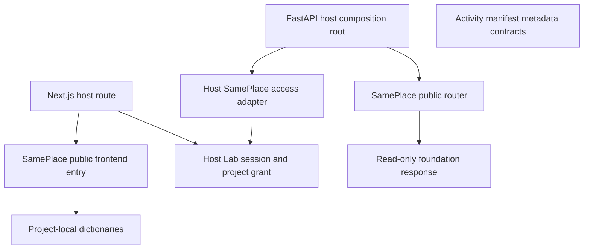
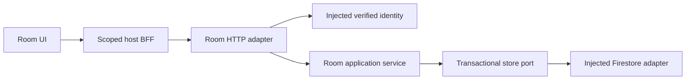

# Architecture — SP01–SP02

Status: SP02 candidate; not activated. SP01 foundation was merged. The Russian requirements remain the normative product specification.

## Composition and dependency direction

The host owns infrastructure and authentication; SamePlace owns application behavior. The original status router has no data access; the separate room router uses an injected transactional store. Pure activity contracts import Pydantic only; no host, Firebase or legacy dependency. Existing generic repository boundary checks and the project-specific guard enforce static ownership. These are preventive checks, not a sandbox. Future services must receive infrastructure via explicit ports and adapters. Do not add room, chat, game, asset or media logic to `backend/app` or `frontend/app`.

## Integration points

| Host path | Additive change |
|---|---|
| `portfolio/catalog/registry.json` | Register `sameplace` (catalog hidden) |
| `frontend/tsconfig.json`, route adapter | Public `@sameplace` import and guarded route |
| `backend/pyproject.toml`, `uv.lock`, `Dockerfile` | Editable package; existing FastAPI/Pydantic dependencies only |
| `backend/app/main.py`, security adapter | Mount `/api/sameplace` with fail-closed dependency |
| `Taskfile.yml`, CI | Include SamePlace source/test paths, freeze and localization checks |

## Access and runtime

`SAMEPLACE_ENABLED` is an exact `true` server-side flag, off by default. `PORTFOLIO_LAB_ENABLED` must also be true. Disabled requests return 404 before auth or provider calls; the original status endpoint requires the existing project grant. Room Core verifies identity separately and enforces per-room authorization; no global grant is created. Room writes are transactional and the browser uses a scoped BFF. No WS or eager database initialization. No change to global layout, identity rules, Firestore rules, legacy route, old data, cloud billing or deployment settings.

`GET /api/sameplace/status` returns `{"project_id":"sameplace","stage":"foundation","contract_version":1}` after authorization. It does not expose UID, tokens, provider settings, hidden game state or implementation secrets. This is not a health endpoint for unauthenticated clients.

## Future modules

Room Core is implemented for durable room administration. Social/Realtime, Interior/Media, Activity Host and isolated engines remain planned. The activity manifest contract in `backend/src/sameplace/contracts/activity.py` is a first validated metadata seam. It distinguishes module, contract, state and rules versions, player counts, roles, spectator modes, UI entrypoint, supported locale tags and scene surfaces. The metadata can represent additional languages without enabling them; only the RU runtime dictionary is active. Publication must verify module support for every active locale. No code loading or entitlement runtime yet; add lifecycle ports in SP05 after Room Core is stable. A capability may only be published after its implementation and tests exist. Test-only fixtures are not available activities.

## Legacy freeze

Freeze source: `1e76eaa4c0ba58ceed0e5b5615917a6ee229f777` (PR42). `legacy-freeze.json` is generated from that immutable Git tree when applying this candidate. The guard re-reads the pinned tree, compares the manifest, index paths/modes/blob IDs, changed working-tree paths, hidden index flags and untracked protected paths. It includes all paths containing `preferans` outside `portfolio/sameplace/` (including tests, adapters and assets). Shared host files are protected by compatibility checks and review instead of blanket locking. A full repository tree is required to produce the exact inventory. CI fetches the pinned object because checkout can be shallow. No Git tag or branch protection is created automatically. Owner must protect the guard, manifest and CI configuration from ordinary unreviewed edits. An ignored cache is not a tracked file; on Windows, Git's symlink/filemode handling follows checkout/index semantics. Static checks do not prove runtime parity. Original tests and full repository CI are mandatory.

## Data and deployment

SP01 introduced no data. SP02 defines `sameplace_room_core_v1`; documents are created lazily by authorized commands only. No migration or production writes. Existing Firestore deny-all browser rule remains unchanged. Future ephemeral presence lives in memory. Initial hosting uses existing Vercel/Render only and the strict GBP 0 policy. Keep the flag disabled even after merging; release is SP10, subject to actual capacity and quota evidence.

## SP02 layer composition

See [domain model](DOMAIN_MODEL.md), [security](SECURITY_AND_PERMISSIONS.md), [API](API_CONTRACT.md), and [ADR 0003](adr/0003-scoped-room-admission.md). All activity and social/media logic remains outside the room aggregate. No new third-party dependency or lockfile update is required: the host injects its existing Firebase client and transactional decorator.
