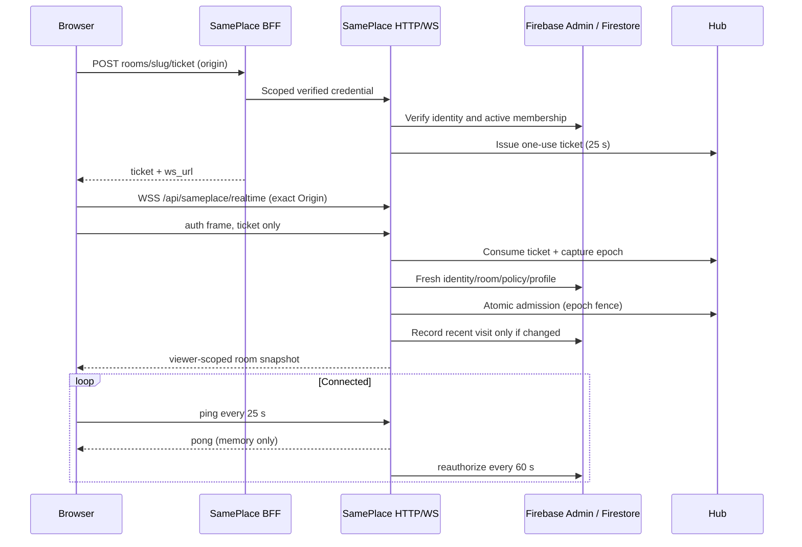

# Realtime room shell and room media

Status: SP05 candidate. SP01–SP04 merged; media signaling and client P2P are implemented, actual device acceptance pending. Activity state remains a future stage. See the canonical Russian requirements and [ADR 0004](adr/0004-single-worker-realtime.md). No provider is activated or billed.

## Runtime ownership

`social/composition.py` owns the project-local `Hub`, shared `QuotaCircuit`, write limiter and composition of the existing Room Core and new social routers. The FastAPI host still mounts the same public factory. Its existing `require_sameplace_identity` and `sameplace_database` adapters are injected; no host or legacy imports in project code. The BFF issues a short ticket from the scoped cookie and adds only the validated backend socket URL. The browser never receives the Firebase credential. A direct client must prove the same identity and room membership.

## Environment contract and activation

All flags are off by default. Keep production off until SP10 and explicit approval. Local isolated verification may set `PORTFOLIO_LAB_ENABLED=true`, `SAMEPLACE_ENABLED=true` on both hosts, `SAMEPLACE_REALTIME_ENABLED=true`, `SAMEPLACE_REALTIME_SINGLE_WORKER=true`, `WEB_CONCURRENCY=1`, `SAMEPLACE_REALTIME_ORIGINS=http://localhost:3000` on the local backend (exact browser origin, not a wildcard). Backend and browser Firebase must use the approved local demo project and matching emulators. Existing `BACKEND_ORIGIN` points to the local backend; `PORTFOLIO_LAB_ORIGIN` is the matching origin if configured. Render must use HTTPS/WSS and the exact configured origin when later approved. Do not use keepalive cron. The single-worker acknowledgement and configured `WEB_CONCURRENCY=1` are necessary but do not prove actual instance/worker count; Owner must verify one instance, one worker, no horizontally scaled deployment before enabling. Process-local capacity is not distributed enforcement. Different origins, query strings, invalid/expired/replayed tickets, unknown frames and failed reauth fail closed. Do not log tickets, authorization or frame bodies.

## Protocol v1

Transport: `GET` upgrade at `/api/sameplace/realtime`, then first frame `{ "type": "auth", "ticket": "<opaque>" }` within 5 seconds. No credential in URL, query, browser storage or snapshot. Ticket expires after 25 seconds, one use, bound to UID, slug, exact Origin. Maximum 32 pending handshakes, 128 tickets (4 per UID), 120 active socket connections, 2 tabs per UID. Application control frame bound 1,024 characters; SP05 addressed media signal frames may be up to 32,768 UTF-8 bytes; hosting-level WS frame size and connection-pressure controls still need release verification. SP03 accepted only client `ping` after auth; SP05 adds the bounded media frames below; mutation commands remain typed HTTP with authoritative identity and permissions. `pong` does not read or write Firestore. WebSocket send deadline 5 seconds; no growing event queue. One coalesced snapshot per changed revision, checked at most once per second in process memory. The polling of memory is not a Firestore listener or HTTP polling. Reauth every 60 seconds; lease expires after 90 seconds. Stale members and expired proposals are removed lazily and while active sockets run. Empty meeting grace is 90 seconds, no database traffic or background scheduling in empty rooms. A restart forgets ephemeral meetings, proposals and last-seen state; durable rooms, profiles, chat and inbox remain.

`room.snapshot` contains `protocol_version=1`, `room_id`, `meeting_id`, `sequence`, `room_revision`, `chat_revision`, `inbox_revision`, `server_now_ms`, `people`, `proposals`. Each person has opaque public ID, nickname, preset avatar, location, visit/watch presentation, `self`. No raw UID, credential, provider/contact info, friend presence or other-room metadata. `room_revision` is an invalidation hint, not authoritative room document version. `chat_revision` prompts authorized chat GET only on changes and bootstrap. `inbox_revision` is scoped per user, prompts an open social panel to fetch; unopened panels fetch on demand. The frontend validates protocol, expected room ID and sequence, discards old frames and clears active projections on disconnect/revocation. Room metadata is refetched on changed revisions/recovery. Error frames contain stable machine code only; close code 4403 denied/revoked, 4409 waiting/conflict, 1013 unavailable, 4400 invalid. Authentication/projection is not a cache of room membership forever.

Core room changes call the project-owned post-commit observer. Archive or member removal/block fences concurrent admission and removes matching leases/tickets before the command returns. Other core changes fence admission and mark room revisions; new limits do not evict existing participants. Existing socket sees revocation on the next memory check (nominally <=1 s, subject to network/scheduling). A direct provider-side change or crash between commit and publication is recovered by reauth/next authoritative read, not claimed instantaneous. Identity verification is never bypassed by a previous ticket. There is a small commit-to-invalidation window; no cross-worker safety claim. Future activity commands must also use durable seat/active-session locks and private viewer projections.

## Admission and graceful fallback

First admitted user opens the meeting, even if Owner is absent. Duplicate tabs share one participant slot, with independent leases. One UID may occupy one meeting at a time; close the other room to move, or wait for lease expiry. Effective limit is min(room.capacity, policy.capacity_ceiling), with global active room/participant limits. Existing admitted users are not evicted by a lower global policy; new admissions are blocked. Wait is retry-based first successful admission, not a durable FIFO queue or promised place. Browser backs off 15/30/60/120 s with jitter, >=60 s in hidden tabs and honors HTTP `Retry-After` up to 600 s. Disabled realtime stops automatic retry. No continuous HTTP presence heartbeat or view polling. Disconnected view explicitly shows degraded state, hides roster/location proposals and live chat, supports manual read-only history and existing room refresh through authenticated HTTP. On 401/403/404 authorization failure active state is cleared; no unsupported claim that an already delivered historical message can be remotely erased. Future strict distributed revocation would require a different coordination layer.

## Location and layout

Current meeting locations are `lounge` and `table` placeholders. Organizer/room owner proposes a location and visit/watch/play intent to actual participants; recipients answer, decline, cancel (issuer only), or expire in two minutes. Accept moves the participant to the placeholder, never creates a seat, game, result or ranking. Decline stays in place. Proposals and bounded request receipts are meeting-local and vanish on restart. Room shell persists as a dedicated component; the own participant is placed in the 2/3/4 or perimeter arrangement and observers separately; full visual/mobile acceptance remains required. SP06 will attach activity lifecycle and safe pause/move invariants rather than letting this placeholder bypass an active game. No active game exists in SP03.

## Future audio/video, music and activity

One logical connection per active tab is the intended transport for future private activity projections, media signaling and music state. No separate socket per module. SP04 adds interior/music state; SP05 adds room audio/video and capacity acceptance; SP06 adds activity contract/authorization; SP07 adds Preferans. Do not stream video through FastAPI or enable TURN/SFU billing. No recording, microphone permission, automatic provider enrollment or media UI claims in SP03. Any transport/provider adapter must maintain origin/auth, capacity, rate limits and no raw secret-state broadcasts.

## SP04 music controller

Room and optional lounge/table override states use independent revisions and server epoch. Removing an override increments its tombstone version; stale commands cannot resurrect it. Owner/DJ may select, play, pause, stop, rewind/seek recorded sources and restore inheritance. `MusicPlayer` stays mounted inside the room shell, so a visual device switch does not replace the audio element/source. Source lifetime is keyed only by source ID, mode, availability and URL; recorded playback derives its target from server time and wraps over the 8-second fixture. Local offset is an approximate sample at response receipt; exact timing across real browsers must be measured. Browser permission is explicit; local volume and mute are independent; audio is paused while realtime is offline, released when leaving. Radio buffering prevents exact alignment. No audio routed into microphones or server relay. SP05 adds local voice/music bus gains and approximate ducking; ambient/game sources and actual game-switch verification follow in SP06/07.

Server-only env pairs: `SAMEPLACE_RADIO_DISCO_URL` / `SAMEPLACE_RADIO_DISCO_RIGHTS_VERIFIED`, `SAMEPLACE_RADIO_ROCK_URL` / `SAMEPLACE_RADIO_ROCK_RIGHTS_VERIFIED`, `SAMEPLACE_RADIO_RETRO_URL` / `SAMEPLACE_RADIO_RETRO_RIGHTS_VERIFIED`. Set flags only after rights and transport review. An unpublished default room selects Melodia Disco and shared playing state only if its rights-verified source is configured; otherwise stopped test Disco. Existing persisted source choices are never silently replaced. Users still have to permit local audio. No new paid services or production environment changes. See ASSET_LICENSES.

## SP05 media protocol

Same authenticated socket, no additional BFF routes or token in URL. After `room.snapshot`, `media.state` is sent only on state changes when `SAMEPLACE_MEDIA_ENABLED=true`: meeting_id, mode, joined, occupied, muted, peers (public id, pair token, offerer, microphone/camera, muted), and an explicitly configured optional STUN URI. Client sends `media.join`/`media.leave`, `media.tracks` (booleans), `media.signal` (target public ID, current pair, offer/answer SDP or ICE), `media.mode` and `media.mute` (target public ID and boolean). Control commands are validated and moderation reauthorizes current permissions with an epoch fence. Server emits addressed `media.signal` with `from`, never broadcasts SDP/ICE. `media.error` has stable code only; `media.disabled` clears media when feature is switched off. One active media endpoint per UID; each pair is valid only for currently permitted endpoints. Reconciliation prunes stale messages on membership/location changes. Queue max 96 frames/128 KiB per endpoint, SDP max 24,000 UTF-8 bytes, ICE max 2,048 characters; aggregate frame/permission limits in RESOURCE_BUDGET. On disconnect, close every peer and stop tracks; new consent after reconnect. No media database traffic except bounded fresh authorization for privileged commands. Room snapshot and media state are independent, and media failures do not change durable rooms. Browser/provider support and P2P moderation limitations are described in MEDIA_OPERATIONS.
