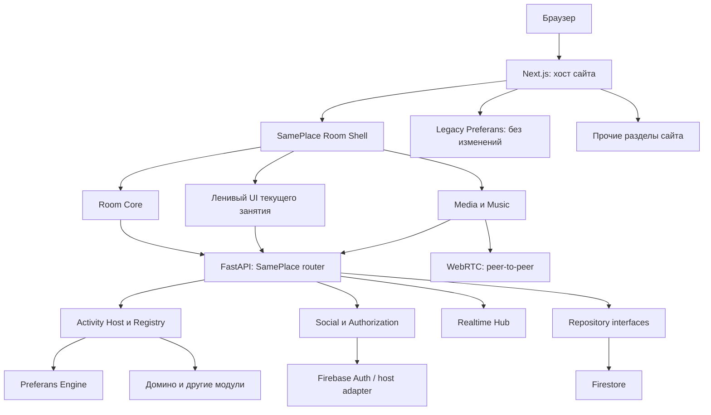
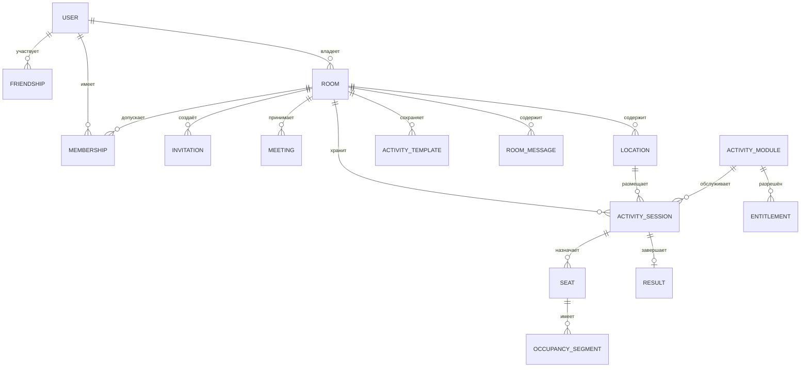
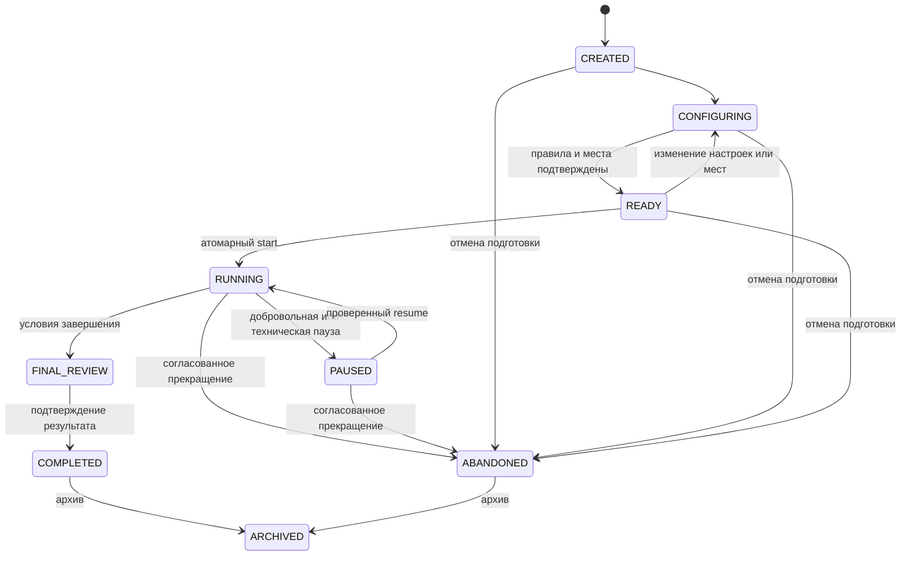

# SamePlace — полное техническое задание и архитектурная спецификация

> **Место встречи изменить нельзя.**

| Поле | Значение |
|---|---|
| Идентификатор документа | SP-TRS-001 |
| Версия | 1.0-draft |
| Дата | 27 ноября 2026 г. |
| Статус | Проект ТЗ на основании согласованных продуктовых решений; реализация не начата |
| Рабочее название | SamePlace |
| Технический идентификатор | `sameplace` |
| Канонический файл | `portfolio/sameplace/docs/SAMEPLACE_FULL_TECHNICAL_SPECIFICATION.ru.md` |
| Формат | GitHub Flavored Markdown, UTF-8, LF |
| Язык документа и приложения первой версии | Русский (`ru`) |
| Владелец требований | Owner |
| Целевой адрес | `https://alextym.com/portfolio/sameplace` |
| Ограничение расходов | £0 дополнительных расходов; без автоматического подключения биллинга или платного тарифа |

## 0. Как пользоваться документом

Это единый нормативный источник для проектирования, разработки и приёмки SamePlace. Он консолидирует два архитектурных опроса (40 вопросов), последующие уточнения об интерфейсе, интерьерах, магнитофоне, приглашениях, конфиденциальности и локализации. Более позднее прямое указание Owner имеет приоритет над ранним предложением.

Условные обозначения:

- **[REQ]** — обязательное согласованное функциональное или продуктовое требование.
- **[DESIGN]** — рекомендуемое инженерное решение, которое допустимо заменить эквивалентным после фиксации причины и проверки инвариантов.
- **[TARGET]** — предварительная измеримая цель или эксплуатационный лимит; не обещание производительности.
- **[FUTURE]** — архитектурно предусмотрено, но не является требованием реализации первой версии.
- **[GATE]** — обязательное условие выпуска. Нельзя отметить выполненным без подтверждения.
- **[OPEN]** — требует проверки или решения при реализации; не является разрешением самостоятельно менять согласованный продукт.

Если метка не указана, в разделах функциональных требований формулировки «должен», «запрещено», «только» являются обязательными; примеры структуры файлов, DTO, имён классов, лимитов и алгоритмов — проектные решения. Все псевдокод и JSON в документе иллюстративны, не являются уже существующей реализацией.

**Область работы:** создать новый подпроект; не изменять существующий преферанс, не мигрировать его историю, не переписывать авторизацию всего сайта, не включать платные сервисы. Документ не даёт разрешения начинать программирование, деплой, миграцию или менять облачную конфигурацию.

### 0.1. Содержание

1. [Концепция и границы](#1-концепция-и-границы)
2. [Исходное состояние сайта и заморозка преферанса](#2-исходное-состояние-сайта-и-заморозка-преферанса)
3. [Архитектура и структура репозитория](#3-архитектура-и-структура-репозитория)
4. [Доменная модель и инварианты](#4-доменная-модель-и-инварианты)
5. [Идентификация, роли и доступ](#5-идентификация-роли-и-доступ)
6. [Комнаты, ссылки и жизненный цикл встреч](#6-комнаты-ссылки-и-жизненный-цикл-встреч)
7. [Друзья, присутствие, чат и приглашения](#7-друзья-присутствие-чат-и-приглашения)
8. [Локации и переходы](#8-локации-и-переходы)
9. [Игровые сессии, места, паузы и замены](#9-игровые-сессии-места-паузы-и-замены)
10. [Контракт игровых модулей](#10-контракт-игровых-модулей)
11. [Интеграция нового движка преферанса](#11-интеграция-нового-движка-преферанса)
12. [Шаблоны, интерьеры, мебель и размещение участников](#12-шаблоны-интерьеры-мебель-и-размещение-участников)
13. [Пользовательский интерфейс и устройства](#13-пользовательский-интерфейс-и-устройства)
14. [Музыка, магнитофон и атмосфера](#14-музыка-магнитофон-и-атмосфера)
15. [Голос и видео](#15-голос-и-видео)
16. [Локализация](#16-локализация)
17. [Хранение, согласованность и восстановление](#17-хранение-согласованность-и-восстановление)
18. [API и realtime-протокол](#18-api-и-realtime-протокол)
19. [История, рейтинги и лицензии](#19-история-рейтинги-и-лицензии)
20. [Безопасность и конфиденциальность](#20-безопасность-и-конфиденциальность)
21. [Инфраструктура, £0 и производительность](#21-инфраструктура-бюджет-0-и-производительность)
22. [Тестирование и критерии приёмки](#22-тестирование-и-критерии-приёмки)
23. [План разработки и выпуск](#23-план-разработки-и-выпуск)
24. [Риски, ADR и вопросы технической проверки](#24-риски-adr-и-вопросы-технической-проверки)
25. [Трассировка согласованных решений](#25-трассировка-согласованных-решений)
26. [Источники и словарь](#26-источники-и-словарь)

---

## 1. Концепция и границы

### 1.1. Назначение

SamePlace — закрытая многопользовательская платформа постоянных виртуальных пространств, в которых друзья встречаются, общаются, слушают музыку, играют в настольные и другие игры, переходят между локациями и возвращаются к незавершённым занятиям. Это не сайт одного преферанса, не онлайн-казино, не приложение видеоконференций с обязательным включением камеры и не публичная социальная сеть на первом этапе.

Основная ценность: у комнаты есть постоянный адрес, знакомый интерьер, состав допущенных людей, история совместного досуга. Комната существует независимо от текущего занятия. Пользователь вправе прийти один, просто посидеть, позвать друзей, пообщаться, перейти к игре или отказаться от неё. Окончание партии не приводит к выходу из комнаты.

### 1.2. Ключевые сценарии

| ID | Сценарий | Результат |
|---|---|---|
| SP-UC-01 | Одобренный пользователь создаёт свою комнату | Получает постоянную ссылку и права Главного архитектора |
| SP-UC-02 | Владелец приглашает зарегистрированного или нового друга | Друг получает доступ именно в разрешённую комнату |
| SP-UC-03 | Друг открывает сохранённую ссылку без владельца | При действующем разрешении попадает в комнату |
| SP-UC-04 | Пользователь приходит один и зовёт друзей | Формирует приглашение «Я уже на месте»; доступные каналы работают согласно конфигурации |
| SP-UC-05 | Трое запускают преферанс | Выбирают шаблон, места и правила, подтверждают готовность |
| SP-UC-06 | Четвёртый друг входит в ходе игры | Общается и/или наблюдает; закрытые данные недоступны |
| SP-UC-07 | Игроки заканчивают игру | Подтверждают результат, остаются в комнате, могут сыграть ещё |
| SP-UC-08 | Игроки ставят преферанс на паузу и запускают другое занятие | Предыдущая партия сохранена; музыка и связь комнаты не прерываются из-за смены игры |
| SP-UC-09 | Один из друзей отсутствует | Место резервируется или занимает виртуальный игрок; возвращение человека допускается по правилам безопасной замены |
| SP-UC-10 | Организатор предлагает новую локацию | Каждый принимает или отклоняет приглашение; отказ не исключает из комнаты |
| SP-UC-11 | Архитектор меняет интерьер | Сохраняет новую конфигурацию, не меняя правила игры |
| SP-UC-12 | Пользователь скрывает присутствие от друзей | Сервер не передаёт запрещённые сведения; внутри посещаемой комнаты видимость участника сохраняется |
| SP-UC-13 | Owner отключает SamePlace | Новый проект становится недоступен, остальные приложения сайта продолжают работать |

### 1.3. Обязательный объём стабильной версии 1.0

Постоянные закрытые комнаты; создание и передача владения; разрешения и приглашения; друзья и избранное; чат; presence и конфиденциальность; переключаемые локации; одна активная игровая сессия в комнате с несколькими сохранёнными на паузе; переиспользуемый движок преферанса и его адаптированный интерфейс; наблюдение; резервирование мест и виртуальные игроки преферанса; музыка; готовые интерьеры и 2D-редактор; голос/видео при проверенном бесплатном лимите; мобильный интерфейс; локальная и глобальная статистика; минимум второй самостоятельный игровой модуль (домино) как доказательство независимости платформы. Для домино до его разработки согласовывается отдельное ТЗ правил; ядро не придумывает правила за Owner.

Реализация по этапам разрешена. Ранние версии могут не иметь всех возможностей 1.0, но незавершённая функция должна быть скрыта или явно обозначена. Нельзя выдавать заглушку за работоспособный сервис.

### 1.4. Будущее развитие — вне первой реализации

[FUTURE] Несколько одновременно активных игр внутри комнаты; публичные комнаты; полноценный магазин; оплата игр; внешние разработчики; 3D-квесты; свободное перемещение 3D-аватаров; игры с ведущим (например, «Мафия»); карточный «Козёл»; динамичные многопользовательские игры; мультиязычный контент; альтернативное развёртывание приложения.

[FUTURE] Контракты должны допускать эти возможности, но не требуют сейчас универсального физического движка, микросервисов, запуска стороннего кода, распределённого event sourcing, собственной видеоплатформы, блокчейна или системы платежей.

Не включать ставки, денежные игровые выигрыши, скрытое наблюдение за приватными комнатами, запись видеосвязи по умолчанию, автоматическое платное SMS, неограниченный файловый хостинг и произвольные внешние скрипты.

### 1.5. Идентичность и ребрендинг

Рабочее название — **SamePlace**. Юридическая доступность названия для коммерческого использования не подтверждена. `project_id` стабилен и не зависит от маркетингового названия. В будущем при изменении slug старые канонические ссылки должны безопасно перенаправляться с сохранением контроля доступа. Не использовать чужие логотипы или изображения без разрешения. Публичная карточка портфолио сохраняет стиль и язык существующего каталога сайта; собственный интерфейс SamePlace — русский (см. §16).

---

## 2. Исходное состояние сайта и заморозка преферанса

### 2.1. Проверенная база

На дату подготовки по ветке `main` изучены манифест и реестр портфолио, контракт `portfolio/README.md`, frontend route преферанса, Python/TypeScript конфигурация хостов, security adapter, realtime/store/UI и история `SESSION_NOTES.md` до PR40. Исходный проект — приватный трёхместный преферанс, не универсальная комната. В `FirestoreRooms` состояние, участники, игровые действия и результат связаны с `room_id`; результат имеет ключ комнаты. В текущем интерфейсе `PreferansGame` и realtime-подключении наличие `mySeat` существенным образом определяет участие и медиасвязь.

| Компонент | Зафиксированный факт |
|---|---|
| `portfolio/catalog/registry.json` | Зарегистрированы `fleet_hub`, `workforce_intelligence`, `preferans` |
| `frontend/app/portfolio/preferans/page.tsx` | Хостовый route adapter; проверка Lab и project grant; флаг `PREFERANS_ROOMS_ENABLED` |
| `backend/app/main.py` | Монтирует публичный router и realtime router преферанса |
| `backend/app/security/project_grants.py` | Централизованный контроль грантов `View`, `Test`, `Admin`, отдельно глобальный Owner; текущие проверки грантов без кеширования |
| `portfolio/preferans/backend/src/preferans/online/realtime.py` | Single-process hub, короткие tickets, 60 с reauth, 90 с WS lease; состояние игры авторитетно в Firestore |
| `portfolio/preferans/backend/src/preferans/online/realtime_api.py` | Отправляет изменившиеся представления, presence и медиасигнализацию; транзакции при значимых переходах/дедлайнах |
| `portfolio/preferans/frontend/src/PreferansGame.ru.tsx` | При исправном WS отключает HTTP fallback и HTTP heartbeat игры; при потере соединения восстанавливает их ограниченно |
| Hosting / технологии | Next.js + React + TypeScript / Vercel; Python + FastAPI / Render; Firebase Auth + Firestore; Playwright и pytest |

PR22: в ноябре 2026 года была зафиксирована проблема превышения квоты Firestore (около 54 тыс. чтений за скользящие 24 часа; не точное значение дневного счётчика). После архитектурных исправлений Owner сообщил об успешном устранении инцидента и существенном сокращении запросов. Исходники подтверждают предусмотренные механизмы: здоровый WS вместо постоянного polling, bounded fallback, backoff, circuit breaker, viewer-specific projections. **PR22 не считается текущей нерешённой проблемой.** Новые production-метрики и флаги среды самостоятельно не проверены. Нельзя переносить прежние замеры на новую платформу или объявлять запас квоты доказанным.

### 2.2. Неизменяемый Legacy Preferans

[REQ] `portfolio/preferans/` остаётся в текущем состоянии, доступен по прежнему URL и используется как портфолио и временное место встречи. Позже может остаться только демонстрационным проектом. Такое отключение — отдельное решение Owner, не часть данного ТЗ. Его история, рейтинг, пользователи, правила и коллекции не мигрируют и не объединяются с SamePlace.

[GATE] До начала изменений зафиксировать фактический HEAD `main` (полный SHA) и tree/blob manifest защищённых путей; создать неизменяемую ссылку на исходную версию (например, tag после одобрения Owner). Документ не утверждает, что тег уже существует. Не брать произвольный SHA из списка последних коммитов без проверки ветки. Сохранить исходные артефакты тестов и матрицу API/маршрутов.

Защищённые зоны: весь `portfolio/preferans/` включая документацию, ресурсы, тесты и исходники; `frontend/app/portfolio/preferans/`; выделенный `backend/app/security/preferans_access.py` и другие найденные legacy-only адаптеры; совместимость существующего alias, публичного router, конфигурации и формата данных. Полный перечень утверждается после инвентаризации. Общие файлы реестра, host router, конфигурации сборки и CI могут получать **добавочные** изменения для нового проекта, без изменения поведения legacy.

CI `check-preferans-freeze`:

1. Сравнить полный список и SHA-256/ Git tree защищённых файлов с проверенным baseline: добавление, удаление, переименование, изменение, изменение symlink или режима файла — ошибка.
2. Запретить зависимости SamePlace на `preferans` legacy internals и обратные зависимости. Изоляция проверяется статическими import-boundary тестами.
3. Отдельно проверить прежние route/API/feature flags и все оригинальные unit/integration/E2E тесты.
4. Проверить отсутствие новых обращений к legacy collections из репозиториев SamePlace; тест с данными-«канарейками» подтверждает неизменность документов после новых операций.
5. Защитить сам baseline и скрипт проверки правилами review/branch protection, если доступны. Проверка не должна позволять обновить baseline тем же обычным PR и тем самым обойти запрет. Исключения — только отдельное явное разрешение Owner.

[GATE] Если интеграция требует изменения legacy, не «чинить заодно»: остановить изменение и предложить адаптацию нового пакета. Уязвимость старого приложения фиксировать отдельно; при критическом риске Owner решает о временном отключении или исключительной правке. CI freeze не является доказательством неизменности runtime: общие зависимости, стили, auth, CSP, маршрутизация и hosting также требуют регрессионной проверки.

### 2.3. Переиспользуемый преферанс

[REQ] Создать независимый `preferans_engine` из зафиксированной версии исходного алгоритма и тестов. Не импортировать оригинальный проект, не поддерживать общую mutable базу и не переводить legacy на новый пакет. На этапе извлечения переносится чистая доменная логика и ресурсы с допустимой лицензией; слой старых комнат заменяется адаптером SamePlace. В дальнейшем развивается новый движок. Подробности §11.

---

## 3. Архитектура и структура репозитория

### 3.1. Решение

[DESIGN] Модульный монолит с версионируемыми контрактами занятий (Activity Module Architecture). SamePlace — независимый модуль портфолио, не надстройка внутри legacy Preferans. Используются существующие хосты и общая идентификация. Внутреннее разбиение по доменам, отдельные entrypoints и пакеты позволяют в будущем выделить приложение в самостоятельный deployment. Игровые модули разрабатываются независимо, но начальная поставка — доверенная сборка общего продукта. «Установить игру» означает активировать зарегистрированный модуль/право в комнате, а не скачать исполняемый код на сервер от неизвестного автора.

Альтернативы: расширение старого преферанса нарушает заморозку и смешивает социальную и игровую модель; микросервисы для каждой игры требуют инфраструктуры, координации и расходов, пока не обоснованных нагрузкой. Отдельный backend может быть рассмотрен позже при доказанной конкуренции с RAG за ресурсы и допустимом бюджете; не создавать его автоматически.



Медиапотоки идут напрямую между клиентами или через согласованный медиапровайдер, а не через FastAPI. Стрелка к B для Media обозначает авторизацию и signaling, не передачу аудио/видео. Схема логическая, не сеть микросервисов.

### 3.2. Подсистемы и владение

| Подсистема | Владеет | Не владеет |
|---|---|---|
| Room Core | Комнатами, memberships, meeting, locations, сменой activity, capacity | Правилами игр и медиакодеками |
| Social | Профилями SamePlace, дружбой, избранным, privacy, приглашениями | Глобальными грантами остальных проектов |
| Activity Host | Сессиями, назначениями мест, orchestration, версиями, lifecycle | Карточным/доминным алгоритмом |
| Activity Module | Правилами, легальными действиями, приватными проекциями, счётом | Авторизацией сайта, общим интерьером |
| Interior & Layout | Assets, scenes, координатами, шаблонами, viewer perspective | Порядком ходов |
| Media & Music | Аудиоканалами, WebRTC lifecycle, состоянием магнитофона, разрешениями | Счётом и состоянием руки |
| Notification | Внутренними сообщениями и внешними адаптерами доставки | Грантами доступа |
| Registry & Entitlements | Манифестами, совместимостью, разрешением использовать модуль | Выполнением платежей в 1.0 |
| Persistence | Репозиториями, кодеками, транзакциями и recovery | Правилами интерфейса |
| Host integration | Общей идентификацией, монтированием роутеров, сборкой, feature flags | Доменной логикой SamePlace |

### 3.3. Предлагаемое размещение

```text
portfolio/
  catalog/registry.json                    # добавить sameplace
  preferans/                               # FROZEN
  sameplace/
    project.json                           # id, slug, title, summary, API, catalog
    README.md
    docs/
      SAMEPLACE_FULL_TECHNICAL_SPECIFICATION.ru.md
      SESSION_NOTES.md
      adr/
    contracts/                             # JSON Schema / OpenAPI / manifests
    backend/
      pyproject.toml
      src/sameplace/
        domain/                            # room, social, activity, scene models
        application/                       # use cases, ports, policies
        infrastructure/                    # Firestore, realtime, delivery adapters
        api/                               # HTTP/WS, DTO, public router
        bootstrap.py                       # composition root
    frontend/
      package.json
      src/
        index.ts                           # public entry
        shell/                             # room layout, top menu, providers
        features/                          # rooms, social, activities, interior
        media/                             # persistent music/video services
        i18n/                              # locale registry + dictionaries
        shared/                            # neutral UI, contracts, helpers
    activities/
      preferans/
        manifest.json
        engine/                            # independent Python package
        adapter/                           # host activity adapter
        frontend/                          # adapted game UI
        rulesets/
        tests/
      domino/                              # later, own rules and module
    interiors/                             # versioned JSON + licensed assets
    tests/                                 # domain, contract, integration, e2e fixtures
frontend/app/portfolio/sameplace/            # thin host routes/layout
backend/app/                               # additive router/auth integration only
scripts/                                  # CI and freeze checks, registry checks
```

[DESIGN] Точные Python workspace/uv paths, npm package topology и линковка согласуются с текущим репозиторием перед реализацией. Избегать циклов: `activity adapter -> engine` и `adapter -> public activity contracts`; ядро видит адаптер только через registry/composition root. Бизнес-логика не находится в `frontend/app` или `backend/app` хоста. Пакет движка может впоследствии быть опубликован отдельно; сейчас достаточно локального пакета с версией, проверенными зависимостями и публичным API. Доступ из игрового модуля к Firestore через согласованный repository port, не через глобальные SDK-объекты.

### 3.4. Ограничение области изменений сайта

Разрешены необходимые добавления: реестр/манифест, карточка каталога, route mount, API mount, host identity adapter, сборка, CSP для проверенных ресурсов нового проекта, CI, минимальное расширение host identity/admission если требуется и проверено. Не добавлять глобальный i18n provider, не менять язык главной страницы, Chat/RAG, Resume, Contact, меню сайта и других portfolio apps. Не менять текущий login experience остальных проектов. Новые CSS ограничены корневым контейнером SamePlace или CSS Modules; не использовать глобальные селекторы, влияющие на legacy. Если необходим слот общего header, добавить опциональный scoped slot и доказать прежнее поведение.

Feature flags: `SAMEPLACE_ENABLED` (по умолчанию off), отдельные флаги realtime/media/notifications/experimental modules, безопасное выключение. Не использовать флаги как замену разрешений. На disabled server и frontend маршрут закрыт; прямой backend origin также защищён. Не включать новые флаги production до приёмки.

---

## 4. Доменная модель и инварианты

### 4.1. Сущности



Связи концептуальны, не SQL схема. Meeting не владеет сохранением партии: ActivitySession принадлежит Room и может продолжиться в другой Meeting. Presence и WebSocket connection — временные объекты, не постоянные членства. Для будущих локаций разрешено несколько активных ActivitySession, в 1.0 действует ограничение одной.

| Сущность | ID и поля (минимум) | Срок жизни |
|---|---|---|
| `UserProfile` | UID Firebase; display_name, avatar_ref, locale, privacy, status | До удаления/деактивации профиля |
| `CreatorApproval` | UID, state, approved_by, revision | До отзыва Owner |
| `Room` | room_id, slug, name, owner_uid, status, visibility, capacity, revision, current scene refs | Постоянно, включая архив |
| `Membership` | room_id+UID, roles/capabilities, status, granted_by, revision, expires_at? | Пока действует доступ |
| `Friendship` | Пара UID, requester, state, timestamps | До отмены/удаления |
| `Favorite` | UID+room_id | До удаления пользователем |
| `Invitation` | opaque id, digest токена, target, scope, expiry, consumed/revoked | До истечения/отзыва |
| `Meeting` | meeting_id, room_id, opened_at, closed_at?, generation | Фактическая встреча |
| `Presence` | UID, room_id, meeting_id, location_id, lease, connection generation | Секунды/минуты |
| `Location` | location_id, room_id, kind, scene_revision, state | Постоянная или временная |
| `TransitionProposal` | proposal_id, target_location, audience snapshot, answers, expiry, version | До завершения предложения |
| `ActivitySession` | activity_id, room_id, module_id/version, lifecycle, state_version, rules_snapshot, meeting links | До завершения/архива, включая длительные паузы |
| `Seat` | activity_id+seat_id, logical_order, reservation, occupant_type, controller | Пока существует сессия |
| `OccupancySegment` | seat_id, occupant UID/bot ID, start/end round/event boundary | Неизменяемая история участия |
| `ActivityVote` | vote_id, action, eligible voters snapshot, answers, deadline, expected version | До принятия/отклонения/истечения |
| `GameRound` | module-specific id, sequence, metadata | В пределах сессии |
| `Ruleset` | module_id, ruleset_id, revision, validated config | Версионируемый |
| `ActivityTemplate` | owner/room scope, module_id, ruleset revision, layout/scene refs, launch options | Переиспользуемый |
| `SceneTemplate` | template_id, revision, owner/scope, object graph | Переиспользуемый |
| `Asset` | asset_id, type, version, URI, hash, license, dimensions, variants | По версии каталога |
| `MusicState` | room/location scope, source_id, play state, epoch, version, changed_by | Пока действует состояние |
| `MediaSession` | meeting_id, channel_id, participants, permissions, generation | Временная |
| `RoomMessage` | message_id, sender, room_id, created_at, expires_at, text, moderation state | 30 дней по умолчанию |
| `Result` | result_id, activity_id unique, module/version, immutable outcome, eligibility | Постоянно с учётом privacy policy |
| `Rating` | room/global scope, module/rules family, subject, aggregates | Производная от результатов |
| `Entitlement` | subject_type, subject_id, module_id, state, validity | До отзыва/истечения |
| `AuditEvent` | actor, action, object, time, reason, command_id | По политике хранения |

### 4.2. Критические инварианты

- `room_id` не изменяется; URL slug уникален в SamePlace и не переиспользуется для другой комнаты после архивирования.
- Не более 3 неархивированных комнат одного одобренного владельца; восстановление также проверяет лимит. Архивирование не является обходом глобального storage cap.
- Настраиваемая вместимость 1–10 человек, но effective capacity ограничивается проверенной медиа-вместимостью и лимитами Owner. Боты не считаются физическими участниками; число игровых мест задаётся модулем. Участник с несколькими вкладками занимает одно место capacity.
- В 1.0 на комнату максимум одна **активированная** игровая сессия (включая подготовку/готовность/розыгрыш/финальное подтверждение); приостановленные сессии не занимают слот активности. Переключение atomic. В будущем ограничение становится параметром policy.
- Человек не может контролировать более одного игрового места в активных играх (платформенный инвариант, в том числе между комнатами). Разрешены несколько сохранённых на паузе назначений.
- В комнате может быть несколько locations; один человек в один момент находится в одной фактической локации. Права на наблюдение и аудиоканал не меняют его seat автоматически.
- Ни membership, ни роль владельца, ни модерация не дают права читать закрытое состояние игры. Информация выдаётся module-specific projection по контексту получателя.
- Для одной игровой сессии итог фиксируется единожды; рейтинг не начисляется дважды. Legacy data не участвует в вычислении.
- В игре действует неизменяемый снимок правил и версии совместимого движка. Изменения шаблонов не воздействуют на уже начатые сессии.
- Все долговечные мутации авторизуются на сервере; отсутствующая/просроченная/неподтверждённая авторизация означает отказ, а не fallback-доступ.
- При потере процесса долговечное состояние не теряется; эфемерные соединения и leases пересоздаются. Локальное время, JS и анимация не являются источником истины.

---

## 5. Идентификация, роли и доступ

### 5.1. Уровни авторизации

1. **Идентичность:** существующий Firebase UID. Не создавать второй аккаунт/пароль или копию auth database. Проверять серверно токены/сессию по действующему host-контракту; не доверять клиентскому UID, email как идентификатору, query string или только наличию cookie.
2. **Допуск в приложение:** глобальный Owner может одобрить создание комнат. Приглашённый пользователь без такого одобрения может получить ограниченный SamePlace-допуск к конкретной комнате. Это не `Admin` и не доступ к RAG/admin, Fleet, Workforce или legacy Preferans.
3. **Членство комнаты:** доступ и разрешения конкретной комнаты; выдаёт Главный архитектор или участник с делегированной capability. Приглашение не наследует все права приглашающего.
4. **Контекст занятия:** назначенные игроки, наблюдатели, ведущий (Game Master) и право читать именно те данные, которые разрешает модуль.
5. **Entitlement:** право использовать конкретную игру или платный в будущем ресурс; не заменяет membership и не даёт глобальных административных прав.

Текущий общий `require_project_access` требует глобального project grant для защищённых операций. [DESIGN] Новый adapter SamePlace должен корректно принимать ограниченный room grant после приглашения и не расширять общий механизм `View/Test/Admin` на другие проекты. Если действующая host identity admission блокирует приглашённого, реализовать узкое, явно протестированное исключение только для SamePlace после доказанной Firebase identity и действительного invitation/membership. Не добавлять blanket no-op, не выдавать общую роль `Test` постороннему как обход, не открывать endpoint до успешного auth. Проверить страницу, BFF, direct FastAPI и WS одинаково. Механизм bootstrap приглашения отдельно от комнатного middleware: он проверяет токен, получателя и идентичность, затем создаёт scoped grant транзакционно.

### 5.2. Роли

| Роль UI | Технический scope | Смысл |
|---|---|---|
| Owner (владелец платформы) | Global | Одобрение создателей, лимиты, отключение проекта, контроль инфраструктуры |
| Главный архитектор | Room owner | Владение комнатой, делегирование прав, архив/передача |
| Архитектор | Room designer | Конструирование интерьера и шаблонов, при делегировании — каталог и приглашения |
| Модератор | Room moderator | Допуск посетителей, удаление, отключение звука, блокировка в комнате |
| DJ | Room/location media | Управление общим магнитофоном в соответствующем scope |
| Организатор игр | Room activity organizer | Подготовка, предложение и запуск занятий, состав игроков |
| Ведущий | Activity game master | Спикер/ведущий конкретной игры; определяется её правилами |
| Игрок | Activity seat | Игровые команды в рамках своего места |
| Наблюдатель | Activity viewer | Разрешённая проекция, без игровых действий |
| Участник | Room member | Вход, общение, предложения, свои preferences |
| Виртуальный игрок | Activity seat controller | Не пользователь, не член комнаты, только алгоритм |

Создатель комнаты получает membership и ownership в одной транзакции; по умолчанию необходимые административные capabilities предоставляются ему. Делегированные роли могут сочетаться. Ведущий и организатор могут быть разными людьми. В «Мафии» ведущий может быть неиграющим участником и получать скрытую информацию исключительно по контракту этого модуля; в преферансе нельзя выдавать скрытые руки ведущему, архитектору или глобальному Owner по одной лишь роли.

### 5.3. Матрица прав

`✓` — право по роли при выполнении общих условий; `d` — отдельно делегируемая capability; `m` — модульная/контекстная проверка; `—` — отсутствует. Глобальный Owner управляет допуском/квотами, но не автоматически получает membership или приватное игровое представление. Все комнатные роли предполагают действующее членство. Матрица — исходная policy, расширение только явной версией.

| Операция | Owner платформы | Главный архитектор | Архитектор | Модератор | DJ | Организатор | Ведущий | Участник |
|---|---|---|---|---|---|---|---|---|
| Одобрить создание комнат | ✓ | — | — | — | — | — | — | — |
| Создать свою комнату | ✓* | ✓* | ✓* | ✓* | ✓* | ✓* | ✓* | ✓* |
| Передать/архивировать/восстановить комнату | — | ✓ | — | — | — | — | — | — |
| Делегировать права комнаты | — | ✓ | — | — | — | — | — | — |
| Пригласить новых пользователей | — | ✓ | d | d | d | d | d | d |
| Вход и общение | m | ✓ | ✓ | ✓ | ✓ | ✓ | ✓ | ✓ |
| Позвать уже допущенных друзей | m | ✓ | ✓ | ✓ | ✓ | ✓ | ✓ | ✓ |
| Изменить capacity и visibility | — | ✓ | d | — | — | — | — | — |
| Изменить интерьер | — | ✓ | ✓ | — | — | — | — | — |
| Установить модуль в комнате | — | ✓ | d | — | — | d | — | — |
| Допуск/выгнать/заблокировать | — | ✓ | d | ✓ | — | — | — | — |
| Отключить звук участника | — | ✓ | — | ✓ | — | — | m | — |
| Управление общим магнитофоном | — | ✓ | d | d | ✓ | d | d | d |
| Предложить занятие | m | ✓ | ✓ | ✓ | ✓ | ✓ | ✓ | ✓ |
| Выбрать игроков / запустить | — | d | — | — | — | ✓ | m | — |
| Провести особый игровой этап | — | m | m | m | m | m | m | m |
| Сыграть ход | m | m | m | m | m | m | m | m |
| Просмотреть секретное состояние | m | m | m | m | m | m | m | m |
| Установить глобальный лимит/выключить проект | ✓ | — | — | — | — | — | — | — |

`*` Только при CreatorApproval, лимите и активном профиле; глобальный Owner может иметь отдельный platform capability. `m` в строке секретного состояния всегда означает проверку game module, не общий raw-state доступ.

### 5.4. Полномочия и отзыв

Capability keys стабильны, например `room.invite`, `room.design`, `room.moderate`, `room.manage_music`, `activity.organize`, `activity.host`. Нельзя делегировать права более высокого scope; запрет self-escalation. Отзыв membership действует на HTTP сразу после подтверждения изменения, на локальные сокеты — немедленным invalidation event; периодическая reauth служит страховкой (целевой верхний интервал 60 с при отсутствии сигнала). При сбое проверки закрыть защищённый канал. При отзыве очистить клиентские private projections, отозвать tickets, остановить медиа/подписки, освободить presence. Уже раскрытую информацию невозможно забрать из памяти человека; это не обещать.

Отсутствие владельца не прекращает встречу. Передача владения требует двух подтверждений, проверку CreatorApproval/лимита получателя, актуальной версии комнаты и атомарного обновления ownership; нельзя потерять единственного владельца. Старый владелец остаётся обычным участником с согласованными правами, не получает автоматически доступ к другим комнатам нового владельца. Если Owner отзывает право создавать комнаты, новые создания блокируются; судьбу уже существующих определяет отдельная policy Owner (предлагается не удалять автоматически, ограничить transfer/архив при злоупотреблении). Это техническое уточнение, не новое согласованное право.

---

## 6. Комнаты, ссылки и жизненный цикл встреч

### 6.1. Создание и каталог

[REQ] Только одобренный Owner пользователь создаёт собственные комнаты, максимум три. Форма: название, постоянное короткое имя, вместимость, готовый интерьер, исходная политика входа; остальные параметры редактируются после создания. Действие атомарно резервирует slug, проверяет CreatorApproval, ownership counter, global storage cap, создаёт Room, начальную Location «Гостиная», membership владельца, defaults и audit. Повтор отправки с тем же idempotency key не создаёт дополнительную комнату. В случае конфликта slug предложить другое имя; не менять slug автоматически после подтверждения.

[REQ] «Мои комнаты» включает принадлежащие пользователю; «Доступные комнаты» — только комнаты с разрешением входа; «Избранное» — сохранённые ссылки; «Недавние встречи» — собственную историю посещения. Пустые комнаты показываются как доступные, но не требуют realtime subscription каждой комнаты. Каталог запрашивается постранично или ограниченным списком; никогда не сканировать все комнаты базы.

### 6.2. Адреса

| Маршрут (UI) | Назначение |
|---|---|
| `/portfolio/sameplace` | Вход, landing, обзор возможностей, переход к своим комнатам |
| `/portfolio/sameplace/rooms` | Доступные комнаты, создание, избранное |
| `/portfolio/sameplace/r/{slug}` | Постоянная каноническая ссылка |
| `/portfolio/sameplace/r/{slug}/history` | История и рейтинги комнаты |
| `/portfolio/sameplace/r/{slug}/design` | Редактор для авторизованных архитекторов |
| `/portfolio/sameplace/j/{token}` | Одноразовое/ограниченное приглашение |
| `/portfolio/sameplace/friends` | Друзья и запросы дружбы |
| `/portfolio/sameplace/catalog` | Игры и ресурсы, доступные пользователю |
| `/portfolio/sameplace/settings` | Локальные настройки профиля/конфиденциальности |

Все пользовательские URL внутри `/portfolio/sameplace`. Никаких `/r/`, `/j/`, `/meet` в корне всего сайта. API имеет отдельный namespace `/api/sameplace` в соответствии с host conventions, технический WS endpoint допускается на авторизованном Render origin; не является пользовательской ссылкой на комнату. Locale не входит в slug или идентификатор комнаты. Смена отображаемого имени не меняет URL. [DESIGN] Slug ASCII lowercase `[a-z0-9-]`, 3–48 символов, не начинается/заканчивается дефисом, зарезервированные слова исключены; уникальность enforced транзакцией. Пользователь может выбрать короткий slug (`friday`, `our-home`) без персональных данных. Не превращать slug в секрет доступа. Если когда-либо вводится редактирование slug, старый alias остаётся зарезервированным; не перенаправлять на другую комнату.

### 6.3. Видимость и право входа

[REQ] На первом этапе нет публичных комнат. В data model допускаются `private`, `unlisted`, `friends`, `public` как будущие policy variants, но UI/API не разрешают `public` и не предоставляют незнакомому пользователю каталог чужих комнат. `private` — только действующим memberships. `unlisted` (если реализуется) не раскрывает состав комнаты по ссылке и не предоставляет вход без grants. `friends` — механизм обнаружения для друзей, если explicitly enabled, но не автоматическое членство без настроенной policy. До отдельного согласования auto-admission для друзей выключен. Приватность комнаты сильнее настройки профиля о показе location.

Переход по постоянному URL: проверить флаг проекта, идентичность, room status и membership; при отсутствии сессии — предложить вход с безопасным return path, при отказе — нейтральное сообщение без утечки данных; после входа проверить всё повторно. Не рендерить имя/аватары/текущую игру неавторизованному посетителю. При исчерпанной вместимости показать ожидание, не выдавать room projection или медиакреденшелы. Заблокированный посетитель не может войти через новую вкладку, invite или stale token.

### 6.4. Room и Meeting — разные жизненные циклы

| Объект | Состояния | Переходы |
|---|---|---|
| Room | `ACTIVE`, `ARCHIVED` | Создание, архивирование, восстановление; удаление — только отдельная политика данных |
| Meeting | `OPEN`, `IDLE_GRACE`, `CLOSED` | Первый участник открывает встречу, последний уходит, grace, закрытие; новая встреча получает новый ID |
| Presence | `CONNECTING`, `ONLINE`, `RECONNECTING`, `OFFLINE` | Lease и авторизованное соединение; не является membership |
| Location | `AVAILABLE`, `ACTIVE`, `CLOSED` | Гостиная доступна всегда; игровые временные локации могут быть закрыты |

[DESIGN] Встреча не требует команды «начать» и не ждёт владельца. Первый реально допущенный участник атомарно открывает/возобновляет текущую Meeting. При исчезновении последнего клиента короткое grace окно (например, 90 секунд с учётом lease) защищает от случайного разрыва; после него meeting закрывается, эфемерный hub очищается, сессии сохраняются на паузе. Не поддерживать сервер awake для пустой комнаты. Закрытие после рестарта может быть lazy при следующем входе; помечать неизвестный интервал, не начислять игровые штрафы за него. Время встречи и время активного игрового процесса различаются.

### 6.5. Capacity и очередь

[REQ] Capacity комнаты настраивается, не более 10 людей. Действительный лимит = минимум настроенной вместимости, проверенной вместимости среды и глобальной policy. Если бесплатная видеосвязь для 10 не обеспечивается, **уменьшать максимально допустимое число людей**, а не объявлять поддержку 10 или самовольно выбирать ограничение только числа камер. Новое уменьшение лимита не удаляет memberships; при действующей встрече не выгонять людей произвольно, блокировать новые входы и применять лимит после завершения или безопасного перехода. Если текущая нагрузка опасна — деградировать/отключить медиа и сохранить игру; Owner управляет аварийной остановкой. Камера добровольна; capacity не меняется от числа включённых камер мгновенно.

[DESIGN] Глобальные лимиты активных комнат/участников, атомарный admission slot, TTL/lease в hub; в single-worker процессном режиме локальная синхронизация + долговечные invariants для game seat. При ожидании не создавать частый polling: ограниченный статус по push/редкому retry, без удержания игрового места. Реальная очередь может быть простой first-come/first-served с expiry, без обещания точной позиции при рестарте. Не резервировать online slot за отсутствующим человеком только потому, что у него забронирован игровой seat; при возвращении применять admission. Организатор видит capacity и может согласовать замену/освободить место без скрытого kick.

### 6.6. Архивирование и передача

Архивирование доступно владельцу после подтверждения. При текущей игре сперва безопасная пауза/закрытие meeting; не удалять незавершённое состояние, не создавать итог автоматически. Приглашения отзываются или инвалидируются revision; действующие подключения закрываются, музыкальные и media leases прекращаются, новые входы блокируются. Room ID, slug, история, результаты, сохранённые сессии и metadata сохраняются. Восстановление проверяет capacity/лимит комнат, не возобновляет старые tickets и не начинает партию автоматически. Удаление персональных данных и окончательная очистка по отдельной policy не равнозначны обычному архиву.

---

## 7. Друзья, присутствие, чат и приглашения

### 7.1. Профиль и дружба

Профиль SamePlace привязан к UID; nickname, avatar (готовый asset или разрешённое изображение), язык, privacy, настройки. Не раскрывать Firebase UID и email без необходимости; UI использует opaque public member IDs. Уникальность nickname не является security constraint. Дружба двусторонняя: `PENDING`, `ACCEPTED`, `DECLINED`, `CANCELLED`, `BLOCKED`. Предложение дружбы подтверждает получатель; удаление дружбы не отзывает автоматически существующий room membership. Блокировка препятствует новым запросам/приглашениям и отображению статуса в social layer; не является скрытым выходом из уже общей комнаты. Модерация самой комнаты выполняется по room membership policy.

Друзья и приглашения — независимы. Можно пригласить незнакомого человека в конкретную комнату, не добавляя его в список друзей. Можно иметь друга, который не допущен ни в одну твою комнату. Не предоставлять поиск по частным email/телефонам, не раскрывать directory всех пользователей; поиск ограничен видимыми профилями, уже известной точной ссылкой или разрешёнными lookup. Rate limits и нейтральные ошибки против enumeration.

### 7.2. Privacy и presence

[REQ] В настройках друзей есть управление «Показывать другим моё присутствие на сайте». Не смешивать social presence с room presence. В рамках SamePlace это статус пребывания в приложении, а не глобальный мониторинг всех страниц сайта.

| Настройка | Рекомендуемое начальное значение | Правило выдачи |
|---|---|---|
| `show_online` | Да | Только допустимым друзьям; при выключении «Статус скрыт», не «Оффлайн», если это раскрывает состояние |
| `show_room` | Нет | Только если `show_online` и получатель имеет доступ к комнате, плюс room visibility policy |
| `show_activity` | Нет | Только при `show_online`, безопасной видимости контекста, без приватного состояния и состава игры |
| `show_last_seen` | Нет | Только разрешённым друзьям; не публиковать точные события из скрытых посещений |
| `allow_friend_invites` | Да | Приглашения от друзей с rate limit |
| `allow_nonfriend_invites` | Нет | Внутренние unsolicited invites запрещены; отдельно полученная пользователем ссылка может быть принята по его инициативе |
| `allow_email_pings` | Нет до согласия | Канал «Позвать друзей» только после opt-in |
| `allow_sms_pings` | Нет до согласия | Канал SMS только после opt-in и настройки получателя |

[DESIGN] Значения privacy defaults — предложения. При `show_online=false` не передавать друзьям room/activity/online timestamps через REST, WS, notifications или косвенную выдачу каталога. Изменение privacy инвалидирует cached social projections, не нуждается в выходе из комнаты. Пользователь, реально находящийся в общей комнате, видим её текущим участникам (состав, аватар, признаки связи и права игры), иначе невозможно организовать общение и игровой процесс. Участник другой комнаты не узнаёт присутствие через список комнат, общий счётчик посещений, сообщения ошибки или «кто сейчас играет». Owner получает агрегированную эксплуатационную статистику, не автоматический unrestricted access к приватным сообщениям/аудио.

### 7.3. Приглашение с новым правом входа

Invitation создаётся пользователем с `room.invite`. Scope: одна комната, разрешённая роль, срок действия, адресат (UID или verified ownership mechanism), максимальное число использований, состояние. [DESIGN] По умолчанию одноразовое персональное приглашение на 7 дней, максимально 30 дней; многоразовые приглашения только при отдельном разрешении Owner и bounded use count. Токен cryptographically random (не менее 128 бит энтропии), в БД хранится digest, не plaintext. В логах, referrer и telemetry не сохранять URL с токеном. При открытии до auth показать нейтральное приглашение; после login подтвердить получение. Email в invite проверяется через доказанное владение адресом или UID; непроверенная provider-строка не доказательство. Не автоматически merge аккаунты по email.

Погашение (redeem): auth + token validation + target binding + active room + invitor permission/explicit revoke + atomic consume + membership upsert с только разрешённым scope + audit. Повтор того же подтверждённого запроса возвращает безопасный existing outcome, не расходует новый invite. Приглашение, созданное до отзыва прав приглашающего, должно стать недействительным, если соответствующая policy запрещает дальнейшее использование. Не grant права на other rooms. Редемпшн не требует одобрения создания комнат. Если человек уже member, использовать обычную ссылку, не генерировать новый token для «Я уже на месте».

### 7.4. «Позвать друзей» — уведомление уже допущенных

[REQ] В постоянном верхнем меню комнаты есть действие «Позвать друзей» (не зависит от активной игры). При входе в комнату оно доступно сразу; не отправлять сообщения автоматически по факту входа. Открывается диалог с ограниченным, авторизованным списком людей, имеющих действующий доступ именно к этой комнате. Отображаются имя/аватар, доступные согласованные каналы; статус online только при разрешённой privacy. Можно выбрать одного, несколько или всех подходящих; находящихся в комнате можно отметить «Уже здесь» и по умолчанию не включать. Не показывать email/номер другим участникам без основания.

Стандартное сообщение (редактируемое в пределах policy и длины): «Я уже на месте. Присоединяйся! {room_url}». Ссылка постоянная, не повышает права, не содержит скрытых параметров или credentials. Нельзя выбирать пользователя, не имеющего текущего membership, даже вручную подменив HTTP payload. Для выдачи нового доступа используется отдельный flow приглашения §7.3.

| Канал | Начальное поведение |
|---|---|
| Внутреннее уведомление SamePlace | Реальный in-app delivery через авторизованный social WS или bounded inbox при следующем входе; без глобального сканирования |
| Email | Заглушка/адаптер (первый этап). Может показать preview и копирование; явно «Отправка email пока не подключена» |
| SMS | Заглушка/адаптер (первый этап). При необходимости отдельный пользовательский action открытия системного SMS composer, если устройство/адрес и согласие позволяют; не обещать отправку |
| Копировать ссылку/сообщение | Рабочая локальная функция |
| Telegram/WhatsApp | [FUTURE] Контракты адаптеров, без реальной интеграции и расходов |

В репозитории уже используется Resend для других задач. [DESIGN] При последующем подключении email использовать отдельный проектный adapter, не менять существующие contact/RAG/Fleet flows, не использовать чужой quota ledger без отдельного согласования. Условия free plan и deliverability проверить до включения; по умолчанию adapter `disabled/mock`. SMS server provider, телефонный Firebase Auth с тарификацией и любые платные каналы запрещены без изменения бюджета. Открытие системного composer по явному нажатию не равно отправке; пользователь оплачивает возможный SMS собственным тарифом, приложение не инициирует расходы автоматически.

`NotificationRequest` содержит request_id, room_id, recipient_ids, channel, template_key/approved text, state. Сервер повторно проверяет membership отправителя/получателей, opt-in, блокировки, лимиты на отправителя/комнату/получателя, idempotency; контакты остаются только server-side. [TARGET] Начальные лимиты: 3 запроса за 10 минут на отправителя, не более одного внешнего ping получателю из одной комнаты за 5 минут, дневной лимит Owner. Параметры уточнить нагрузкой. Состояния `NOT_CONFIGURED`, `PREVIEW`, `QUEUED`, `ACCEPTED_BY_PROVIDER`, `FAILED`, `SUPPRESSED`, `DELIVERED` (только если провайдер действительно подтверждает). Не показывать «отправлено» для mock, clipboard, composer или запроса, не подтверждённого провайдером. Дедупликация не допускает повторных external sends при retry, а неопределённый результат не ретраится вслепую.

### 7.5. Чат

[REQ] Общий текстовый чат комнаты; история 30 дней по умолчанию. Авторизованные текущие members читают доступную историю по room scope (время доступа к истории для новых members — policy; по умолчанию видна разрешённая 30-дневная история, если Owner комнаты не ограничил). Сообщение UTF-8 plain text, время сервера, sender public ID, client message id. Без HTML, произвольных вложений и загрузки файлов на первом этапе. Экранировать текст, валидировать длину (например 1000 символов), rate limit, пагинация cursor (последние 50, старые по запросу). Модератор может скрыть сообщение с причиной; автор может удалить своё, если policy разрешает, без возможности подделать sender. Не экспортировать содержимое в RAG, общие логи или сторонние модели.

Просроченные сообщения фильтруются на сервере сразу по `expires_at`; физическое удаление небольшими batch в пределах бесплатных quotas при активном обслуживании или отдельном бесплатном ручном maintenance. Firestore TTL может требовать billing: не включать в Spark. Если комнатой не пользуются, физическая очистка может отстать; предусмотреть bounded maintenance и измерение backlog. Не обещать мгновенное удаление из всех резервных копий. Политика должна отличать скрытие, логическое истечение и физическое удаление (§20).

---

## 8. Локации и переходы

### 8.1. Разделение понятий

Location — место пребывания и коммуникации, Scene — версия интерьера, Layout — размещение, ActivitySession — конкретное занятие. Гостиная (`lobby`) — постоянная локация комнаты. Игровая location создаётся/выбирается при подготовке activity, может использовать тот же фон и другой layout. Например «Старая квартира» имеет гостиную и карточный стол; будущая 3D-квест-локация имеет отдельную сцену. Не отождествлять смену scene с началом игры.

[REQ] Первоначально одна активная игра, но несколько locations и несколько paused activities. Друзья могут остаться в гостиной, перейти посмотреть, играть или вернуться. Все остаются в одной Room, пока явно не вышли/не были удалены. В будущем несколько активных games/locations с раздельными audio channels, без изменения room_id и membership model.

### 8.2. Предложение перехода

Организатор или участник с правом предлагает занятие/локацию: целевая location, название игры, роль (предложение играть/смотреть/посетить), список приглашаемых. Состояния ответа `PENDING`, `ACCEPTED`, `DECLINED`, `EXPIRED`, `CANCELLED`; `ACCEPTED` не равно «занял seat». В комнате отображаются ответы («Пойдём», «Останусь», «Ожидается ответ»), без раскрытия статуса вне комнаты. Отказ видят остальные участники этой встречи; не автоматически выгонять, не отключать звук без выбранного channel policy.

[DESIGN] Proposal хранится versioned с ограниченным временем жизни (например 2 минуты с возможностью продления/нового предложения). Ответ должен быть от адресата, повтор идемпотентен. При изменении списка мест/правил значимые изменения требуют нового подтверждения. Перед фактическим переходом проверить permission/capacity, module availability и active game lock. Отклонённый или просроченный ответ оставляет человека в текущей location. Принятие предложения не прерывает текущую активную игру без предусмотренной паузы. При ошибке назначения возвращать участника в прежнюю location; не считать переход выполненным до server acknowledgement.

### 8.3. Управление локациями

Верхнее меню: текущая location, список доступных locations и количество допущенных в них людей (только room scope), кнопка «Вернуться в гостиную». Незанятые/paused locations обозначены. UI показывает observer vs player, возможность перейти, недоступность при обязательном игровом действии. Выход игрока в гостиную во время RUNNING требует безопасной паузы/замены, а не безусловного снятия seat. Наблюдатель может перейти свободно, не меняя состояние игры.

---

## 9. Игровые сессии, места, паузы и замены

### 9.1. Жизненный цикл



Это outer lifecycle, не модель всех игровых фаз. Модуль преферанса самостоятельно управляет раздачей, торговлей, прикупом, вистованием, розыгрышем, расчётом и междураундовыми состояниями. `FINAL_REVIEW` используется, если модуль требует подтверждения. `PAUSED` содержит предыдущую phase, причины, elapsed/remaining deadlines и state revision. `ARCHIVED` — read-only. Нельзя переходить из COMPLETED в RUNNING; «Сыграть ещё» создаёт новый activity_id. Архивирование незавершённого занятия должно либо хранить восстановимый paused state, либо создавать явное abandoned outcome (не рейтинговое); выбирать явно, без тихого удаления.

### 9.2. Подготовка

1. Любой допущенный участник может предложить игру из доступного каталога. Организатор получает предложение, выбирает module/version, activity template, интерьер, правила, допустимое число мест.
2. Выбрать участников из членов комнаты, включая отсутствующих (не из всех аккаунтов сайта). Если присутствующих больше допустимого числа мест, показать «Кто не играет? Кого сделать наблюдателем?» с аватарами. Наблюдатели остаются в комнате и могут общаться.
3. Назначить места с `seat_id` и фиксированным логическим порядком. Назначенный игрок подтверждает место/участие; у отсутствующего — резерв, не поддельное подтверждение.
4. Проверить `ruleset` по schema/инвариантам модуля. До старта допустимы изменение правил, рассадки, swap (согласие затронутых участников; для преферанса сохранить существующее требование согласия всех трёх). При значимом изменении reset readiness. После старта обычная перестановка мест запрещена; безопасная замена контроллера seat — отдельная операция.
5. Запустить только после readiness всех необходимых human participants и проверок модуля, наличия ботов для допустимых мест, entitlement и active session lock. Не выдавать readiness отсутствующему человеку автоматически.

### 9.3. Резервы и виртуальные игроки

[REQ] Возможны ожидание зарезервированного друга или временный бот вместо него. UI «Добавить виртуального игрока» / «Виртуальный друг»; человек и алгоритм визуально различаются. Резерв — идентификатор приглашённого member, срок ожидания/политика организатора, не online capacity. Бот не получает Firebase UID, friendship, чат от лица реального друга, доступ к контактам или media. Идентификатор `bot:{module}:{instance}` (внутренний). Не выдавать алгоритм за присутствующего человека и не имитировать его голос/лицо.

Модуль объявляет `supports_bots`, разрешённые типы и безопасные границы. Для преферанса бот должен быть разработан отдельно (§11); на первой итерации движка флаг false, отсутствие функции обозначается в UI. Стратегия: легальные действия из actor projection, детерминированные эвристики, seeded RNG, при необходимости ограниченный Monte Carlo по допустимым гипотетическим рукам; не OpenAI API, не неограниченное CPU. Бот не видит реальный скрытый deck, руки других игроков и не получает доступ к raw state через runner. Тестирует тот же command validation, что человек. Задержка хода bounded и отменяема; при недоступности алгоритма игра ставится на техническую паузу. Для сложных голосований бот действует по модульной policy, не считается человеческим голосом.

### 9.4. Пауза и возобновление

Добровольная пауза: любой активный человек-игрок предлагает, все активные human players подтверждают. Боты не блокируют согласие и не подменяют голос отсутствующего человека. Для game master модуль может требовать отдельное согласие, если это необходимо для безопасного перехода. Наблюдатели не голосуют. Список имеющих право голосовать фиксируется при создании vote, сервер хранит deadline и version. Отказ/expiry сохраняет игру без перехода; техническая пауза имеет приоритет и отменяет/безопасно сохраняет pending vote. Не изменять scoring или считать голоса после stale version.

Техническая пауза: разрыв связи необходимого участника (после lease/grace), недоступность сервера/хранилища, невозможность модуля продолжить, отзыв доступа, restart без надёжного подтверждения непрерывной активности. Не требовать голосов при аварии. Сервер фиксирует причину, останавливает таймеры и любые бот-действия; после рестарта не начисляет штрафы за недоказанный интервал. Пока storage недоступно, блокировать мутации, показать «Соединение потеряно. Игра будет восстановлена с последнего подтверждённого состояния», а не обещать сохранение неподтверждённых действий.

При паузе сохраняется authoritative snapshot: карты/кости/секреты, очки, текущая phase, turn, roster/seat occupancy, ruleset/version, pending vote/settlement, remaining timers, journal и дедупликация. Смена UI/локации не теряет snapshot. После подтверждения паузы освобождается active session slot и глобальный human active-seat lock, но seat reservations остаются. Другая игра может начаться. Возобновление: выбранная paused session, правильная версия движка, entitlement/права, необходимые люди или согласованная замена, capacity, отсутствие другой активной игры, подтверждение готовности; атомарно восстановить active lock и deadlines. Если старая версия не поддерживается, read-only/export (где разрешено) и миграция после тестов, не silent reset.

### 9.5. Отключение и замена

При кратком разрыве прежний участник восстанавливает seat через новый ticket, generation и актуальную проекцию. Не создать второй seat на ту же UID. При длительном отсутствии оставшиеся могут согласовать замену человеком или ботом, если модуль разрешает; отсутствие человека не делает его голос автоматически «за». [DESIGN] Для выбытия/необратимого отзыва membership допускается согласие всех доступных остальных human players плюс организатор, с явной записью причины; при споре игра остаётся paused или согласованно abandoned. Модуль определяет допустимую границу: в преферансе замена после расчёта раздачи и до следующей раздачи, без доступа к закрытым данным предыдущего контроллера. Если disconnect в середине раздачи и безопасно продолжить нельзя, предложить предусмотренное правилами решение (например, безопасный rollback/redeal только если модуль уже поддерживает и все согласовали) либо ждать/архивировать; не тайно передавать карты боту/новому человеку.

Замена виртуального игрока вернувшимся другом — в начале следующей раздачи/безопасного раунда. Счёт остаётся за seat, сохраняется immutable occupancy segment. Сессия, где хотя бы один ход/значимая игровая фаза выполнена ботом, не включается в основной локальный/глобальный human rating. Если бот был только предложен до старта и не участвовал, рейтинг может быть обычным. Сессии со сменой человека на другого после старта также консервативно исключаются из основного рейтинга (инженерное правило, чтобы не приписывать человеку чужие результаты). Сохранять причину eligibility, human/bot counts, фактические segments, помечать mixed/unrated в истории. Не исключать обычный reconnect того же UID.

### 9.6. Организатор, ведущий и наблюдатели

Организатор может передавать полномочия при действующей membership и согласованной процедуре. [DESIGN] Если организатор ушёл, владелец комнаты назначает замену или при его отсутствии остальные активные люди единогласно выбирают участника с достаточными capabilities; без необходимых прав — безопасная пауза. Ведущий внутри игры заменяется только по правилам модуля, при отсутствии безопасного способа передачи скрытой информации — пауза/завершение по правилам. Не смешивать передачу room role с game master role.

Режимы наблюдения, выбираемые ведущим/организатором из возможностей модуля: `SOCIAL_ONLY` (участники и общение, без игрового поля), `PUBLIC_BOARD` (публичные действия/поле/счёт), при допустимости `PUBLIC_SUMMARY` (общий счёт и статус). Полный raw-state не является режимом наблюдения. Преферанс: нельзя видеть закрытые карты, колоду, прикуп до публичного открытия, скрытый сброс, частные подсказки; согласованные открытые по правилам данные могут отображаться только в той audience, которую разрешает модуль. Наблюдатель не может голосовать, выбирать ход, забирать место, влиять на таймеры. Гостевые аватары компактны, не меняют layout активного стола. Новый вход во время RUNNING не занимает seat автоматически.

### 9.7. Повторная игра и завершение

После завершения показать результат и доступную историю, действия «Сыграть ещё», «Вернуться в гостиную», «Выбрать другое занятие», «Возобновить сохранённую игру». Повтор использует предложенный template/roster, но новый ID и новые согласия, не переиспользует state и deck. Комната, media, music, чат, разрешения продолжаются независимо. Время ожидания новых людей не должно расходовать активные игровые таймеры старой партии.

---

## 10. Контракт игровых модулей

### 10.1. Манифест и регистрация

Манифест — versioned декларативные метаданные, не произвольный код. Канонический каталог — доверенные файлы/пакеты сборки. Runtime installation — entitlement и activation config, не установка зависимости с внешнего URL. `module_id` стабилен; `module_version`, `contract_version`, `state_schema_version` и `rules_schema_version` независимы. CI проверяет уникальность IDs, наличие entrypoint, schema, translations, assets, capabilities, совместимость. Модуль не может объявить поддержку функции, если нет тестов и реализации.

Пример целевого manifest преферанса (после готовности ботов; до этого `bots=false`):

```json
{
  "module_id": "preferans",
  "module_version": "1.0.0",
  "contract_version": 1,
  "state_schema_version": 1,
  "rules_schema_version": 1,
  "display_name_key": "activities.preferans.title",
  "kind": "turn_based",
  "players": { "min": 3, "max": 3, "allowed": [3] },
  "roles": { "game_master": "optional_non_privileged" },
  "capabilities": {
    "pause": true,
    "resume": true,
    "spectators": true,
    "bots": true,
    "replace_controller": true,
    "rankings": true,
    "hidden_information": true,
    "reconnect": true
  },
  "spectator_modes": ["social_only", "public_summary", "public_board"],
  "layout_profiles": ["three_seat_table"],
  "supported_locales": ["ru"],
  "supported_scene_surfaces": ["table", "mat", "deck"],
  "rules_schema_ref": "preferans.rules.v1",
  "ui_entrypoint_key": "preferans"
}
```

`scene surface` — требуемый функциональный slot, не жёстко заданный стол: пляжная подстилка или палуба могут удовлетворять этому контракту. Ведущий не universal requirement; для будущей «Мафии» манифест определяет обязательную/неиграющую роль и безопасные viewer scopes. Для динамичных игр может отсутствовать pause/resume; host предлагает только поддерживаемые команды. SDK не требует, чтобы будущий модуль использовал Python/React внутри при условии согласованного adapter; независимый 3D/Unity runtime — отдельное инженерное решение.

### 10.2. Backend ports

Рекомендуемый контракт (псевдокод):

```python
class ActivityModule(Protocol):
    def manifest(self) -> ModuleManifest: ...
    def validate_config(self, config: Mapping, roster: Roster) -> ValidatedConfig: ...
    def create_state(self, config: ValidatedConfig, roster: Roster, rng: RandomSource) -> State: ...
    def start(self, state: State, ctx: CommandContext) -> Transition: ...
    def legal_actions(self, state: State, actor: ActorContext) -> list[ActionDescriptor]: ...
    def apply_command(self, state: State, command: GameCommand, ctx: CommandContext) -> Transition: ...
    def pause(self, state: State, ctx: PauseContext) -> Transition: ...
    def resume(self, state: State, ctx: ResumeContext) -> Transition: ...
    def on_deadline(self, state: State, ctx: DeadlineContext) -> Transition: ...
    def can_replace(self, state: State, seat: SeatId, ctx: ReplaceContext) -> Decision: ...
    def replace_controller(self, state: State, ctx: ReplaceContext) -> Transition: ...
    def project(self, state: State, viewer: ViewerContext) -> AuthorizedView: ...
    def result(self, state: State) -> ResultDraft | None: ...
    def encode(self, state: State) -> Mapping: ...
    def decode(self, payload: Mapping, version: int) -> State: ...
```

Методы optional capabilities могут возвращать typed `NOT_SUPPORTED`. `Transition` содержит new state, public event descriptors, private events с audience, deadlines, result draft, effects descriptors; не содержит выполненных сетевых side effects. Domain по возможности чистый и детерминированный при поданном clock/RNG; не читает глобальные настройки, не использует HTTP/Firestore напрямую. `ActorContext` формируется сервером после membership/seat/capability checks. `ViewerContext` определяет allowed audience и seat/game master, а не клиентское поле `role=admin`. Модуль никогда не возвращает raw state в общий host response. Errors — стабильные machine codes и безопасные args, локализуются на клиенте.

Внешние эффекты (сохранение, fanout, ranking, bot scheduling) обрабатывает host application service после commit. Side effects не выполнять внутри retryable Firestore transaction. Дедлайн имеет server epoch и expected state_version; повтор/опоздание не меняет дважды. `ResultDraft` проверяется модульными и общими инвариантами, получает immutable ID и eligibility. SDK не задаёт единую формулу рейтинга для разных игр.

### 10.3. Frontend adapter

Модуль экспортирует публичный entry (React component или явно разрешённый renderer) и descriptors для игрового подменю, списка настроек, summary, rules/help, result view. Host передаёт только authorized view, `sendCommand`, locale translator, layout slots, current session identity, connection state, allowed commands и lifecycle callbacks. Не передавать Firebase credentials, общий raw room store или прямой database client. Модуль вызывает стандартный host navigation API, не меняет location/URL самостоятельно. Компонент при unmount освобождает подписки, listeners, animations, intervals, audio contexts и GPU. Состояние игры остаётся на сервере.

```ts
interface ActivityViewProps<View> {
  activityId: string;
  view: View;
  locale: string;
  revision: number;
  mode: 'player' | 'spectator' | 'gameMaster';
  connected: boolean;
  layout: ActivityLayout;
  sendCommand(command: ModuleCommand): Promise<CommandReceipt>;
  requestHostAction(action: HostAction): Promise<void>;
}
```

Host не должен содержать `if module_id == 'preferans'` для торговли/счёта или особые CSS hacks в общем layout. Допустима таблица доверенных loader functions по module_id (dynamic imports статически известны bundler). UI modules загружаются по demand; registry metadata не импортирует тяжёлый код. Вкладка не загружает домино или 3D-ресурсы при посещении преферанса. Для будущих 3D сцен освобождать textures, geometries, render loops и workers; браузер может сохранять скачанные JS chunks в cache, не обещать физическое удаление их из памяти.

### 10.4. Версии, совместимость и контракты

Single source of truth: versioned JSON Schema/ OpenAPI для общих DTO/manifest; Python Pydantic и TypeScript types генерируются или проверяются против общих fixtures в CI. Не поддерживать две независимые вручную расходящиеся схемы. Module-specific schema принадлежит модулю. Strict validation неизвестных полей для команд, backward-compatible readers для сохранённых версий, explicit migration. Не менять существующий протокол без negotiation и тестов. Несовместимый старый клиент получает `UPGRADE_REQUIRED` и безопасный reload/reconnect; не делает ход по новой схеме. Deployment frontend/backend может быть несинхронным; флаг включать после совместимого выпуска обоих. Сохранённые игры pin module_version + rules version + state schema. Поддержка старых версий или доказанная миграция обязательна перед удалением decoder. При неуспехе сохранить оригинальные данные.

### 10.5. Checklist добавления игры

- Отдельное согласованное описание правил, манифест, entrypoints, тесты invariants, projection и auth, локализация ru, источники assets.
- Соответствие поддерживаемым player counts, layout, паузе/наблюдению/замене/ведущему; неподдерживаемое выключено.
- Unit/contract тесты не импортируют legacy или другой игровой модуль. Реальная интеграция в host без изменений Room Core (кроме расширения общего контракта через ADR, если действительно требуется).
- Проверка mobile, lazy loading, teardown, reconnect, сохранения state и бюджета. Отдельное entitlement/activation; ошибки модуля изолируются boundary, комната продолжает работать.

---

## 11. Интеграция нового движка преферанса

### 11.1. Стратегия извлечения

[REQ] Сохранить текущий визуальный опыт, правила, функции и игровой алгоритм преферанса. Не использовать старый проект как импортируемый runtime. Снять baseline исходников и тестов перед извлечением; изучить всю документацию и поздние PR changes, а не только первоначальный черновик ТЗ. Более позднее подтверждённое правило важнее старого текста. Составить inventory engine/codec/scoring/online state/UI/hooks/assets, классифицировать domain/application/infrastructure/host concerns. Копировать в новый независимый пакет только нужные части, сохранить provenance, авторство и license. Не копировать credentials, production data, room IDs, account IDs, историю и существующие collections.

| Из старого проекта | Действие в новом |
|---|---|
| Чистые правила, deck, bidding, legal actions | Перенести и проверить differential fixtures |
| Scoring (пуля/гора/висты/распасы/штрафы), settlement, рейтинговые формулы | Перенести без произвольного изменения арифметики; module result adapter |
| Game state codecs, tests, fixtures | Перенести/адаптировать к versioned contract, старые baseline cases |
| Room creation, membership, Firebase grants | Не копировать как domain; заменить Room Core и SamePlace auth |
| Seat-specific projection, privacy | Сохранить корректность, добавить spectator/host projection |
| HTTP/WS transport | Новый общий транспорт; адаптировать game commands/views |
| Таймеры, pause, readiness, swap, undo, голосования | Сохранить семантику в модуле и host lifecycle; reconcile deadlines |
| Оригинальный стол, карты, UI, анимации, настройки | Скопировать разрешённые ресурсы и компоненты, адаптировать shell/layout, responsive |
| Магнитофон, media | Вынести в общую инфраструктуру комнаты, UI skin отдельно |
| Старая статистика/история | Не импортировать и не объединять |

### 11.2. Обязательные функциональные регрессии

Новая версия должна воспроизводить действующие «запорожские» правила. До кодирования составить таблицу `legacy feature -> test -> new module operation`, включая:

- три места, распределение дилера и первый ход, readiness, unanimous seat swap до начала;
- полный порядок торговли, «Здесь», исключение 6 пик, мизер и мизер без прикупа, 10 без прикупа/тотус, назначение контракта после прикупа, ограничения family/overbid;
- раздачу 32 карт, прикуп, сброс, открытые/закрытые состояния, легальность ходов, вистование, распасы, порядок взяток, последний ход/взятку;
- согласованные заявления/голосования о мизере, «за своё», остатке взяток, отменах, concession «без трёх», изменения поздних PR; не возвращать retired accidental-reveal workflow без решения Owner;
- пуля, гора, взаимные висты, правила приоритета, счётчик и штрафы, reconciliation и итоговые «удары», корректировки с причиной и финальный review;
- анимации раздачи/сбора взяток, псевдо-розыгрыш с 30 декоративными рубашками без изменения реального deck, подсказки только дозволенной audience, сортировку, zoom, notebook, полный экран, темы стола;
- текущие правила confidentiality, не раскрывать скрытый discard/hand даже после reconnect или отказа vote.

Данный перечень не заменяет оригинальные правила: актуальное содержимое legacy engine + tests + согласованные поздние требования определяет точную формулу. Если документация и реализация расходятся, зафиксировать конкретный конфликт с воспроизводимым примером и получить решение, не изобретать новую house rule.

### 11.3. Сравнение старого и нового

[DESIGN] Differential test harness запускает одинаковые seed/clock/команды на зафиксированной legacy domain логике в тестовом окружении и новом engine, сравнивает легальные действия, public/private projections по seat, phase, ledger, результат и события с нормализацией ID/timestamps. Legacy package используется только как эталон тестов (если это не требует runtime dependency), не в production SamePlace. Golden snapshots проверяют визуальную совместимость. Каждый переносимый test case должен пройти обе реализации или иметь документированное осознанное отличие outer lifecycle (room/game split). Не заменять сложный движок упрощённой демоверсией ради скорости.

### 11.4. Новый scope преферанса

В SamePlace один полный преферанс = ActivitySession, отдельная раздача = GameRound; счёт хранится по логическим seats. Предыдущий `room_id` в domain codec заменяется/адаптируется в `activity_id` без изменения правил. История нового преферанса начинается с нуля. Наблюдатели, ведущий и bots — новые outer roles, не изменяющие карточное правило. Новый UI использует existing game visuals в пределах игровой зоны, отдельное подменю, общую Room Shell. Закрытие стола не закрывает комнату, «ещё одна игра» создаёт новый activity_id. Домино не использует движок преферанса.

---

## 12. Шаблоны, интерьеры, мебель и размещение участников

### 12.1. Независимость оформления и логики

[REQ] Интерьер, layout, игровой модуль, правила и музыкальное устройство — независимые сущности. Интерьер может меняться без изменения алгоритма игры; игра может использовать любой совместимый scene surface. Комната без занятия имеет собственную сцену. Игровая локация получает scene reference из шаблона либо выбор организатора. Декор не может менять порядок хода, seat ID, количество карт, visibility private state или игровую геометрию вне поддерживаемых slots. На каждом клиенте отображение может масштабироваться локально, не перемещая логические места других игроков.

### 12.2. Типы шаблонов

| Тип | Состав | Первоначальное наполнение |
|---|---|---|
| `RoomTemplate` | Интерьер, location presets, capacity, default roles/policies, media skin | 2–4 готовые конфигурации, например квартира, гараж, пляж, клуб |
| `InteriorTemplate` | Background, functional surfaces, объектная композиция, lighting | 5 согласованных локаций ниже |
| `LayoutTemplate` | Slots и правила responsive/rotation, observer rail | 2, 3, 4 и параметрический 5–10 человек |
| `Ruleset` | Валидированная модульная конфигурация | 2–4 допустимых конфигурации преферанса, без выдуманных house rules |
| `ActivityTemplate` | module, ruleset revision, layout, scene, roster policy, allowed bots/spectators | 2–4 конфигурации запуска преферанса, включая повторяемую дружескую игру |
| `MediaPreset` | Разрешённый источник, mode, skin, default playback policy | 2–4 профиля (Disco, Rock, Retro и т. п.) после проверки источников |
| `AssetVariant` | Skin/модель предмета, материал, версия, доступность | 2–4 там, где существует реальная вариативность |
| `AmbientProfile` | Независимые фоновые звуки среды | [FUTURE/DESIGN] 2–4 профиля, не обязательны для первого UI |

[REQ] Не ограничиваться одним экземпляром там, где заявляется расширяемость: при выпуске функциональной категории иметь минимум два реально переключаемых экземпляра, обычно 2–4; согласованные пять интерьеров — исключение в большую сторону. Не создавать искусственные дубликаты, не вводить новую игровую house rule только ради второго шаблона. При разработке второй экземпляр должен быть проверкой архитектуры, а не `if id == 'default'`. Шаблоны имеют id, revision, name_key/пользовательское имя, owner/scope, schema_version, compatibility, payload, timestamps. Built-in templates неизменяемы; пользователь копирует в собственный draft, редактирует и публикует новую revision. Пользовательские шаблоны можно копировать между своими комнатами при наличии прав и entitlements на ресурсы. Ссылка на шаблон не является правом использовать его закрытые assets.

### 12.3. Согласованный каталог интерьеров

| ID | Название | Визуальные элементы и functional slots |
|---|---|---|
| `old_apartment` | Старая квартира | Ностальгическая домашняя обстановка, стол, мягкая мебель, декор, магнитофон; tabletop + seats + media object |
| `garage` | У гаража | Гаражный кооператив, открытые металлические ворота, столик, разномастные стулья, летний вечер; tabletop + seats + media object |
| `zhdanovskyi_beach` | Ждановский пляж | Запорожье, Днепр, песок, друзья на подстилке, переносной магнитофон; `mat` как игровая поверхность, позиции сидящих на подстилке вместо стульев |
| `kindergarten_boat` | Кораблик в детском саду | Металлическая лодка-декорация советского детского сада, атмосфера 1990-х, возле павильона группы; борта лодки, декоративные элементы, `deck`/сидячие позиции, игровой участок |
| `card_club` | Карточный клуб | Сукно, дерево, кресла, тёплый свет; tabletop + seats + media object |

Кафе и дача исключены. Не подменять Ждановский пляж произвольным морским пляжем, а кораблик — настоящим судном или современной пластиковой площадкой. Точное художественное оформление согласуется по референсам; изображения из предыдущих обсуждений не являются лицензированными готовыми assets. Нельзя публиковать чужие фотографии/модели без прав; не использовать реальные лица, персональные фотографии или конкретные адреса без разрешения. Использовать собственную графику, лицензированные изображения/CC0, процедурные материалы, при необходимости исходные изображения от Owner с подтверждением прав. Сцены 2D; 3D — последующий renderer, не обязательная часть этой работы.

### 12.4. Модель сцены и assets

Пример структуры (координаты условные):

```json
{
  "schema_version": 1,
  "scene_id": "old_apartment",
  "revision": 1,
  "renderer": "scene2d",
  "canvas": { "width": 1600, "height": 900, "safe_area": [0.05, 0.05, 0.9, 0.9] },
  "background_asset_id": "apartment.background.v1",
  "objects": [
    { "object_id": "surface-1", "asset_id": "table.round.wood.v1", "x": 0.5, "y": 0.5, "scale": 1, "rotation_deg": 0, "z": 10, "slot": "play_surface" },
    { "object_id": "music-1", "asset_id": "audio.vesna212s4.v1", "x": 0.12, "y": 0.72, "scale": 0.8, "rotation_deg": 0, "z": 20, "slot": "music_controller" }
  ],
  "layout_profile_ids": ["two_seat", "three_seat_table", "four_seat_cross", "perimeter"],
  "ambient_profile_id": null
}
```

Scene coordinates — normalized, renderer преобразует в viewport. Схема ограничивает размеры/rotation/z-index, количество объектов и типы взаимодействия. Functional anchors и hit areas имеют минимальные размеры. Декор не может перекрывать обязательные controls и private hand. Render assets регистрируются по стабильным IDs, version/hash, размеру, формату, лицензии, источнику, attribution, responsive variants, accessibility label. Запрещены arbitrary HTML/JS, remote URL от пользователя, untrusted SVG script, CSS injection и загрузка с непроверенных CDN. В первой версии редактор пользуется встроенным каталогом; пользовательские загрузки вне scope, пока нет безопасного бесплатного storage/quota plan.

### 12.5. 2D-редактор интерьеров

[REQ] Архитектор выбирает готовый интерьер, добавляет/удаляет допустимый декор, перемещает, вращает, масштабирует, меняет слои/варианты, заменяет фон, мебель и музыкальный skin. Список ресурсов, preview, drag/keyboard/touch, undo/redo локального черновика, «Сохранить», «Отмена», «Вернуть исходный шаблон», «Сохранить как шаблон». Функциональные slots (игровая поверхность, игроки, магнитофон, обязательные controls) нельзя удалить без валидной замены. Объекты должны оставаться в безопасной области. На мобильном — режим выбора объекта с простыми контролами координат/перемещения, не только mouse drag.

Редактирование в черновике не рассылает каждое движение в Firestore. Публикация — validated diff/whole bounded snapshot с expected_revision. При конфликте двух архитекторов показать актуальную версию и предложить повторить/сравнить; не применять last-write-wins без предупреждения. После commit все клиенты получают scene revision; активная игровая поверхность/позиции могут быть отложены до паузы/безопасной границы, если изменение мешает игре. Оформление личного масштаба, контрастности, прозрачности, hide decorations — локальные preferences; они не меняют общую сцену.

### 12.6. Layout Engine

| Число мест | Расстановка (локальная перспектива) |
|---|---|
| 1 человек в гостиной | Собственный аватар в нижней части, центр свободен |
| 2 | Себя — в левом нижнем углу, другого — в правом верхнем |
| 3 | Себя — внизу по центру, двух других — сверху слева и справа, как текущий преферанс |
| 4 | Себя — внизу по центру, соперника — сверху, остальных — слева и справа по центру |
| 5–10 | По периметру, собственный slot внизу, устойчивый clockwise order |

В гостиной число основных аватаров определяется присутствующими. При активной игре layout определяется **числом игровых мест модуля**, а не всеми посетителями. Наблюдатели/гости отображаются отдельной компактной полосой или панелью (маленькие avatars, счётчик, overflow); ведущий без seat — отдельный role slot. При входе/выходе гостя геометрия игровой зоны и закрытая рука не скачут. При reconnect/замене контроллера логическое место и turn order неизменны; UI вращает только viewer-relative координаты. В наблюдательской перспективе использовать стабильный canonical order, не показывать фиктивную «свою руку». Bot виден в своем seat и помечен. При отсутствии камеры placeholder сохраняет размер video tile.

[DESIGN] Layout resolver получает logical seats, viewer seat, viewport class, scene anchors, module profile, observer count; возвращает slots, не меняя game state. Доступность обязательных touch controls, safe area телефона, landscape/portrait, масштабирование игрового поля, отдельный zoom карточного стола, минимальный размер текста и hit target. Общая сцена может обрезаться или упрощаться на узком экране; приоритет — читаемость игры, а не точное воспроизведение декоративной картинки.

---

## 13. Пользовательский интерфейс и устройства

### 13.1. Постоянная Room Shell

На всех локациях сохраняется главное меню комнаты вверху. Возможности: название/адрес комнаты, список участников, позвать друзей, доступные локации/занятия, история/рейтинги, музыка (магнитофон), микрофон, камера, настройки, полный экран, выход. Для ролей — доступные пункты управления комнатой/редактором/модерацией. Не перегружать верхнюю панель: на узких устройствах второстепенные пункты в accessible overflow; основные действия, состояние соединения и собственный микрофон/камера доступны всегда. Общая навигация сайта остаётся host-owned; если внутри комнаты нужен fullscreen/широкий режим, ограничить его SamePlace route.

Второе меню по центру под главным, приблизительно на уровне нынешнего заголовка «Частная игра · Преферанс по-запорожски». Модуль предоставляет только свои действия: преферанс — правила, пуля, настройки стола/игры, swap до старта, голосования, пауза; домино — собственные controls; квест — свои. Смена игры заменяет подменю, но не Room Shell. Не дублировать постоянные медиа-кнопки в каждом модуле.

### 13.2. Экраны и состояния

| Экран | Основные действия | Состояния/ошибки |
|---|---|---|
| Landing | Вход, информация, комнаты | Disabled, unauthenticated, приглашение |
| Rooms | Создать, открыть, избранное, скопировать ссылку | Нет комнат, лимит, архив, отказ |
| Invite | Вход/регистрация, принять или отклонить | Истёкло, уже погашено, неверный адресат, отозвано |
| Lobby | Общение, участники, чат, музыка, «Что будем делать?» | Один участник, ожидание, connection degraded |
| Activity preparation | Выбор игры, шаблона, правил, seats, observers, ready | Не хватает игроков, conflict, reservation, unsupported capability |
| Activity running | Игровое поле, команды, public status, pause/return | Waiting turn, vote, reconnect, technical pause |
| Spectator | Social/summary/public board | Настройка ведущего, запрет скрытых данных |
| Paused sessions | Выбрать сохранённую, resume, archive | Несовместимая версия, недостающие игроки, активная другая игра |
| Result | Итог, история, повторить | Final review, unrated/mixed, already confirmed |
| Interior editor | Catalog, preview, edit, save template | Conflict, validation, no permission |
| Friends / privacy | Запросы, online, настройки, блокировки | Hidden status, no visible data |
| Moderation | Список участников, mute/kick/ban, делегирование | Нет прав, technical pause, audit |
| Owner controls | Approval, global limits, metrics, feature flags | Quota risk, maintenance, disabled modules |

Состояния отображаются русским текстом и иконкой; не кодировать только цветом. Ошибка server authority не заменяется optimistic success. Локальные optimistic изменения допустимы для décor draft и UI preferences, но authoritative moves/seat/role/score только после подтверждения. При stale state предложить refresh; не отправлять ход повторно автоматически с новым id. При потере соединения явно указать режим «Восстановление»/«Ограниченное обновление» и запретить потенциально опасные действия.

### 13.3. Responsive и доступность

[REQ] Поддерживать ПК, ноутбуки, планшеты и смартфоны, не просто «страница открывается». На телефоне должны быть реально доступны вход, гостиная, чат, приглашения, музыка, управление медиа, старт, игровые ходы преферанса, просмотр пули, пауза/возобновление и выход. Редактор работает через touch controls. Desktop drag and drop имеет tap-to-select/tap-to-place и keyboard alternative; нельзя требовать hover для essential action. Сохранить локальную сортировку карт; touch gesture не должен случайно отправить ход. Разрешить портрет/альбомный режим; если сложный стол удобнее в landscape, дать подсказку, не блокировать portrait без обоснования. Respect reduced motion, keyboard focus, aria labels, contrast, readable scale; ориентир WCAG 2.2 AA для ключевых flows, не заявлять сертифицированное соответствие без аудита.

[TARGET] Проверочные viewport: 360×640 и 390×844 portrait, 844×390 landscape, 768×1024 tablet, 1280×720 и 1920×1080 desktop; актуальные Chrome/Edge, Firefox, Safari/iOS, Android Chrome. Проверять реальные устройства для WebRTC/autoplay/drag; эмуляция viewport недостаточна. Touch targets стремятся к 44×44 CSS px (допускается компактная игровая зона с эквивалентными доступными действиями); отсутствие горизонтальной прокрутки всего сайта; внутренняя pan/zoom игрового поля допустима. Не навязывать загрузку 3D/HD assets слабому устройству.

---

## 14. Музыка, магнитофон и атмосфера

### 14.1. Общий контроллер и skins

[REQ] В комнате всегда есть возможность включить музыку через визуальный магнитофон. Состояние воспроизведения — общее, независимо от игры, смены интерьера и переходов. DJ — отдельное делегируемое право; личная громкость/отключение доступны всем. Визуальная смена устройства не останавливает воспроизведение. На уровне location возможно локальное переопределение общего музыкального канала; это **общее для соответствующей локации**, не скрытая персональная смена источника. Персональное mute/volume остаются локальными.

| Asset/preset | Требование |
|---|---|
| `vesna_212s4` | Весна-212С-4, переносной кассетный магнитофон; обязательный вариант |
| `vega_122s_two_tier` | Вега МП-122С (кассетный магнитофон) сверху и Вега 50У-122С (усилитель) снизу; **ровно два нижних яруса исходного стереокомплекса**, без третьего блока, CD/винила; обязательный вариант |
| `mayak_233` | Маяк-233 — дополнительный вариант |
| `radiotehnika_s50` | Пара отдельных колонок **Radiotehnika S-50**, не S-70; может сочетаться с соответствующим стереокомплексом |

Магнитофон, усилитель и колонки представлены отдельными объектами или комплектом template, сохраняющим их независимые slots. Точное соответствие внешнего вида проверяется по референсам до приёмки assets. UI control overlay/увеличенное изображение устройства содержит play/pause, source selection, общую индикацию, личную громкость и mute; видимые декоративные кнопки не должны обещать функцию, которой нет. Управление с клавиатуры и touch. Даже если интерьер не показывает устройство целиком, управление музыкой доступно из главного меню.

### 14.2. Источники и синхронизация

Начальные media presets: Disco (предпочтительный источник — Мелодія FM Disco, если доступен официальный разрешённый web stream), Rock (кандидат Радио ROKS Украина), Retro (источник уточнить). Достаточно 2–4 разрешённых конфигураций; не добавлять непроверенные внешние URL и не выдавать недоступную станцию за работающую. Пользователь выбирает из allowlisted registry, не произвольный URL. Записи — только собственные/лицензированные/public-domain или предоставленный разрешённый источник. Не копировать коммерческие песни на CDN или сервер, не транслировать чужой stream через Render без разрешения. При отсутствии допустимого источника использовать нейтральный разрешённый test asset; UI честно обозначает статус.

`MusicState`: scope (`room` или `location`), source_id, mode (`live_radio`, `recorded`), playback (`playing`, `paused`, `stopped`), position_at_epoch_ms для записи, started_at_server_ms, revision, changed_by. DJ command авторизуется и версионируется; server sends committed update. Клиенты получают тот же source state, но воспроизводят его самостоятельно. Для записи вычислить целевую позицию по server time, корректировать небольшое расхождение без постоянных Firestore reads; при seek/pause/resume синхронизировать новый epoch. Для radio нельзя обещать точную sample-level синхронизацию: разные буферы/стримы. Новому посетителю доступен current music state, запуск только после user gesture/разрешения браузера. Смена модуля не размонтирует audio provider; при уходе из комнаты audio остановить, освободить ресурс.

### 14.3. Громкость и эхо

Раздельные уровни: voices, music, ambient, game sounds; master mute, индивидуальный volume и ducking музыки при разговоре (по локальной настройке). Не направлять музыку в microphone stream, не микшировать в общий голосовой канал. WebRTC constraints echoCancellation/noiseSuppression/autoGainControl по поддержке устройства, наушники рекомендованы. Даже при AEC нельзя гарантировать отсутствие акустического эха на внешних колонках. При локальной блокировке autoplay показывать «Включить звук», а не ломать общую синхронизацию. Фоновый ambient — optional independent channel; будущие профили: дождь/часы квартиры, птицы/автомобили у гаража, волны Днепра, шелест деревьев детского сада, тихий шум клуба. По умолчанию без дополнительных звуков, если они не согласованы или мешают связи.

---

## 15. Голос и видео

### 15.1. Архитектура

[REQ] Медиасвязь принадлежит Room/Meeting, не game seat. Каждый физический участник, включая наблюдателя, может общаться при наличии permissions; бот не подключается к медиа. Камера/микрофон выключены до явного согласия пользователя и разрешения браузера. Автоматически включать чужой микрофон/камеру запрещено. Статичные аватары заменяются video tiles без переписывания Layout Engine; доступен fallback на avatar. Видео и звук не записываются и не хранятся на сервере в 1.0.

[DESIGN] Интерфейс `MediaProvider`: join/leave channel, publish/unpublish local tracks, subscribe/unsubscribe, mute policy, revoke, device selection, stats, teardown. Первоначально WebRTC P2P mesh с server signaling через авторизованный WS; SFU — interchangeable provider после доказанного бесплатного режима или отдельного бюджета. STUN не гарантирует соединение за restrictive NAT; TURN нужен части пользователей. Не использовать Render как медиарелей или видеотранскодер. Не выдавать неограниченные TURN credentials; только краткоживущие, scope ограничен. При отсутствии гарантии £0 TURN/SFU адаптер выключен; пользователь видит понятное «Прямое соединение недоступно». Не подключать провайдера лишь на основании free allowance, если есть overage/billing risk.

### 15.2. Аудиоканалы и переходы

[REQ] Переключаемый режим «Вся комната» / «Текущая локация». [DESIGN] По умолчанию в одной встрече room-wide voice; при создании изолированной location доступен local channel, room moderator/organizer меняет policy, участники видят текущий режим и выбирают допустимый канал. В 1.0 один активный publish channel на человека (без скрытой трансляции сразу в несколько). Подписка на другую location невозможна без соответствующей policy. При переходе обновить membership in media channel, отозвать прежние разрешения, не допустить утечки звука; если policy room-wide, соединения сохраняются при смене game. Не прерывать связь при lazy unmount игрового UI. Видео следует текущей разрешённой аудитории (по умолчанию room-wide или same location согласно mode); скрытая privacy вне комнаты не скрывает реально участвующего человека внутри неё.

### 15.3. Модерация

Модератор может локально/глобально для комнаты отключить звук участника, запретить publish, исключить или заблокировать. UI показывает «Микрофон отключён модератором». Восстановить право можно, но включение микрофона — только самим пользователем. При revoke/ban закрыть WS/peer connections и media tickets, перестать пересылать signaling. P2P не гарантирует принудительный серверный контроль уже установленного соединения с модифицированными клиентами: штатные клиенты прекращают connection; для строгой server-enforced moderation нужен SFU. Это известное ограничение free-first архитектуры, не обещание Teams-grade control. Не выдавать администратору возможность прослушивать чужой канал без membership.

### 15.4. Проверка вместимости

Mesh с N участниками имеет до N−1 исходящих peer connections на участника и N(N−1)/2 пар. Для 10 это 9 исходящих связей и 45 пар, что существенно для upload/CPU. SFU обычно уменьшает исходящую нагрузку, но не отменяет decoding incoming streams. [REQ] Если бесплатная и приемлемая связь на 10 не подтверждена, уменьшить максимально допустимую вместимость комнаты (например до 6 или 4, только по результату теста). Не подменять решение Owner ограничением камер при прежней вместимости. Камера остаётся добровольной независимо от этого.

[GATE] До media release проверить 2, 3, 4, 6, 8, 10 участников последовательно до последнего реально поддерживаемого размера, как минимум разные домашние сети и mobile data, разные браузеры, без TURN и с разрешённым бесплатным relay (если такой доказан). Замеры CPU/RAM, upload/download, packet loss, RTT, jitter, freezes, audio echo, disconnect/rejoin, moderation, смена location и autoplay. [TARGET] Начальный video profile 360p/15 fps с адаптацией качества, audio приоритет, нормальное общение без регулярных разрывов; конкретные bitrate/latency targets после прототипа. Не рекламировать поддержку 10 до приёмки. Невозможность media на отдельных сетях может сохраняться даже при уменьшении N; нужен graceful fallback на статичные аватары и чат, а при обязательности разговора для конкретной встречи — не запускать неподдерживаемую media meeting.

---

## 16. Локализация

### 16.1. Область действия

[REQ] Первая версия SamePlace использует только русский язык. Техническое задание, внутренние пользовательские инструкции, правила, ошибки, menus, dialogs, notifications, settings, accessibility labels — по-русски. Бренд SamePlace, общепринятые обозначения и названия внешних моделей сохраняются. Не требуется английский перевод или язык выбора в первой версии. **Многоязычная архитектура действует только внутри нового подпроекта портфолио.** Никакого глобального переустройства i18n сайта; остальные портфельные проекты, включая замороженный преферанс, не меняются. Общий host header/login/каталог сохраняют свои текущие языки и поведение. Если SamePlace предоставляет собственный экран входа/ошибки, он русскоязычный; системный диалог внешнего провайдера или браузера может использовать язык устройства и не находится под контролем проекта.

### 16.2. Реализация

[DESIGN] Project-scoped locale provider на корневом layout `/portfolio/sameplace`; locale registry со списком поддерживаемых языков `["ru"]`, default/fallback `ru`. Не модифицировать глобальный `html.lang`, общие cookies и маршруты сайта ради проекта. Для доступности root контейнер SamePlace получает `lang="ru"`; модальные порталы вне контейнера получают соответствующий `lang`. Locale preference хранится в профиле SamePlace (при наличии) и локально scoped key для bootstrap; неподдерживаемое значение нормализуется в `ru`, без redirect loop. В будущем выбор языка из поддерживаемого списка меняет только этот проект. Постоянные ссылки не зависят от языка; IDs, slug, roles, API codes, commands, rules schema, machine enums остаются language-neutral.

Пример каталогов:

```text
portfolio/sameplace/frontend/src/i18n/
  locales.ts
  provider.tsx
  messages/ru.json
  formatters.ts
portfolio/sameplace/activities/preferans/frontend/i18n/
  messages/ru.json
portfolio/sameplace/activities/domino/frontend/i18n/
  messages/ru.json
```

Общие keys: `room.invite.title`, `room.presence.hidden`, `activity.pause.reason.disconnect`, `errors.capacity_reached`, `notifications.waiting_at_room`, `media.mic_muted_by_moderator`. Module namespaces `activities.preferans.*`, `activities.domino.*`; новые игры поставляют свой словарь. Не использовать русский текст как идентификатор события/роли. Server возвращает стабильный machine code + typed safe args; frontend формирует текст. Для серверной email/SMS доставки выбирать локаль получателя из разрешённых, fallback ru. Текст, введённый человеком (имя комнаты, чат, nickname, собственный шаблон) не переводится автоматически и не служит ключом. Rules/help встроенных игр — локализованные Markdown/structured content с versioned reference; смена языка не изменяет rule logic или исторический snapshot.

```json
{
  "room.invite.title": "Позвать друзей",
  "room.presence.hidden": "Статус скрыт",
  "activity.pause.reason.disconnect": "Игра приостановлена: потеряно соединение с участником.",
  "errors.capacity_reached": "В комнате пока нет свободных мест.",
  "notifications.waiting_at_room": "Я уже на месте. Присоединяйся! {roomUrl}"
}
```

Использовать `Intl.DateTimeFormat`, `Intl.NumberFormat`, `Intl.PluralRules` или эквивалентную библиотеку с ICU plural/select; корректные русские формы «1 игрок», «2 игрока», «5 игроков», «21 игрок». Даты хранятся UTC server timestamps; форматируются в locale и timezone пользователя; правила и рейтинги используют raw numeric values, не строки форматирования. Не конкатенировать предложение из фрагментов, которые нельзя корректно перевести. Не зашивать длину текста в layout; allow wrapping и pseudo-localization на тестах. Не включать флаг английского или других языков до полного словаря и тестов. Независимые локализованные labels для assets, interiors, templates, module catalog; provenance IDs не переводятся.

### 16.3. CI локализации

[GATE] Проверить полное покрытие обязательных RU keys, отсутствие duplicate keys, matching placeholders/types, fallback при неизвестном locale/key (в dev явная ошибка, в production безопасный fallback), русские plural forms, отсутствие случайного английского machine error в интерфейсе. Для будущих языков — contract test key parity, pseudolocale (длинные строки), направление текста как future capability, accessibility labels. Проверить locale switching mock на уровне SamePlace без изменения `/`, `/portfolio`, `/portfolio/preferans`, RAG и shared header. Новый модуль не имеет права самостоятельно менять глобальный язык. ТЗ хранится как ASCII filename с суффиксом `.ru.md`, UTF-8; не использовать кириллические имена файлов или пробелы в канонических путях, не транслитерировать содержимое.

---

## 17. Хранение, согласованность и восстановление

### 17.1. Выбор хранилища

[DESIGN] Firestore Standard в существующем production Firebase проекте — durable store нового приложения, при подтверждённых условиях Spark/quota. Firebase Auth остаётся общей идентификацией. Никаких production SQLite на ephemeral disk Render для незавершённых игр; process memory только realtime projections/presence/tickets/cache. Не подключать отдельный PostgreSQL/Redis только для абстрактной масштабируемости; repositories и contracts допускают замену позже. Preview/dev — Firebase Emulator, synthetic test data; отдельный Spark проект при необходимости, не копировать production credentials и пользователей. Общая Firebase quota и auth infrastructure остаются shared risk, компенсируются изоляцией и budget guards.

### 17.2. Предлагаемая физическая модель

Имена коллекций предварительные, но namespace `sameplace_` обязателен. Не обращаться к `preferans_rooms`, `preferans_results`, `preferans_rankings` из production SamePlace. Не использовать один документ для всех rooms/users. Все запросы bounded, indexes проектируются по access patterns; не хранить массивы бесконечной истории в одном документе.

| Firestore path (пример) | Данные / доступ |
|---|---|
| `sameplace_profiles/{uid}` | Ник, asset ref, locale, privacy; server-only private contact fields отдельно |
| `sameplace_creator_approvals/{uid}` | Approval/revision, owner_count или отдельный counter |
| `sameplace_room_slugs/{slug}` | Mapping to room_id, reserved status, alias |
| `sameplace_rooms/{room_id}` | Metadata, owner, capacity, current meeting/active activity, revisions, scene refs |
| `sameplace_rooms/{room_id}/members/{uid}` | Membership/capabilities/status/revision |
| `sameplace_user_rooms/{uid}/rooms/{room_id}` | Bounded reverse membership index, transactionally maintained, no auth authority by itself |
| `sameplace_rooms/{room_id}/locations/{location_id}` | Scene, type, status, audio override |
| `sameplace_rooms/{room_id}/meetings/{meeting_id}` | Meeting opened/closed/generation, summary, not heartbeat stream |
| `sameplace_rooms/{room_id}/messages/{message_id}` | Chat text, sender public id, expires_at, moderation state |
| `sameplace_invitations/{invite_id}` | Digest lookup, target, scope, expiry, consumed/revoked; no raw token |
| `sameplace_friendships/{pair_id}` | Canonical sorted UID pair, state, requester; reverse queries/indexes |
| `sameplace_profiles/{uid}/favorites/{room_id}` | Favorite state |
| `sameplace_activities/{activity_id}` | room_id, location_id, lifecycle, module/version, rules snapshot, revision, result ref |
| `sameplace_activities/{activity_id}/private/current` | Authoritative game state/secret fields, server-only; split bounded docs if necessary |
| `sameplace_activities/{activity_id}/seats/{seat_id}` | Logical seats, controller, reserve, revision |
| `sameplace_activities/{activity_id}/segments/{segment_id}` | Occupancy history and boundaries |
| `sameplace_activities/{activity_id}/events/{sequence}` | Bounded domain journal; audience and secret references, server-only by default |
| `sameplace_operations/{scope_key}` | Durable idempotency receipts for critical commands; bounded retention policy |
| `sameplace_active_seats/{uid}` | Durable active seat lock, activity_id, generation; atomic across rooms |
| `sameplace_results/{activity_id}` | Unique immutable result and eligibility |
| `sameplace_ratings/{scope_module_subject_key}` | Derived aggregate, idempotent applied results; avoid unbounded embedded list |
| `sameplace_templates/{template_id}/revisions/{revision}` | Versioned configs/ownership, bounded immutable revisions |
| `sameplace_entitlements/{entitlement_id}` | User/room rights, state, validity, module_id |
| `sameplace_notifications/{request_id}` | Dispatch ledger, safe status, dedupe/expiry; no plaintext secrets |
| `sameplace_audit/{event_id}` | Security/admin audit, bounded query and redacted fields |
| `sameplace_platform/config` | Global limits, feature policy, schema/version, owner controls |

Music state room/location scope can be embedded bounded in metadata or separate doc depending on contention. Presence, pending media frames, connection leases, typing indicator, animation events, per-frame mouse moves, volume changes не сохраняются как постоянные записи. Proposal/vote, влияющий на durable game state, хранится как часть bounded authoritative snapshot/субколлекция. Raw-state docs недоступны клиентскому Firestore SDK. Все клиентские данные выдаются API с проверкой audience. Firebase Admin SDK обходит Security Rules, поэтому server authorization обязательна независимо от Firestore Rules; Rules дополнительно deny direct browser reads/writes для private namespace и тестируются Emulator. Не менять existing legacy rules, кроме необходимых additive rules для SamePlace без расширения доступа.

### 17.3. Команды и атомарность

Каждая мутация получает `command_id` (opaque UUID/strong random), target IDs, expected revision, action, typed payload. Сервер: authenticate → authorize → validate schema → read authoritative state + idempotency receipt → check expected revision + invariants → apply module transition → atomic commit snapshot/event/receipt/locks (и result при завершении) → publish committed projection. При одинаковом command_id и payload вернуть прежний receipt (после проверки доступа), при повторе id с иным содержимым — conflict. При stale revision вернуть безопасную текущую версию/refresh hint, не применять команду «как получится». В транзакции не выполняются email, WebSocket send, bot network call, неповторяемый RNG или внешние эффекты. RNG/seed для события должен быть выбран безопасно и сохраняться/передаваться так, чтобы retries не создавали разные реальные раздачи; секрет не выдавать клиенту.

Cross-room active-seat locks и room active activity slot проверяются/обновляются в одной транзакции с transition, насколько позволяет ограниченный roster. До 10 людей это bounded transaction; ограничить number of related docs/operations. Не использовать process mutex как единственную защиту durable invariants. При рестарте проверить lock generation и actual persisted activity; stale lock нельзя снять без подтверждённого terminal/paused state. Concurrent room joins/slug reservations/ownership transfer, invitation consumption, final confirmation и ranking проверяются с emulator race tests. Изменения permissions увеличивают membership revision, invalidate tickets/cache. Отзыв не должен ждать истечения произвольного длительного кеша.

### 17.4. Persistence policy

[REQ] Незавершённые игры сохраняются бессрочно до завершения или явного архивирования. Не удалять из-за отсутствия друзей, завершения meeting, redeploy или истечения TTL. Долговечные действия сохраняются до acknowledgement, не хранить несколько неподтверждённых ходов в клиенте как истину. Нормальная игра сохраняет state snapshot + bounded journal, необходимый для аудита, replay/итогов. Не реализовывать полное event sourcing без необходимости, но snapshots и события должны быть versioned, включая historical result. Размер state измерять; Firestore документ ограничен примерно 1 MiB, не доводить к пределу (целевой cap отдельного state doc, например 256 KiB; split/compact по module schema). Не сохранять видеопотоки, большие images или assets в Firestore. Assets — versioned static build/CDN с license provenance.

Политики хранения: room metadata/history/results — долгосрочно; game state — бессрочно пока нужен; chat — 30 дней; invitations/tickets/ephemeral events — bounded; audit — предварительно 90 дней для обычных событий, критические security/ownership/result correction события по отдельной policy; receipts — не удалять до safe replay horizon (durable result uniqueness не зависит от receipt retention). Все сроки кроме согласованных 30 дней и бессрочных games — [DESIGN], уточняются по объёму/правам. Не делать массовую очистку без preview/dry-run, bounded batch и проверки room scope. При достижении storage budget не удалять незавершённые партии: запретить новые ресурсы/комнаты/сессии, предоставить безопасное архивирование, сообщить Owner.

### 17.5. Recovery и миграции

При запуске backend lazy hydrate только нужные rooms/activities, не сканировать всю базу. Server generation новый; восстановить room from persisted metadata, не считать старые presence leases действующими. Active session без доказанной непрерывности переводится в technical pause с консервативным remaining time, без штрафов за downtime. Reconnect client получает fresh authorized snapshot и current revision; buffered stale commands не исполняются автоматически. Если commit успешен, но publish потерялся, reconnect/reconciliation восстанавливает latest snapshot; receipt отвечает на повторный command_id. Periodic reconciliation bounded и по необходимости; не polling каждую миллисекунду.

Миграция: schema_version на каждом durable object, forward/backward decoder, fixtures старых версий, dry-run, bounded batches, idempotency, rollback strategy. Не делать destructive mass migration в рамках app startup. При необходимости экспорт/backup в разрешённое Owner защищённое место в пределах £0; не подключать managed backups/PITR/export billing автоматически. Оценить доступность официального бесплатного способа до утверждения RPO. Для подтверждённых транзакций цель RPO=0 при рестарте Render, но не при катастрофической потере облачного проекта; disaster recovery и возможность restore проверяются отдельно. Не обещать гарантированный облачный SLA на free tier.

---

## 18. API и realtime-протокол

### 18.1. Общие правила HTTP

Namespace `/api/sameplace/v1` (точный mount согласовать с host conventions), JSON UTF-8, server-generated request_id, typed errors (`application/problem+json` если совместимо с существующим API). `401` unauthenticated, `403` denied, `404` neutral unknown/hidden resource, `409` conflict/capacity/version, `422` invalid payload, `429` rate limit, `503` temporary unavailable/quota, `Retry-After` для соответствующих случаев. Не раскрывать existence/private details при unauthorized access. Auth cookie/token по host policy, CSRF protection для cookie-based mutations, exact origin/CORS. Server принимает только bounded payload; pagination cursor signed/validated scope. Не использовать GET для изменения состояния. Не переносить browser secrets в query strings.

### 18.2. Предлагаемый API inventory

`{roomId}` — внутренний opaque ID; slug resolve только авторизованно. `{activityId}` проверяется на принадлежность room. Права для каждой операции определяются §5, модульными policy и object scope. Ниже inventory, не готовый OpenAPI.

| Method | Endpoint после `/api/sameplace/v1` | Назначение |
|---|---|---|
| GET | `/me` | Свой профиль, creator approval, capabilities |
| PATCH | `/me/preferences` | Локаль, privacy и пользовательские настройки |
| GET/POST | `/rooms` | Доступный список / создание комнаты |
| GET | `/rooms/by-slug/{slug}` | Безопасный resolve и summary |
| GET/PATCH | `/rooms/{roomId}` | Авторизованная metadata / настройки |
| POST | `/rooms/{roomId}/join` | Admission и meeting/presence bootstrap |
| POST | `/rooms/{roomId}/leave` | Освобождение presence, game-aware leave |
| POST | `/rooms/{roomId}/archive` | Архивирование |
| POST | `/rooms/{roomId}/restore` | Восстановление |
| POST | `/rooms/{roomId}/ownership-transfer` | Offer/accept transfer через typed action |
| GET | `/rooms/{roomId}/members` | Bounded roster; privacy-safe fields |
| PATCH | `/rooms/{roomId}/members/{memberId}` | Roles/capabilities/permissions |
| POST | `/rooms/{roomId}/moderation` | Mute, kick, ban, revoke |
| POST | `/rooms/{roomId}/invitations` | Пригласить нового участника |
| POST | `/invitations/redeem` | Scoped token redemption |
| POST | `/invitations/{inviteId}/revoke` | Отозвать invite |
| GET/POST | `/friends` | Список / запрос дружбы |
| POST | `/friends/{friendshipId}/actions` | Accept/decline/remove/block |
| GET/POST/DELETE | `/favorites` (DELETE по ID) | Избранные комнаты |
| GET/POST | `/rooms/{roomId}/messages` | History page / отправить сообщение |
| POST | `/rooms/{roomId}/messages/{messageId}/moderation` | Скрытие/удаление по policy |
| GET | `/rooms/{roomId}/notification-recipients` | Уже допущенные адресаты, opt-in flags |
| POST | `/rooms/{roomId}/notifications` | «Позвать друзей», mock или реальные разрешённые каналы |
| GET | `/notifications` | Bounded inbox |
| GET | `/rooms/{roomId}/locations` | Доступные локации |
| POST | `/rooms/{roomId}/transitions` | Предложить переход |
| POST | `/rooms/{roomId}/transitions/{proposalId}/respond` | Ответить на приглашение |
| GET/POST | `/rooms/{roomId}/activities` | Список сессий / создать |
| GET | `/rooms/{roomId}/activities/{activityId}/view` | Authorized projection |
| POST | `/rooms/{roomId}/activities/{activityId}/commands` | Module command |
| POST | `/rooms/{roomId}/activities/{activityId}/lifecycle` | Configure/start/pause/resume/abandon/archive |
| POST | `/rooms/{roomId}/activities/{activityId}/seats` | Assign/reserve/ready/swap/replace |
| POST | `/rooms/{roomId}/activities/{activityId}/votes` | Propose/respond scoped vote |
| GET | `/rooms/{roomId}/history` | Результаты, paused/archived summary |
| GET | `/rooms/{roomId}/rankings` | Локальный рейтинг по module |
| GET | `/rankings` | Глобальный доступный рейтинг по module |
| GET | `/catalog/modules` | Реестр доступных модулей/capabilities |
| GET/POST | `/templates` | Bounded catalog / создать копию |
| GET/PATCH | `/templates/{templateId}` | Чтение / новая revision |
| PATCH | `/rooms/{roomId}/scenes/{locationId}` | Publish scene revision |
| POST | `/rooms/{roomId}/music/commands` | DJ commands |
| POST | `/realtime/ticket` | Scoped ticket для social или room channel |
| GET | `/rooms/{roomId}/snapshot` | Bootstrap/bounded HTTP recovery |
| POST | `/rooms/{roomId}/media/ticket` | Только если provider требует авторизации |
| GET/PATCH | `/owner/config` | Global limits / policy, global Owner only |
| POST | `/owner/creator-approvals` | Approve/revoke creator capability |
| GET | `/owner/metrics` | Redacted bounded diagnostics, not billing truth |

Все server DTOs строго валидированы. Отдельный route не означает отдельную cloud function/сервис. Общая операция `lifecycle` может быть разбита на несколько endpoint, если это улучшает контракт, но её тип и permissions должны быть явными. Для WebSocket ticket использовать краткий TTL, одноразовое погашение, exact origin, scope и connection generation; не класть в URL долгоживущий Firebase token. Предпочтительно передавать ticket через защищённый handshake/subprotocol или первый frame с проверкой origin/timeout; если query технически нужен, редактировать access logs. Прямой Render endpoint проверяет authorization не слабее BFF.

### 18.3. Realtime design

Один логический WS connection на активный клиент SamePlace, multiplex room events, social notifications, activity snapshots, media signaling, music. Несколько вкладок могут иметь ограниченные connections, но один UID занимает один admission slot; один активный controller per seat, takeover с подтверждением/generation, старое соединение теряет право команд. Не открывать socket для каждой установленной игры или каждого друга. Lobby без активной room может иметь лёгкий social subscription только если нужен и в пределах global budget; иначе bounded inbox on demand. В комнате presence хранится process-local и публикуется при изменении, не heartbeat writes.

```json
{
  "protocol_version": 1,
  "type": "activity.snapshot",
  "room_id": "opaque-room-id",
  "meeting_id": "opaque-meeting-id",
  "activity_id": "opaque-activity-id",
  "sequence": 104,
  "state_version": 27,
  "server_now_ms": 1795800000000,
  "payload": { "viewer_mode": "player", "phase": "playing" }
}
```

| Event family | Audience / правило |
|---|---|
| `room.snapshot`, `room.presence`, `room.member.changed` | Авторизованный member room; privacy-safe projection |
| `social.presence`, `notification.received` | Только разрешённый получатель, не глобальный broadcast |
| `location.proposed`, `location.response`, `location.changed` | Участники meeting, ответы scoped |
| `activity.snapshot`, `activity.event`, `activity.vote` | Viewer-specific, по module rules; secret data не общий broadcast |
| `music.state` | Room/location channel, committed revision |
| `chat.message`, `chat.hidden` | Authorized room audience |
| `media.signal`, `media.state` | Точные authorized participants/channel, bounded frames |
| `auth.revoked`, `session.replaced`, `resync.required` | Затронутый client |
| `ping`, `pong`, `server.status` | Ephemeral; без Firestore writes |

Sequence/channel generation и object versions предотвращают out-of-order updates. Version gap: fetch authorized full snapshot, не применять чужой delta. Equal version ephemeral events имеют отдельный sequence/audience. Slow client: bounded send queue, coalesce snapshots, drop непостоянные cues, при overflow resync/disconnect; нельзя бесконечно накапливать память. Publish after commit, не передавать raw document. Reauth: базовый ориентир 60 с (проверить cost/security), immediate local revocation; lease ориентир 90 с, reconnect exponential backoff with jitter. Bounded HTTP recovery только при реальном отказе WS; healthy WS исключает постоянные view/pulse polling. Initial fallback 15–30 с для активных/обычных состояний, 60 с hidden, 30–120 с ошибок — стартовая policy на основе опыта PR22, не обещание exact timing. Не включать HTTP heartbeat на неиграющих гостей; в fallback presence lease может требовать редкого scoped heartbeat, но измерить операции. При degraded realtime не выдавать interface за instant synchronization.

### 18.4. Безопасное переключение Activity

Server command `pause` commit → освобождение active slot → `activity.paused` → `activate` новой сессии с новым activity_id/generation → `activity.snapshot` соответствующей audience. Клиенты unmount прежний module, cancel timers/listeners, clear private state и подписки; Room Shell сохраняется. Запоздавшие события/команды старого activity_id отвергаются даже при совпадающем state_version. Если новый module loading fails, показать ошибку и безопасный возврат в гостиную, не потерять ранее сохранённое занятие. Ретрай запуска с тем же command_id не создаёт две сессии. При будущем parallel activities host multiplex по activity_id и role, не требует другого принципа Room identity.

---

## 19. История, рейтинги и лицензии

### 19.1. История и итог

[REQ] История SamePlace независима от Legacy Preferans. В комнате доступна хронология завершённых и архивированных занятий, незавершённые/paused sessions отдельно. Фильтры: module, даты, участники (в рамках разрешённого списка), статус, rated/unrated. По завершении хранить module ID/version, ruleset snapshot/ref, activity_id, room_id, даты и duration без технических пауз, итоговый score/placements, фактические occupancy segments, eligibility reason, final confirmation. Результат immutable после подтверждения; исправление — отдельная аудитируемая процедура корректировки (если модуль и Owner policy разрешают), не прямой edit исторической записи. В преферансе сохранить действующее финальное подтверждение и корректировки до него. Не хранить в публичном результате закрытую руку/сброс, личные контакты или исходный RNG seed.

Результат не может быть одновременно присвоен двум сессиям, а повторная отправка final-confirmation не создаёт второй result. Для одного `activity_id` deterministic result key. Aggregate updates должны быть atomic с result (если bounded и приемлемы по квоте) или иметь durable pending marker и idempotent processing, с отображением «Рейтинг обновляется» до подтверждения. Не запускать платный background worker. Если применение aggregate отложено после сбоя, обработать на следующем авторизованном запросе/безопасной bounded maintenance. Проверить согласованность локального и глобального рейтингов при повторах и конкурентных подтверждениях.

### 19.2. Рейтинг

| Вид | Scope | Правила |
|---|---|---|
| Локальный | Room + module/ranking family | Результаты данного пространства, доступны по membership policy |
| Глобальный | SamePlace + module/ranking family | Только допущенным пользователям, не публичному интернету |
| Смешанная игра | Activity history | С ботом/заменой, отображается, но не начисляет основной human rating |
| Незавершённая/abandoned | History status | Не начисляет результат, если модуль не имеет явного валидного normal completion |

Игровой модуль определяет scoring и outcome metrics. Преферанс сохраняет согласованные показатели золотых медалей, полученных/нанесённых «ударов», сортировку и статистику действующих правил; точная формула берётся из замороженного baseline, не упрощается. Не сравнивать очки разных игр напрямую. Версии правил могут объединяться в одну ranking family только при доказанной сопоставимости. Несовместимая scoring version получает отдельную family; не пересчитывать историю задним числом без явной процедуры. Глобальный рейтинг не выдаёт частные room IDs, график посещений или текущую игру, если они скрыты. Участие в игре и право на отображение имени — отдельные вопросы; при privacy deletion использовать допустимую pseudonymization и сохранять арифметическую целостность. Не превращать список глобальных участников в открытый directory контактов.

### 19.3. Каталог и будущие лицензии

[REQ/FUTURE] Поддержать две модели Entitlements: `subject_type=ROOM` (игра доступна допущенным участникам данной комнаты) и `subject_type=USER` (покупатель вправе использовать модуль в разрешённых собственных комнатах). В 1.0 только бесплатные встроенные модули/Owner grants, без оплаты. Registry — факт наличия доверенного кода, entitlement — право использования, room activation — выбранная конфигурация; все три проверки независимы. Пользовательская лицензия не должна незаметно выдавать игру всему сайту; при активации в комнате проверить owner/subject и разрешённый scope гостевого участия. Детали коммерческих лицензий (permanent/subscription, число комнат, участие владельца, transfer, refund, pricing) утверждаются до коммерческой версии отдельным ТЗ. Не программировать фиктивную оплату и не хранить карточные данные.

Предлагаемая policy при отзыве entitlement: запретить новые starts/activations; незавершённую игру сохранить и разрешить завершение/чтение по утверждённой grace policy, а при security revoke — безопасно приостановить, не удалить данные. Удаление модуля из каталога не уничтожает historical result и state. Для incompatible module version — read-only/error и сохранение snapshot. Marketplace third-party code требует security review, signing, лицензий, sandbox/отдельного deployment; не является функцией 1.0.

---

## 20. Безопасность и конфиденциальность

### 20.1. Threat model

| Риск | Защита | Проверка |
|---|---|---|
| IDOR: чужая room/activity/scene | Object-level membership + scope на каждом endpoint | Подмена room_id, activity_id и чужого member_id |
| Обход через Render hostname | Same server guards для прямого доступа, exact CORS/Origin | Запросы без Next.js/BFF и с недействительными токенами |
| Повышение роли | Server-derived capabilities, immutable Owner UID, deny escalation | Invite с `Admin`, self-promote, чужой owner transfer |
| Утечка карт/костей | Private state server-only, viewer-specific projections | Перебор REST, WS, events, logs, errors, cache, spectators, host |
| Устаревшая авторизация | Revocation event, revision, short ticket, periodic reauth, fail closed | Revoke во время игры и медиа, старая вкладка, stolen expired ticket |
| Гонки и replay | Transactions, expected revisions, command receipts, active locks | Повтор start/finalize/join, одновременный старт из двух rooms |
| Утечка social presence | Server audience filters, block rules, no side channels | Друзья с/без grants, скрытая игра, невидимая room |
| Спам/расходы SMS/email | Consent, membership, quota, disabled paid providers, dedupe | Подмена адресата, массовые запросы, retry after provider timeout |
| XSS/CSRF | Plain text escaping, CSP, schema, CSRF для cookie auth | Chat/name/assets injection, cross-origin requests |
| DoS и квоты | Global caps, bounded queues, per-UID/IP limits, backoff | Переполнение соединений, payload, retry storm, массовые комнаты |
| Вредоносные ресурсы | Allowlisted manifests, license registry, no arbitrary code/upload | External URL, SVG script, traversal, oversized scene |
| Неавторизованное подключение медиа | Short scoped tickets, audience/channel validation | Forward signaling в чужую location, expired/forged participant |
| Утечка secrets | Env secrets server-only, redacted logs, no tokens/UID in public | Bundle, errors, monitoring, referrer, URLs |
| Разрушение legacy или RAG | Freeze guard, import boundaries, collection isolation, feature flags | Regression suite и canary docs |

### 20.2. Обязательные security controls

- HTTPS/WSS; exact allowed origins, не wildcard с credentials. Не ослаблять существующую CSP для всего сайта. Разрешать только проверенные media/assets origins на нужном scope; если технически policy задаётся хостом, обеспечить минимальное расширение и regression test.
- Token verification server-side, проверка актуального admission/membership; запрет на доверие client role, raw UID, viewer_mode, room_id из payload без сверки. Membership grant не читается из client-provided claims как единственного authority. Direct database access к server-only namespace запрещён; Emulator tests.
- Nonce/tickets one-use, ограниченный TTL, binding к UID/room/channel/origin/generation, invalidate при logout/revoke. При session takeover старые private projections очищаются в штатном клиенте; не обещать удаление информации, уже прочитанной пользователем.
- Защищённые страницы/API не кешируются публично (`Cache-Control: private, no-store` для чувствительных ответов), noindex/robots не является авторизацией. Не включать private URLs в sitemap. Service worker/offline cache не хранит raw private cards/chat/tokens. SSR/React serialization проверять на отсутствие raw state.
- Pagination, bounded payloads, strict schemas, rate limits per actor/room/action, отсутствие unbounded regex/queries. Опциональное поле не обходит проверку; unknown command types rejected. Безопасные ошибки не раскрывают адреса, руки, роли других пользователей, существование закрытых rooms.
- Audit действий: approvals, invitations/redemption/revoke, role changes, bans/kicks/mutes, scene publication, ownership transfer, pause/replace, finalization/adjustments, entitlement, global config. actor, object ID, timestamp, reason, request/command ID, before/after revision. Не писать полный secret state, тексты личных сообщений, contact info, ICE credentials или auth tokens в общие логи. Security audit отличается от game ledger.
- Owner-level управление — не универсальный просмотр закрытых карт/голоса/частных chats. Никакой автоматической передачи данных SamePlace в RAG, внешнюю аналитику, LLM или обучение моделей.

### 20.3. Данные и пользовательские права

Минимизировать персональные данные. Firebase identity может содержать email, но SamePlace не требует телефон для основной функции; контакты для уведомлений добровольны и server-private. Раздельные opt-in для внешних каналов, отзыв согласия, настройки privacy. Информация о комнате доступна только авторизованным; доступ по приглашению не равен согласию на рекламные сообщения. Для архива/удаления профиля предусмотреть export собственных данных в разрешённом объёме, deactivation и pseudonymization результатов без раскрытия чужих секретов. Удаление пользователя не должно автоматически разрушить совместную историю или счёт других людей; политика хранения и правовые основания уточняются до публичного/коммерческого запуска. Не собирать данные несовершеннолетних специально, не делать публичный marketplace/social discovery без отдельного privacy/moderation review. Не выдавать эту архитектуру за юридическое заключение о соответствии GDPR/UK GDPR. До коммерциализации отдельно проверить privacy notice, terms, retention, лицензии на музыку/графику, trademark, права пользователей и требования к платежам.

---

## 21. Инфраструктура, бюджет £0 и производительность

### 21.1. Обязательное финансовое ограничение

[REQ] Никаких новых расходов, автоматического перехода на платный тариф, включения billing, превышения платного бесплатного allowance, подключения платного SMS, managed backup, Cloud Functions или прочих ресурсов без отдельного изменения решения Owner. Это ограничение действует на весь lifecycle: разработка, тесты, production, media, уведомления. Не обходить ограничения провайдеров искусственным распределением нагрузки на множество бесплатных аккаунтов. При невозможности обеспечить функцию за £0 уменьшить scope/вместимость, отключить соответствующий adapter, сохранить данные и явно сообщить. Budget alerts сами по себе не являются hard spending cap.

| Компонент | Базовый выбор | Ограничение / решение |
|---|---|---|
| Frontend | Существующий Vercel Hobby | Только личное/некоммерческое использование; проверка квот build/invocations/bandwidth; перед продажами сменить условия hosting |
| Backend | Существующий Render Free | Общие 750 free instance-hours на workspace в месяц (проверено по документации на 27.11.2026), sleep/restart и ограниченные ресурсы; не добавлять always-on второй сервис автоматически |
| Auth | Firebase Auth существующего сайта | Сохранять проверенные методы входа; не включать платные способы/телефонную верификацию автоматически |
| Durable state | Firestore Standard / Spark | По официальной документации: 50 тыс. reads, 20 тыс. writes, 20 тыс. deletes в сутки, 1 GiB storage free quota, один free database на проект; проверять текущий тариф и общих потребителей |
| Realtime | FastAPI WS + bounded in-memory hub | Один проверенный worker/instance, не distributed lock; без постоянных DB polling и cron keepalive |
| Медиа | WebRTC direct P2P | Не требует отдельной медиаплаты, но NAT, CPU и bandwidth ограничивают доступность; TURN/SFU только после подтверждения hard £0 |
| Email/SMS | Disabled/mock adapters | Возможный Resend после проверки квот/условий, SMS не подключать автоматически |
| Assets | Static licensed assets существующей сборки | Bounded размеры и lazy load; без нового платного storage |
| Dev/test | Firebase Emulator, local CI, synthetic fixtures | Не нагружать production при разработке; не включать billing ради тестов |

Cloudflare Realtime TURN/SFU имеет условия тарификации по трафику; наличие бесплатного allowance не означает отсутствие расходов при его превышении. Текущая документация TURN указывает платный outbound traffic вне связки SFU и специальные условия при использовании совместно. Не фиксировать без проверки прежнее предположение о гарантированных 1000 GB бесплатного TURN как основание для запуска. Нужен подтверждённый способ исключить overage и отдельное решение Owner; иначе адаптер disabled. Аналогично LiveKit/любые managed providers.

### 21.2. Бюджет операций Firestore

Опыт PR22 используется как положительный baseline: постоянный быстрый HTTP polling устранён при рабочем WS, а реальные команды/доступы остаются источником операций. Не вводить новую периодическую загрузку roster, rankings, history, rooms или media state. Защитные проверки не отключать ради квот. Вычислять rough budget отдельно по операциям, отдельно от фактических provider counters:

```text
reads_day ≈ reads_other_projects
          + bootstrap_reads × joins
          + reauth_reads × (connected_user_minutes / reauth_period_minutes)
          + command_reads × authoritative_commands
          + recovery_reads + history_reads + retries + index_entry_reads
writes_day ≈ writes_other_projects
           + command_writes × authoritative_commands
           + durable_social_and_scene_writes + result_writes + retries
```

Это оценка, не биллинг. Пример: 10 активных пользователей, 6 часов, reauth раз в минуту, по 3 чтения на проверку дают 10 × 360 × 3 = 10 800 reads только reauth; при 5 чтениях — 18 000. Это не измеренные значения SamePlace. Игровые команды, транзакции, другие проекты и index reads добавятся. Значит, лимит «10 в комнате» не гарантирует 6-часовую игру в бесплатной квоте; измерение обязательно. Число reads на команду определить трассировкой без секретных payload. Один uid с несколькими вкладками не должен безлимитно умножать reauth и bootstrap. При неблагоприятной нагрузке снижать глобальное число активных участников, ограничивать новые встречи и применять bounded fallback. Не кешировать доступы вслепую; оптимизация должна сохранять revoke semantics и доказанный freshness bound.

### 21.3. Admission и budget guards

[DESIGN] Owner config (начальные conservative targets, корректируются после измерений): `max_rooms_per_creator=3`, `max_room_capacity<=10`, `verified_media_capacity` (до испытаний не выше проверенного размера), `max_active_rooms=1` на первой private beta, `max_active_humans=10` или меньший проверенный предел, `max_connections_per_user=2`, `max_pending_invites_per_room`, `max_saved_templates_per_owner`, `max_room_message_length`, `max_scene_objects`, `max_paused_sessions_per_room` (при достижении блокировать новые, не удалять старые), `max_storage_soft_bytes`. Глобальный лимит Owner configurable; platform caps защищены от случайного снятия. Число сохранённых комнат/paused games отдельно от online capacity. Новые встречи не вытесняют действующие. Пороговые значения, кроме 3 rooms и 10 max, не являются согласованными жёсткими цифрами.

Мониторинг shared Firestore: предупредительный уровень ориентировочно 70% дневной quota, 85% — запрет новых длительных встреч/необязательных queries, 95% — остановка необязательной нагрузки и безопасное завершение/пауза до исчерпания; резерв для существующего сайта и критических durable writes. Пример номинальных порогов reads 35k/42.5k/47.5k, writes 14k/17k/19k из PR22; сначала проверить фактические provider limits. Не трактовать process-local counters как точную глобальную квоту. Счётчик после restart теряет часть информации; если нет доступной бесплатной authoritative metrics integration, использовать консервативные локальные оценки, ручной Owner контроль и provider hard limits. Не заявлять автоматическое гарантированное ограничение всей Firebase quota, когда legacy/другие сервисы тоже пишут. Guard выключает только SamePlace, не изменяет код RAG/legacy. Не продолжать игру, если нельзя гарантировать commit state. Circuit breaker на подтверждённом quota exhaustion, bounded backoff/jitter, Retry-After, fail closed; не запускать сотни recovery requests одновременно.

### 21.4. Производительность клиента и сервера

[REQ] Room Shell persistent, game bundles lazy, heavy scene assets on demand, module cleanup при unmount. При десяти установленных играх загружается код текущей, а не всех. Общий music/media provider живёт вне activity renderer, но teardown при выходе из room/logout. Оптимизировать images (WebP/AVIF where supported, responsive variants, reasonable fallback), не загружать все skins сразу. Анимации на GPU/compositor где уместно; reduced motion. Не запускать 3D в фоне. Пагинация history и rankings, cached immutable manifest/assets, небольшие DTOs. Не использовать browser-based bot как authoritative controller: сервер проверяет любые ходы.

[TARGET] Первоначальные измеримые цели (пересмотреть после baseline):

| Метрика | Предварительная цель и измерение |
|---|---|
| Room UI, warm entry | Интерактивный shell ≤3 с p95 в обычной тестовой сети, без media permission; отдельно cold-start |
| Cold Render wake | Отдельно измерять, показать loading/retry, не обещать ≤3 с на free service |
| Authoritative action visibility | p95 commit-to-render ≤500 мс при warm healthy WS и обычной сети; минимум 100 action samples; отдельно command end-to-end |
| Idle connection | 0 постоянных Firestore writes на heartbeat/ping/presence; reads только bounded reauth/recovery, доказать trace |
| Empty room | Нет active WS/polling, no persistent per-room scheduler, нет keepalive |
| Bundle isolation | Network trace не содержит неактивных game chunks/3D assets без явного prefetch policy |
| Teardown | После 20 переключений игр/локаций нет растущего числа listeners/timers/peer connections; memory trend измерить |
| Media | Реальная проверенная вместимость, отсутствие регулярных разрывов/неприемлемого эха; профиль §15 |
| Storage | Bounded docs, usage forecast, no quota violation при обычном тестовом сценарии |

Не выдавать цифры за SLA. CPU/RAM Render и браузеров измерять при room idle, 3 players, 3+spectators, проверенном максимуме и одновременной нагрузке на RAG. Если RAG страдает, снизить admission/CPU bot budget и рассмотреть отдельный deployment только после согласования £0/лимитов. Время WS внутреннего цикла не является latency p95. Для production gate зафиксировать actual provider usage before/after, baseline других проектов, duration, actions, auth mode, reconnects, fallback, media bytes и версию deployment.

---

## 22. Тестирование и критерии приёмки

### 22.1. Стратегия

Тесты — часть каждого этапа, не финальная формальность. Existing `task ci` и текущие repository checks сохраняются. До реализации уточнить актуальные commands и CI jobs; использовать Windows-compatible developer workflows (PowerShell/uv/npm/Task), а также Linux CI. Нельзя подменять полный CI изолированными compile/unit проверками. Новая test suite включается в текущий backend/frontend pipeline и отдельно запускается для модуля. Использовать Firebase Emulator и synthetic UIDs/data, mock media/notification adapters, deterministic clock/seed, никакой production email/SMS. Реальные UAT — с отдельными допущенными тестовыми аккаунтами после Owner разрешения, без публикации secret snapshots.

| Уровень | Проверки |
|---|---|
| Unit | Domain states, capabilities, pause/vote, layout, i18n plurals, rating eligibility, command validation |
| Property-based / generative | Card conservation, legal moves, unique seats, no double score, finite deadlines, allowed transitions, invariants under replay |
| Contract | JSON Schema/OpenAPI DTO, module manifest, projection audience, capabilities, locale keys, version compatibility |
| Integration | Firestore transactions/Emulator Rules, admission, invite redeem, idempotency, concurrent mutations, restart/recovery |
| Security negative | Direct backend, IDOR, XSS, CSRF, stale tokens, cross-room, spectator privacy, social leakage |
| E2E | 1–10 simulated users within verified capacity, actual room workflows, mobile, room shell persists |
| Regression | Legacy freeze, original test suite, main site/RAG/contact/portfolio behavior, existing API/config |
| Load / soak | Resource budget, long sessions, WS reconnect, media, memory, quota and RAG contention |
| UAT | Actual friends/devices, interiors, game feel, audio/video, rules/scoring, localized UX |

### 22.2. Матрица приёмки

Каждая строка имеет воспроизводимый automated или manual test, expected result, evidence и status. Ни один тест здесь не отмечен пройденным — это будущие критерии.

| ID | Проверяемый сценарий | Критерий прохождения |
|---|---|---|
| T-001 | Проект выключен | SamePlace UI/API/WS не допускают вход; оригинальные маршруты работают |
| T-002 | Создание без approval | 403/безопасный отказ, ноль room docs |
| T-003 | Создание 1–3 и попытка четвёртой | Три разрешены, четвёртая отклонена; concurrent requests не обходят лимит |
| T-004 | Одинаковый slug и retry create | Один mapping; повтор не создаёт ещё room |
| T-005 | Переименование | Ссылка из bookmarks продолжает вести в ту же room |
| T-006 | Вход без владельца | Допущенный member заходит, без ожидания owner |
| T-007 | Чужая ссылка | Неавторизованный не получает room metadata/roster |
| T-008 | Invite без platform grant | Firebase registration + valid redeem даёт только specific room; другие apps denied |
| T-009 | Expired/revoked/reused invite | Никакого лишнего membership или расширения прав |
| T-010 | Invite на чужой email/UID | Неподтверждённый адресат не погашает приглашение |
| T-011 | Передача ownership | Два согласия, capacity/creator checks, один новый owner, atomic counters |
| T-012 | Архив/restore | URL зарезервирован, вход blocked, данные сохранены; restore проверяет лимит |
| T-013 | Capacity | N≤effective cap, N+1 ждёт; две вкладки одного UID не занимают два slots |
| T-014 | Global admission | Новая встреча ждёт при лимите, текущая не вытесняется |
| T-015 | Комната пуста | Нет per-room polling, listeners и медиапотоков |
| T-016 | Friend request | Двустороннее подтверждение, удаление дружбы не отнимает room grant |
| T-017 | Privacy | Друг без разрешения не получает online/room/activity/last seen ни через HTTP, ни WS |
| T-018 | Privacy внутри room | Участники видят друг друга в текущей встрече, вне room статус скрыт |
| T-019 | «Позвать друзей» | Только current authorized members, выбор нескольких, постоянная ссылка |
| T-020 | Заглушки SMS/email | Никакой реальной отправки/расходов; статус не «отправлено» |
| T-021 | Notification consent и spam | Блокируются неподходящие адресаты/повторы/избыточная частота; контакты не выдаются |
| T-022 | Chat | Авторизованное сообщение, escaped text, cursor paging, 30-day expiry |
| T-023 | Удаление/модерация chat | Отсутствие чужой авторизации; expired docs исключены независимо от cleanup |
| T-024 | Location invitation | Ответы yes/no/pending видимы meeting; отказ остаётся в комнате |
| T-025 | Согласие посмотреть ≠ играть | Observer не занимает seat автоматически |
| T-026 | Старт преферанса при 4–6 людях | Organizer выбирает троих, остальные observers; readiness explicit |
| T-027 | Reserve отсутствующего | Не ready без согласия; можно ждать или выбрать bot |
| T-028 | Seat swap до старта | Согласие согласно модулю; ready сброшен; после start swap denied |
| T-029 | Одна активная сессия | Два конкурентных start в room дают одну активную |
| T-030 | Активное место в другой room | Второй активный seat для UID denied; paused reservations разрешены |
| T-031 | Добровольная пауза | Все активные люди подтверждают; отказ не останавливает игру |
| T-032 | Technical disconnect | Pause без голосования, deadlines frozen, без штрафов за downtime |
| T-033 | Resume после дней/рестарта | Те же cards/score/phase/rules, корректные оставшиеся таймеры |
| T-034 | Pause → другая игра → resume | Независимые activity IDs; первая сохранена, вторая не меняет её состояние |
| T-035 | Stale command | Команда прежней activity/version отвергнута, score unchanged |
| T-036 | Bot moves | Только легальные actions из actor projection; не видит скрытых рук |
| T-037 | Замена bot→human | Только safe round boundary; score seat retained, occupancy audit, unrated |
| T-038 | Permanent leave | Согласованная допустимая замена или paused/abandoned, без silent rule changes |
| T-039 | Передача organizer | Процедура с разрешениями и audit, прежние stale capabilities отозваны |
| T-040 | Ведущий модуля | Module-specific view; для преферанса никаких admin hidden cards |
| T-041 | Spectator | Social/public board modes, private API/WS data denied |
| T-042 | Новый гость во время игры | Compact avatar, не меняет layout/cards/turn |
| T-043 | Окончание игры | Result подтверждён один раз, участники остаются в room |
| T-044 | Сыграть ещё | Новый activity_id, новый deck, reuse template без reuse state |
| T-045 | Рейтинг | Локальный и глобальный, idempotent update, mixed excluded |
| T-046 | Legacy history | Не импортирована, canary docs неизменны |
| T-047 | Новый template | 2+ реальных варианта, snapshot не меняется от редактирования |
| T-048 | Пять сцен | Все согласованные локации; нет дачи/кафе, beach mat и boat deck совместимы |
| T-049 | Редактор | Move/scale/rotate/replace; save/copy/reuse; invalid anchors blocked |
| T-050 | Два архитектора | Stale revision conflict, no silent overwrite |
| T-051 | Layout 2/3/4/5–10 | Собственная перспектива и logical order, spectators separate |
| T-052 | Музыка | DJ controls shared source; personal volume/mute independent |
| T-053 | Смена skin | Весна и Вега два яруса + S-50 корректны; playback не перезапускается |
| T-054 | Смена игры | Room shell, чат, музыка, media остаются при room-wide mode |
| T-055 | Autoplay | Блокировка браузером объясняется; воспроизведение после gesture |
| T-056 | Recorded source sync / radio | Записи корректируют position; radio одинаковый source, без ложной точной синхронизации |
| T-057 | Camera/mic | По явному согласию; аватар при выключении; никакого remote unmute |
| T-058 | Media channels | Room-wide/local, не слышны запрещённые каналы; смена location безопасна |
| T-059 | Mute/kick/ban | Штатный клиент прекращает publish/connection; admission revoked; P2P limitation documented |
| T-060 | Media capacity | Подтверждён free limit; при неуспехе effective room capacity снижена |
| T-061 | Mobile | Реальные touch gameplay/menus/chat/pause/media, без hover-only actions |
| T-062 | Locale ru | Все user-visible keys, русские plural/ошибки; никаких глобальных изменений сайта |
| T-063 | Future locale | Pseudolocale и unknown locale fallback; stable IDs/URLs; module dictionaries independent |
| T-064 | Lazy loading | Неактивный module не скачивает тяжёлый bundle; cleanup timers/subscriptions |
| T-065 | Module isolation | Домино подключается без изменения preferans_engine и правил Room Core |
| T-066 | Unsupported module capability | UI/API не позволяют несуществующие pause/bots/spectator features |
| T-067 | Entitlement scopes | Room/user grant проверяются независимо; denied activation не теряет paused state |
| T-068 | Module version | Старый snapshot читабелен/безопасная миграция; несовместимый client не мутирует |
| T-069 | Firestore rules | Direct browser private reads/writes denied, даже с валидным auth |
| T-070 | Revoke active | REST denied, WS invalidated, private state очищен в штатном клиенте |
| T-071 | Direct backend/CSRF/CORS | Все object permissions действуют вне Next.js; cross-origin mutations denied |
| T-072 | Retry and transactions | Duplicate command same result, different payload conflict, no external effects twice |
| T-073 | Crash after commit before publish | Recovery latest state, receipt recognized, no double result |
| T-074 | Healthy WS | Нет постоянных view/pulse HTTP requests; ephemeral events без DB writes |
| T-075 | WS fallback | Bounded retry, reconnect, no polling storm; UI честно degraded |
| T-076 | Quota failure | Circuit opens, no retry storm/paid upgrade, state safe; другие проекты не изменены |
| T-077 | Freeze manifest | Изменение/добавление/удаление protected file вызывает CI fail |
| T-078 | Main site | RAG, contact, resume, portfolio, auth и legacy Preferans regression green |
| T-079 | Реальная длительная сессия | Замеры 1/6/8 часов в рамках verified budget; no phantom penalty after disconnect |
| T-080 | Memory/resource cleanup | 20 переходов, no monotonic leak of timers/sockets/tracks, стабильный UI |
| T-081 | Security logs | Нет токенов, private hands, contacts, sensitive chat в общих logs/bundles |
| T-082 | Owner quota config | Обычный room admin не меняет global cap/approval; Owner changes audited |
| T-083 | Differential Preferans | Golden scenarios совпадают по rules, scoring, projections, eligible actions |
| T-084 | Asset rights | У каждого распространяемого изображения/звука source/license; no unauthorized uploads |
| T-085 | £0 gate | Нет включённого billing/paid provider/автоперехода; новые функции в approved quotas |

### 22.3. Нагрузочная матрица и доказательства

1. Emulator/local: concurrency для room create, redeem, join/capacity, seat lock, finalization, scene conflict; artificial disconnect/restart и quota error; deterministic engine tests.
2. Private staging: синтетические пользователи, flags scoped, 2–3 clients, 15–30 минут, сравнение reads/writes/traffic с baseline; 1 час после прохождения первых проверок.
3. Games: 3 active + observers до проверенного максимума, repeated games, pause/resume, bot CPU, room without owner, mobile. Не использовать одновременно legacy production test без учёта общей квоты.
4. Media: разные сети и устройства, возрастающий N по §15. При неуспехе определить подтверждённый меньший предел; не продолжать только ради цифры 10. Отдельно проверить прямой P2P и недоступность NAT traversal без платного TURN.
5. Long soak: 6 и при достаточном бюджете 8 часов, actual counters, action p95, memory/CPU, upload/download, reconnect, stale locks, room idle, no leaks. Если shared quota не позволяет, задокументировать причину и меньший verified workload, не отмечать 6/8h как пройденные.
6. Regression: full `task ci`, GitHub checks, frontend/backend compatible builds, real browser smoke public site and legacy route; protected canary docs. Owner sign-off для production flags.

Evidence report: commit SHA, environment/versions, test cases, passed/failed/skipped с причинами, реальные provider counts, duration, client count/devices, limitations, screenshots без секретов. Зелёный CI не доказывает media quality, а красивый desktop screenshot не доказывает mobile или security. Не указывать `[x] task ci`, если CI не был выполнен и подтверждён.

---

## 23. План разработки и выпуск

### 23.1. Поэтапная реализация (не обязательное дробление на PR)

| Этап | Задачи | Условие перехода |
|---|---|---|
| 0. Baseline | Перепроверить main, зафиксировать legacy SHA/manifest, inventory host auth/route/build/CI, проверить текущие free plans и usage, утвердить ТЗ | Freeze guard, исходные regression tests, без правок legacy |
| 1. Foundation | SamePlace manifest, feature flags, public entrypoints, contracts, module skeleton, scoped i18n, repo/CI boundaries, emulator fixtures | Проект по умолчанию off, host green, RU scope isolated |
| 2. Identity/Room Core | Approval, memberships, roles, creation/slug, invite redeem, ownership/archive, capacity/admission | T-002–015, security tests; приглашённый без общего grant имеет только room access |
| 3. Social/Room Shell | Lobby, friends/privacy, chat, favorites, позвать друзей (SMS/email mock), realtime bootstrap/recovery, layout profiles | T-016–025, 051, 062–063, 074–075 |
| 4. Interior/Media controller | Scene registry, пять локаций, assets/skins, 2D editor (базовый), music state, 2–4 templates | T-047–056, 084, no paid adapters |
| 5. Preferans engine | Извлечение нового независимого пакета, differential tests, adapter/UI и rulesets | T-083, freeze green, оригинальный UI сохранён по UAT |
| 6. Activity lifecycle | Seats/ready/swap, observers, room/game split, pause/resume, repeat, results/rankings, cross-room locks | T-026–046, 066–073; длительное сохранение state |
| 7. Voice/video | Общий media provider, P2P, channels, moderation, real-device capacity determination | T-057–061, actual free limit, без overage |
| 8. Виртуальные игроки | Bot interface/implementation, legal actions, safe replacement, eligibility | T-036–038, bounded CPU, no hidden-info advantage |
| 9. Второй модуль | Домино после согласования конкретных правил и отдельного module spec; собственный layout/menu/tests | T-065, 066; не переписано ядро/преферанс |
| 10. Hardening/Release | Расширение каталога, mobile polish, failure drills, soak, docs, CI, Owner acceptance | Все applicable gates, £0, production feature flags только с явным разрешением |

Порядок media и bot/домино можно уточнить по зависимости, но не обходить security/legacy gates. Данные контрактов и интерфейсов задаются до сложной UI работы, второй модуль проверяет архитектуру, а не создаётся как пустая заглушка для демонстрации. Этапы могут объединяться в один или несколько PR по объёму и риску. Не создавать десятки PR ради формального дробления, но не сливать непроверенный масштабный rewrite. Каждая поставка должна быть целостной, иметь reproducible tests и безопасный rollback.

### 23.2. Документация и handoff

Канонический документ — данный файл. Во время реализации допустимо выделять из него дочерние документы (`ARCHITECTURE.ru.md`, `ACTIVITY_SDK.ru.md`, `SECURITY_AND_PERMISSIONS.ru.md`, `DOMAIN_MODEL.ru.md`, `REALTIME_AND_MEDIA.ru.md`, `INTERIOR_ENGINE.ru.md`, `LOCALIZATION.ru.md`, `PREFERANS_MIGRATION.ru.md`, `RESOURCE_BUDGET.ru.md`, `TEST_STRATEGY.ru.md`, `DEVELOPMENT_PLAN.ru.md`, `adr/`), не дублируя противоречащие требования; ссылки на канонические IDs/версию. `SESSION_NOTES.md` хранит актуальный SHA, завершённые задачи, тесты с evidence, открытые вопросы, следующее действие, ограничения, без секретов. Все docs внутри SamePlace; не редактировать legacy docs или общий сайт без причины. Русскоязычные документы используют английский ASCII filename и `.ru.md`; для будущего английского — отдельный `.en.md` при необходимости.

### 23.3. Предложение ветки и PR для документации

Код не меняется в рамках подготовки этого файла. Если Owner решит сначала поместить утверждённое ТЗ в GitHub, рекомендуемая ветка для **documentation-only** PR: `docs/sameplace-technical-specification`.

Предлагаемый commit:

```text
📝 docs(sameplace): define full technical specification

- Document room-first architecture, activity contracts and security boundaries
- Define scoped Russian localization and zero-cost release gates
- Freeze legacy Preferans and plan independent engine extraction
```

Предлагаемый PR (не отмечать tests выполненными до проверки):

```markdown
## Summary

Define the Russian-language technical specification for the SamePlace portfolio project.

## Changes

- Add the consolidated product, architecture, security, media and localization requirements.
- Specify the frozen legacy Preferans boundary and independent activity module contracts.
- Define the zero-cost resource budget, implementation roadmap and acceptance gates.

## Testing

- [ ] Review requirements and Markdown rendering
- [ ] task ci

No application code, production configuration, database records or billing settings are changed.
```

Для фактического первого кода после утверждения — отдельная ветка `feat/sameplace-foundation`; commit/PR формулируются по реально изменённым файлам и выполненным тестам. Не создавать ветки, commits или PR автоматически по этому документу.

### 23.4. Release / rollback

[GATE] Release checklist: Owner approval, актуальный baseline/freeze, CI green, auth/Emulator tests, scoped i18n, licensed assets, verified media capacity, production resource budget, no paid services, compatible backend/frontend versions, rollback rehearsal. Enable SamePlace separately; при ошибке выключить только его flags, сохранить durable data, закрыть active sockets/медиа безопасно, сообщить пользователям, не менять legacy flags. При rollback на версию, не читающую новый state schema, оставить feature off и данные нетронутыми до совместимого decoder; не очищать Firestore для упрощения rollback. Не использовать production database в Preview. Коммерческий выпуск — отдельный product/hosting/legal gate; 1.0 private non-commercial.

---

## 24. Риски, ADR и вопросы технической проверки

### 24.1. Реестр рисков

| Риск | Вероятное последствие | Мера / решение |
|---|---|---|
| Existing Lab admission требует общий grant | Нельзя безопасно пригласить нового друга | Узкий SamePlace scoped adapter, bootstrap invite, direct API tests; запрет global bypass |
| Shared Firebase quota | Новая активность мешает старому преферансу/сайту | Baseline PR22, bounded WS, admission cap, quota guard, manual/verified provider usage |
| P2P при разных NAT | Часть пользователей не соединяется | Verified tests, adapter abstraction, graceful fallback, reduce capacity; paid TURN off |
| 10 видеоучастников на слабых устройствах | CPU/upload, прерывания | Реальные тесты и снижение максимума комнаты до подтверждённого |
| Shared Render CPU/instance | RAG latency / restart | Bounded bots, one worker invariant, load tests, separate deployment readiness |
| Извлечение преферанса | Регрессия сложных house rules | Frozen baseline, differential tests, trace inventory, не придумывать правила |
| Длительные паузы при обновлении модуля | Старый state несовместим | Version pinning, compatible decoder/migration, safe read-only state |
| Архитекторы редактируют одновременно | Потеря правок | Revision conflict, draft + publish, immutable templates |
| Хранение бессрочных игр | Рост storage и journal | Bounded new creates/templates, storage forecast; не удалять старые games автоматически |
| Чат 30 дней без TTL billing | Physical cleanup backlog | Server-side expiry + bounded free maintenance, измерение backlog |
| Название SamePlace | Возможный конфликт марки/SEO | Рабочий brand, stable internal IDs, trademark search до коммерческого запуска |
| Музыкальные/визуальные права | Нельзя публиковать чужие ресурсы | Provenance/license registry, проверка official sources, original assets |
| Многоязычность | Глобальные изменения сайта/расползание строк | Scoped provider, dictionaries, code/message separation, regression tests |
| Слишком общий SDK | Overengineering и задержка продукта | Минимальные contracts, второй module как доказательство, future capabilities не реализовать заранее |
| Privacy presence side channels | Нежелательное раскрытие комнаты друга | Audience filters на server, neutral errors, tests с разными memberships |

### 24.2. Предлагаемые ADR

| ID | Решение | Статус |
|---|---|---|
| ADR-001 | Новый модуль портфолио, room-first, modular monolith | Согласованное направление |
| ADR-002 | Полная заморозка legacy; новый independent engine | Согласовано; baseline SHA предстоит зафиксировать |
| ADR-003 | Firebase identity reuse и room-scoped authorization | Согласованное поведение, adapter design требует проверки |
| ADR-004 | Firestore durable state + single-worker ephemeral WS | Предложено на проверенной базе; capacity измерить |
| ADR-005 | Activity SDK, versioned manifests, no arbitrary code | Предложенная архитектура |
| ADR-006 | Один активный slot, несколько paused sessions и global seat lock | Согласовано; транзакции проверить |
| ADR-007 | 2D data-driven scene и independent media skin | Согласовано направление; schema уточнить |
| ADR-008 | P2P-first, replaceable provider, verified capacity ≤10 | Согласованный budget/поведение; provider ещё не выбран окончательно |
| ADR-009 | RU-only initial UI, locale scoped to SamePlace | Согласовано |
| ADR-010 | Strict £0, fail closed on quota/paid uncertainty | Согласовано |
| ADR-011 | External notification adapters disabled by default | Согласованные заглушки; будущая доставка отдельная |
| ADR-012 | Local/global human rating, mixed excluded, historical separation | Согласовано, дополнительные eligibility edge cases предложены |
| ADR-013 | Public room discovery/commercialization deferred | Согласовано |

### 24.3. Открытые вопросы — не новый обязательный опрос

Архитектурных решений достаточно для подготовки и утверждения ТЗ. Следующее — техническая проверка по этапам, а не причина задавать ещё 40 вопросов:

1. Зафиксировать точный current `main` SHA и полный защищённый legacy path inventory до любых изменений. Текущий документ не содержит подтверждённого freeze manifest или tag.
2. Проверить реальный host identity/admission flow и минимальный безопасный способ room-only onboarding. Не выбирать глобальный bypass по умолчанию.
3. Измерить актуальный Firestore расход после устранения PR22, реальные cloud plans, available quotas и конкуренцию с RAG; free tier не является SLA.
4. Определить подтверждённый бесплатный media capacity и NAT coverage. Проверить наличие hard no-charge control у любого TURN/SFU; если нет, не подключать. Уточнить окончательные global limits после замеров.
5. Подтвердить точный вид assets Вега-122С (два нижних блока) и S-50, исходные локации и лицензии. Не использовать референсы из чата как готовые распространяемые файлы.
6. Проверить актуальные официальные доступные радиоисточники и права на воспроизведение. Мелодія FM Disco — предпочтительный default, только если допустима.
7. Извлечь точные актуальные правила/код и все PR regression cases. До разработки домино согласовать его правила; до разработки «Мафии» — отдельный game master/privacy contract. Не придумывать правила.
8. Уточнить и проверить технические defaults: invitation expiry, storage/message caps, reauth budget, bounded retention, actor transfer, safe replacement boundary для каждого модуля. Менять согласованные 3/10/30 days/£0 и бессрочное хранение без Owner нельзя.
9. До публичного коммерческого запуска: товарный знак SamePlace, hosting/лицензии/UK privacy/consumer policies, платежи и другие языки. Не препятствует private development.

---

## 25. Трассировка согласованных решений

### 25.1. Опрос №1

| № | Зафиксированное решение | Разделы |
|---|---|---|
| 1 | Только одобренные Owner создатели | 5, 6 |
| 2 | До трёх комнат на человека | 4, 6 |
| 3 | Вход без владельца при наличии прав | 5, 6 |
| 4 | Настраиваемая вместимость до 10 | 4, 6, 15 |
| 5 | Одна активная игра на первом этапе, поддержка нескольких в модели | 4, 8, 9 |
| 6 | Переключаемый звук всей комнаты/локации | 15 |
| 7 | Не более одного активного игрового места | 4, 9, 17 |
| 8 | Незавершённые игры сохраняются бессрочно | 9, 17 |
| 9 | Все предлагают, организатор запускает | 5, 9 |
| 10 | Организатор выбирает игроков, те подтверждают | 9 |
| 11 | Добровольная пауза по согласию всех игроков | 9 |
| 12 | Несколько делегированных архитекторов | 5, 12 |
| 13 | Двусторонняя дружба и независимые приглашения | 7 |
| 14 | Ведущий выбирает разрешённый режим наблюдения | 9, 10 |
| 15 | Резерв и временный бот | 9 |
| 16 | Возвращение человека на безопасной границе | 9 |
| 17 | Игры с ботами вне основного рейтинга | 9, 19 |
| 18 | Локальный и глобальный рейтинги | 19 |
| 19 | Старая история остаётся в оригинальном проекте (позднее уточнение) | 2, 11, 19 |
| 20 | Готовые интерьеры и перемещение мебели/декора | 12 |
| 21 | Отдельное делегируемое право DJ | 5, 14 |
| 22 | Общая музыка, локальное переопределение | 14 |
| 23 | Строго £0 без автоматической тарификации | 21 |
| 24 | Будущая коммерциализация и продажа модулей | 1, 19, 21 |
| 25 | Поддержка смартфонов наряду с ПК/планшетами | 13, 22 |

### 25.2. Опрос №2

| № | Зафиксированное решение | Разделы |
|---|---|---|
| 26 | Приглашение даёт доступ конкретной комнате без глобального одобрения создателя | 5, 7 |
| 27 | Публичных комнат в первом этапе нет | 6 |
| 28 | Архивирование с восстановлением и историей | 6 |
| 29 | Передача владельцу с двумя согласиями и проверкой лимита | 5, 6 |
| 30 | Несколько paused seats, один active | 4, 9 |
| 31 | Техническая пауза и согласование бота | 9 |
| 32 | Счёт остаётся за seat, mixed unrated | 9, 19 |
| 33 | Согласованная замена выбывшего, если модуль допускает | 9 |
| 34 | Передача полномочий ведущего/организатора | 9, 10 |
| 35 | Общая сцена + индивидуальные visual preferences | 12 |
| 36 | Собственные шаблоны, копирование между комнатами | 12 |
| 37 | User и room licensing models | 19 |
| 38 | При невозможности бесплатного видео для 10 снизить capacity комнаты | 6, 15, 21 |
| 39 | Чат с ограниченным хранением (30 дней) | 7, 17 |
| 40 | Глобальный лимит Owner, новые встречи ожидают | 6, 21 |

### 25.3. Последующие уточнения

| ID | Требование | Разделы |
|---|---|---|
| U-01 | Рабочее название SamePlace, девиз «Место встречи изменить нельзя» | 0, 1 |
| U-02 | Все постоянные пользовательские ссылки внутри `/portfolio/sameplace` | 6, 16 |
| U-03 | PR22 устранён по подтверждению Owner; использовать обновлённую realtime архитектуру | 2, 18, 21 |
| U-04 | Не менять legacy Preferans, freeze test; новый reusable engine | 2, 11, 22 |
| U-05 | 2–4 варианта настроек/шаблонов там, где применимо | 12, 14 |
| U-06 | Отдельный ведущий/спикер для игр типа «Мафия» | 5, 9, 10 |
| U-07 | Вместо кафе — «У гаража»; вместо дачи — Ждановский пляж и кораблик у павильона детского сада 1990-х | 12 |
| U-08 | Вега-122С только два нижних яруса, Radiotehnika S-50 | 14 |
| U-09 | Privacy настройки показа присутствия друзьям | 7, 20 |
| U-10 | «Позвать друзей»: SMS/email заглушки, выбор только допущенных людей, постоянная ссылка и «Я уже на месте» | 7, 13, 18 |
| U-11 | Первая версия только русский; future localization только в SamePlace, не весь сайт; ТЗ на русском с GitHub-friendly filename | 3, 16, 23 |

---

## 26. Источники и словарь

### 26.1. Источники требований

- Два архитектурных опроса Owner и последующие уточнения, изложенные в обсуждении проекта 27.11.2026. Это основной источник продуктовых требований; более позднее указание имеет приоритет.
- Существующий репозиторий `alextym.com`, ветка `main`, проверенные исходники на дату составления. Ссылки ниже ведут в изменяемую ветку; перед кодированием использовать зафиксированный commit SHA. Проверка исходников не заменяет live production UAT.

| Источник | Что использовано |
|---|---|
| [Контракт портфолио](https://github.com/AlexTymosh/alextym.com/blob/main/portfolio/README.md) | Module boundaries, host mounting, registry |
| [Реестр проектов](https://github.com/AlexTymosh/alextym.com/blob/main/portfolio/catalog/registry.json) | Текущий список IDs |
| [ТЗ Legacy Preferans](https://github.com/AlexTymosh/alextym.com/blob/main/portfolio/preferans/docs/FULL_TECHNICAL_SPECIFICATION.ru.md) | Первоначальные функциональные требования преферанса; не заменяет поздние changes |
| [Session notes Preferans](https://github.com/AlexTymosh/alextym.com/blob/main/portfolio/preferans/SESSION_NOTES.md) | Изменения до PR40, open acceptance gates |
| [PR22 quota recovery](https://github.com/AlexTymosh/alextym.com/blob/main/portfolio/preferans/docs/PR22_QUOTA_RECOVERY.ru.md) | История инцидента и меры защиты, оценки не измерения |
| [Preferans route](https://github.com/AlexTymosh/alextym.com/blob/main/frontend/app/portfolio/preferans/page.tsx) | Host guard/route adapter |
| [Project grants](https://github.com/AlexTymosh/alextym.com/blob/main/backend/app/security/project_grants.py) | Существующие project roles, uncached grant policy |
| [Preferans access](https://github.com/AlexTymosh/alextym.com/blob/main/backend/app/security/preferans_access.py) | Server-side guard and realtime verifier |
| [FirestoreRooms](https://github.com/AlexTymosh/alextym.com/blob/main/portfolio/preferans/backend/src/preferans/online/store.py) | Room/game coupling, transactions, legacy data collections |
| [Realtime hub](https://github.com/AlexTymosh/alextym.com/blob/main/portfolio/preferans/backend/src/preferans/online/realtime.py) | Single-process delivery, tickets/leases/reauth |
| [Realtime API](https://github.com/AlexTymosh/alextym.com/blob/main/portfolio/preferans/backend/src/preferans/online/realtime_api.py) | Projection delivery, reconciliation and signaling |
| [Preferans frontend](https://github.com/AlexTymosh/alextym.com/blob/main/portfolio/preferans/frontend/src/PreferansGame.ru.tsx) | WS/fallback, seat coupling, current UI integration |
| [Frontend package](https://github.com/AlexTymosh/alextym.com/blob/main/frontend/package.json) | Next/React/TypeScript/Playwright setup |
| [Backend package](https://github.com/AlexTymosh/alextym.com/blob/main/backend/pyproject.toml) | FastAPI/uv editable modules, pytest, Ruff, Firebase, Resend |

Публичные официальные справочники тарифов проверены на дату документа. Перед production и особенно перед коммерциализацией повторно проверить условия; не полагаться только на числовые значения в ТЗ:

- [Firestore usage and limits](https://firebase.google.com/docs/firestore/quotas), [Standard edition](https://firebase.google.com/docs/firestore/standard-edition), [pricing](https://firebase.google.com/docs/firestore/pricing), [Firebase plans](https://firebase.google.com/docs/projects/billing/firebase-pricing-plans), [TTL](https://firebase.google.com/docs/firestore/ttl).
- [Render free services](https://render.com/docs/free), [Render WebSockets](https://render.com/docs/websocket).
- [Vercel Hobby](https://vercel.com/docs/plans/hobby), [Vercel fair use](https://vercel.com/docs/limits/fair-use-guidelines).
- [Cloudflare Realtime TURN](https://developers.cloudflare.com/realtime/turn/), [TURN FAQ](https://developers.cloudflare.com/realtime/turn/faq/), [Realtime pricing](https://developers.cloudflare.com/realtime/sfu/pricing/).

### 26.2. Словарь

| Термин | Значение |
|---|---|
| Room | Постоянная комната, основная сущность |
| Meeting | Фактическая встреча в комнате |
| Location | Место пребывания внутри комнаты |
| Scene | Интерьер и объектная композиция |
| Layout | Расстановка участников и functional slots |
| Activity | Занятие, игра или приключение |
| ActivitySession | Конкретный экземпляр занятия, независимый от Meeting |
| GameRound | Раздача/раунд внутри игры |
| Seat | Логическое игровое место, не равное connection или UID |
| Controller | Человек либо алгоритм, управляющий seat |
| Membership | Право входа и разрешения конкретной комнаты |
| Presence | Текущее временное присутствие |
| Viewer projection | Разрешённое представление состояния для получателя |
| Owner | Глобальный владелец платформы, не автоматически Room Owner |
| Главный архитектор | Владелец конкретной комнаты |
| Организатор | Управляет запуском игровых сессий |
| Ведущий / Game Master | Роль внутри конкретной игры |
| DJ | Делегируемое право управлять общим магнитофоном |
| Entitlement | Право использовать игру/ресурс |
| Realtime hub | Ограниченный временный транспорт состояния |
| Idempotency | Повтор команды не создаёт новый побочный эффект |
| ADR | Architecture Decision Record — зафиксированное обоснование решения |
| UAT | Приёмка реальными пользователями/устройствами |
| Freeze guard | Автоматическая проверка неизменности legacy baseline |

### 26.3. Заключение и статус

ТЗ покрывает согласованное направление и формализует инженерные решения, достаточные для перехода к утверждению и затем разработке. Рабочие названия классов, DTO, физические коллекции, thresholds, первоначальные defaults и последовательность релизов являются проектными рекомендациями; их можно уточнять с сохранением требований и фиксацией в ADR. Юридическая доступность бренда, конкретные лицензии assets, бесплатная media capacity, актуальные production usage и точный freeze baseline ещё не подтверждены. Код, репозиторий, данные, облачная конфигурация и биллинг при подготовке документа не изменялись. Ни один тест или production release в этом документе не считается выполненным.

**Конец документа.**
